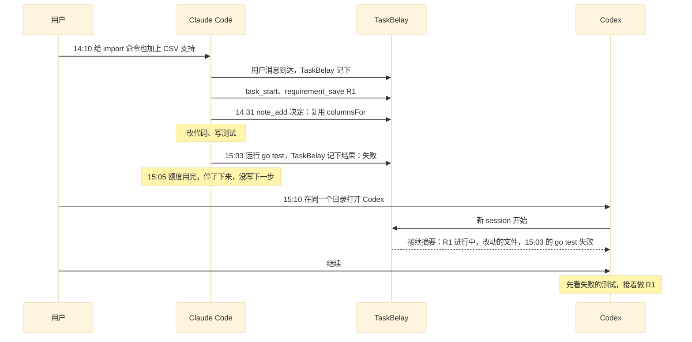

# 任务接续

同一个工作区里，不管用的是 Claude Code 还是 Codex、开过几个 session，做的都是同一个任务（任务的定义见 [任务和需求](requirements.md)）。新 session 开始时，TaskBelay 把当前任务整理成一段接续摘要交给 Agent，Agent 不用用户重讲一遍就能接着做。摘要每次都现场生成，大部分内容由 TaskBelay 自动记录，所以 Agent 额度用完、被中断、来不及写总结时，同样接得上。

## 什么时候给摘要

摘要在 session 开始时交给 Agent。哪些情况给摘要：

| 场景 | 发生了什么 | TaskBelay 怎样做 |
| --- | --- | --- |
| 换 Agent | 用户在同一个工作区打开另一个 Agent | 新 session 开始，注入摘要 |
| 开新 session、清空上下文 | 用户新开 session，或者在 session 里清空了上下文 | 注入摘要 |
| 上下文被压缩 | Agent 自动或手动压缩了上下文 | 压缩之后注入摘要，因为压缩会丢掉细节 |
| 恢复或分叉 session | 用户恢复了之前的 session，或者从它分叉出一个新的 | 这个 session 上次拿到摘要之后，账本如果被别的 session 改过，就注入摘要；没被改过就不注入 |

工作区里没有进行中的任务时，不给摘要。已完成、已中止的任务不会再出现在摘要里。

## 摘要里有什么

摘要按下面的顺序排列，越靠前越重要。摘要和事前提示加起来不超过参数表里的长度上限，超过时从最后一项开始往前删，第 1 到第 4 项始终保留。上限这样定，是因为两个 Agent 往上下文里加内容都有长度限制，其中 Codex 默认约 2,500 token，超出后只给 Agent 一段预览。

| 顺序 | 内容 | 来源 |
| --- | --- | --- |
| 1 | 任务：编号、标题、状态、工作模式、开始时间、最后更新时间、参与过的 Agent 和 session 数 | 自动记录 |
| 2 | 需求：每条的编号、状态、内容、验收标准、原话引用 | Agent 填写 |
| 3 | 方案：只在半自动模式下出现。最新一版的版本号、文件路径，以及是在等用户确认，还是已经确认 | Agent 提交，TaskBelay 记录状态 |
| 4 | 下一步：最新的一条，带写下的时间。写下之后代码又有变化时，注明“写下之后代码还有改动” | Agent 填写 |
| 5 | 还没解决的检查命中，以及最近一次检查的时间 | 自动记录 |
| 6 | 决定：最近 5 条 | Agent 填写 |
| 7 | 改动：相对起点快照改动过的文件和增删行数，最多 15 个文件 | 自动记录 |
| 8 | 最近的验证：每条不同命令最后一次的结果，最多 5 条。拿不到结果的显示为“未知” | 自动记录 |
| 9 | 用户最后一条消息：最多 300 个字 | 自动记录 |

方案还在等用户确认时，摘要会写明这一点，接手的 Agent 先等用户回复，不动手开发。

摘要最后固定写一句：用 `task_get` 查看完整内容；用户的新消息如果是另一件事，先调用 `task_start`。

下面是一份摘要的样子：

```text
TaskBelay 接续摘要（工作区 /Users/dev/projects/report）

任务 t18「import 命令支持 CSV」，进行中，全自动模式。14:10 开始，最后更新 15:05。
参与过：Claude Code（1 个 session）。

需求
- R1 [进行中] import 命令能读入 CSV 文件
  验收：import --format csv data.csv 能导入带表头的 CSV
  原话：“给 import 命令也加上 CSV 支持”

下一步：没有记录

还没解决的检查问题：没有（最近一次检查在 14:52）

决定
- 14:31 复用 export 里的列定义 columnsFor，不另写一份

改动（相对任务开始时）
- internal/importer/csv.go       +40
- cmd/import.go                   +6 -1
- internal/importer/csv_test.go  +25

最近的验证
- 15:03 go test ./internal/importer  失败（退出码 1）

用户最后一条消息（14:10，Claude Code）：给 import 命令也加上 CSV 支持

用 task_get 查看完整内容。用户的新消息如果是另一件事，先调用 task_start。
```

## Agent 需要写什么

摘要里只有三样东西要 Agent 来写，其余都由 TaskBelay 从 hook、git 和账本里自动得到：

- **需求和状态**：开始改代码前用 `requirement_save` 记下需求，做完一条就把状态改成已完成。
- **决定**：做了用户可能在意、或者下一个 Agent 容易推翻的选择时，用 `note_add` 记一条，写清选了什么、为什么，比如“CSV 用标准库 encoding/csv，不引入第三方包”。
- **下一步**：任务没做完就要停下时，用 `note_add` 写清接下来做什么。新写的一条取代之前的。

只让 Agent 写这三样，是因为它们是机器推不出来的东西；Agent 要写的越少，就越不容易漏写。即使 Agent 一样都没写，摘要里的改动、验证结果和用户原话，也足够让下一个 Agent 知道从哪里接手。事前提示会要求 Agent 写这三样。

## 一个例子：额度用完后换到 Codex



Codex 收到摘要时，已经知道用户要什么（R1 和原话）、做到了哪里（改了哪三个文件）、卡在哪里（15:03 的测试失败），以及不该推翻什么（复用 `columnsFor` 的决定）。用户只需要说一句“继续”。

Codex 之后的改动会和 Claude Code 的改动算进同一个 diff。Codex 结束时的检查覆盖整个任务的改动，不区分是哪个 Agent 写的。

## 新消息是接着做还是另一件事

用户的新消息是接着做当前任务，还是另一件事，由 Agent 判断。摘要里有进行中的任务，而用户说的是另一件事，Agent 先调用 `task_start` 开始新任务，旧任务怎样结束见 [任务和需求](requirements.md)。摘要里写着最后更新时间，Agent 可以据此判断这个任务和用户的新消息还有没有关系，拿不准时问用户。

## 两个 session 同时在一个工作区里

TaskBelay 记下每个 session 最后一次活动的时间，任何一次 hook 调用都算活动。一个 session 开始或者用户发消息时，如果同一个工作区里另一个 session 在 10 分钟内有过活动，TaskBelay 会提醒 Agent 和用户：另一个 session 也在这个工作区里，两边的改动会算进同一个任务；想并行做两件事，用 git worktree 分开。

两个 session 同时工作时，账本这样处理：

- 账本的写入一条接一条进行，同一条需求后写的覆盖先写的。
- 每条需求、每条笔记都记着是哪个 Agent 的哪个 session 写的，摘要和 `task_get` 里都看得到。

并行做两件事要用 worktree 分开，是因为 diff 按工作区算，同一个工作区里分不清哪处改动是谁做的，检查结果也就说不清该交给谁。分开之后，每个工作区各有各的任务，互不影响。

## 参数

| 参数 | 值 |
| --- | --- |
| 摘要和事前提示的长度上限 | 2,000 token，按中文每字 1 token、英文每 4 个字符 1 token 估算 |
| 摘要里的决定条数 | 5 |
| 摘要里的改动文件数 | 15 |
| 摘要里的验证命令数 | 5 |
| 用户最后一条消息的长度 | 300 字 |
| 判断“另一个 session 也在工作”的时间窗口 | 10 分钟 |
