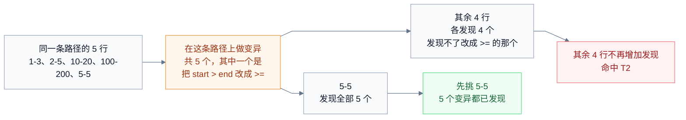

# 过度测试判定

本文定义 TaskBelay 怎样判断 Agent 测得过多，分两部分。**测试代码**：检查本次任务新增和修改的测试用例，和 [过度设计判定](over-design.md) 的检查一起运行。**验证过程**：在 Agent 每次运行测试、构建、静态检查这类命令之前检查。结论同样分三档：放行、提示、拦截。测试代码的检查在 Agent 准备结束时运行，Agent 也可以随时主动要求检查。结论怎样影响 Agent 见 [产品需求](product.md) 的默认行为。本文用到的任务、需求、实现位置和需求代码，定义见 [任务和需求](requirements.md)；各种语言的测试用例怎样写、怎样单独运行一条用例，以及哪些语言能做测试代码的检查，见 [语言支持](languages.md)。

## 过度测试是什么样子

测试的作用，是让需求里的行为以后不被改坏。一条测试用例删掉之后，需求里每一项行为仍然有别的用例守着，这条用例就是多余的。一次验证在运行之前结果就已经确定，或者跑的范围超出了改动能影响到的地方，这次验证就全部或部分是多余的。

用户说：“给 export 加一个 `--lines` 参数，支持 `10-20` 这样的行号范围。”Agent 写了解析函数：

```go
func parseRange(s string) (start, end int, err error) {
	a, b, ok := strings.Cut(s, "-")
	if !ok {
		return 0, 0, fmt.Errorf("invalid range %q", s)
	}
	if start, err = strconv.Atoi(a); err != nil {
		return 0, 0, err
	}
	if end, err = strconv.Atoi(b); err != nil {
		return 0, 0, err
	}
	if start > end {
		return 0, 0, fmt.Errorf("start %d is after end %d", start, end)
	}
	return start, end, nil
}
```

然后写了这样一张测试表：

```go
tests := []struct {
	in         string
	start, end int
	wantErr    bool
}{
	{"1-3", 1, 3, false},
	{"2-5", 2, 5, false},
	{"10-20", 10, 20, false},
	{"100-200", 100, 200, false},
	{"5-5", 5, 5, false},
	{"abc", 0, 0, true},
	{"a-3", 0, 0, true},
	{"3-b", 0, 0, true},
	{"5-1", 0, 0, true},
}
for _, tt := range tests {
	t.Run(tt.in, func(t *testing.T) {
		// 调用 parseRange(tt.in)，检查返回值和错误
	})
}
```

前五行走的是同一条代码路径。其中 `5-5` 有特别的用处：`start > end` 如果被误写成 `start >= end`，只有它能发现。另外四行换了个数字，什么新问题也发现不了。Agent 还另外写了一条测试，检查 `newOptions()` 返回的默认值，而 `newOptions()` 只是填了几个字段。写完之后，Agent 每改一处就运行一遍 `go test ./...`，其中有一次代码根本没变。

## 核心做法

**测试代码**：TaskBelay 把每条新增和修改的用例单独运行一次，记下它在需求代码里执行过哪些行。两条用例执行过的行完全相同，说明它们走的是同一条路径。这时再对这段代码做几处小改动（变异），比如把 `>` 改成 `>=`，看哪条用例能发现、哪条不能。发现不了任何额外改动的用例，就是重复的。此外，一行需求代码都没执行到的用例、只执行了 getter 和构造函数这类简单代码的用例，也是多余的。每条需求还按改动的风险算出一个用例定额，超出时提示。

**验证过程**：TaskBelay 记下每次验证命令运行时的工作区状态。代码没变、中间也没做别的事，又要跑同一条命令，就拦下来，因为结果不会不同。运行范围超出改动能影响到的测试，或者一轮里跑了太多次，就提示。

这些判断都基于运行和统计的结果，不请另一个模型来评判，同样的输入每次得出同样的结论。

## 检查用到的输入

- **测试用例**：一条可以单独运行的测试，比如 Go 的一个测试函数或一个子测试、pytest 的一个测试函数、Jest 的一个 `test` 调用。参数化的用例，每一组参数算一条，比如 Go 表格测试里用 `t.Run` 逐行运行的每一行、pytest `parametrize` 的每一组参数。各种语言的写法见 [语言支持](languages.md)。
- **新增用例和修改用例**：用例所在的测试函数是新增的，或者它对应的子测试、参数组是本次新增的，就是新增用例。已有的用例在本次 diff 里有改动，就是修改用例。
- **需求代码**：每条原话需求的需求代码。它可以包括没改动过的声明，比如用户说“给 parseRange 补测试”，Agent 把 `parseRange` 列进实现位置，它就是需求代码。
- **用例的路径**：单独运行一条用例时，它在需求代码里执行过的行的集合。
- **之前的验证**：同一个 session 里之前运行过的验证命令，每次运行开始时的工作区状态和运行结果，以及这个 session 最后一次运行含其他命令的命令的时间。

## 用例定额

每条原话需求按它的需求代码算出一个用例定额，表示“这条需求大概值得几条用例”。计算时，改动过的声明只看改动过的那些行；实现位置里列出、本次没有改动的声明（比如用户要求补测试的函数），看整个声明。

**轻微改动的定额是 0。** 一条需求的需求代码如果只涉及下面几种情况，就是轻微改动：

- 只改了字面量和注释，比如改文案、改默认值。
- 只改了名字。
- 简单声明：没有分支、没有循环、除了 [语言支持](languages.md) 为这门语言列出的类型转换之类的调用以外不调用其他函数、只读写参数、字段和字面量的函数，比如 getter、setter、只填字段的构造函数；以及类型、常量、变量的声明本身。
- 其他文件。

**其他改动的定额是 1 加上风险加项。** 1 条是主路径用例，证明这项行为确实存在。风险加项在上面说的范围里识别：

| 风险 | 怎样识别 | 加几条 |
| --- | --- | --- |
| 并发 | 启动线程或协程、使用锁和原子操作、并发等待多个任务 | 2 |
| 写文件或数据库 | 写入、删除、改名文件和目录，执行修改数据库的语句 | 2 |
| 解析外部输入 | 把字符串解析成数字、日期、URL，解码 JSON、XML、YAML、TOML | 2 |
| 执行外部命令 | 启动子进程 | 1 |
| 分支多 | 计算范围里每有 4 个分支点 | 1 |

每种语言里对应哪些写法，见 [语言支持](languages.md) 各语言的规则表；分支点的定义也在那里。

每一类风险只加一次，不管出现几处，比如两处 Go 的 `strconv.Atoi` 只加 2 条；“分支多”按分支点的数量计算。一条需求的定额最多 8 条。

定额按需求代码里数得出来的东西算，不按 Agent 写的验收标准有几条来算，免得 Agent 多写几条验收标准就能多写测试。主路径之外的名额只留给最容易出错、值得写边界用例的地方。

## 测试代码的规则

每条规则按同一个格式写：判断什么，怎么判断，有例外时写例外，为什么这样定。只有新增用例会被判为命中；修改用例参与比较，因为改已有用例通常是在适应新的行为。

### T1 没测到需求代码（拦截）

**判断什么**：新增用例有没有测到这次需求相关的代码。

**怎么判断**：新增用例的路径为空，也就是单独运行它时，需求代码的行一行都没执行到，就命中。

**为什么这样定**：这类用例测的是这次没动的代码、标准库或第三方包，或者只属于推断需求的功能。它们也许有价值，但不是这次任务该写的。

### T2 走同一条路径的用例（拦截）

**判断什么**：几条新增用例是不是在重复测同一件事。

**怎么判断**：

1. 把新增和修改用例按路径分组，路径完全相同的分在一组。只有一条用例的组跳过。
2. 在组里用例执行过的需求代码上做变异，范围和定额的计算范围相同：改动过的声明只取改动过的行，列出而没改动的声明取整个声明。每次只改一处：比较运算符互换（`<` 和 `<=`、`>` 和 `>=`、`==` 和 `!=`，`===` 和 `!==` 也算），条件整体取反，整数常量加 1 或减 1，`+` 和 `-` 互换，去掉逻辑非。效果相同的变异只算一个，比如对 `err != nil` 整体取反，和把 `!=` 换成 `==`，结果都是 `err == nil`，只算一个。每组最多做 20 个变异。
3. 变异在工作区的临时副本里做，做法见 [语言支持](languages.md)，用户工作区里的文件始终不变。对每个变异，把组里的用例分别运行一遍。用例失败，就算它发现了这个变异。
4. 从组里挑出一组能发现全部变异的用例：先挑发现变异最多的一条，之后每次挑能发现最多“还没被发现的变异”的一条，直到组里用例能发现的变异都被挑出的用例发现。发现的数量相同时，先挑修改用例，再挑源码中位置靠前的。没被挑中的新增用例命中 T2。
5. 一个变异都做不出来，或者没有一条用例发现任何变异时，保留组里的修改用例；没有修改用例，就保留在源码中位置最靠前的一条。其余新增用例命中。

以开头的 `parseRange` 为例：



`5-5` 一条就覆盖了这条路径，同时还守住了 `>` 和 `>=` 的区别，另外四行留着只会让表格变长。

**为什么这样定**：路径相同的用例，大多是同一个测试换了一个输入。只看路径会误伤边界值：`5-5` 和 `1-3` 走同一条路径，却能发现别的用例发现不了的错误。变异就是用来把这类用例留下的。只在路径相同的组里做变异，是为了把运行次数控制在几十次以内。

### T3 超出定额（提示）

**判断什么**：一条需求的新增用例是不是多于它的风险所需。

**怎么判断**：去掉命中 T1、T2、T4 的用例之后，一条需求的新增用例数超过它的定额，就命中。一条用例的路径同时落在几条需求的代码里，就在每条需求里各算一次。

**为什么这样定**：定额是估算，不像 T1、T2 那样能确定地说明某条用例多余，所以只提示，由 Agent 决定删哪几条。

### T4 只测了简单代码（拦截）

**判断什么**：新增用例是不是只测了 getter、构造函数这类简单代码。

**怎么判断**：新增用例的路径不为空，但路径里的行全部属于简单声明（定义见“用例定额”一节），就命中。

**为什么这样定**：简单声明出错时，用到它的那段代码的用例自然会失败，单独为它写的用例不会多发现任何问题。

### T5 只检查了 mock（提示）

**判断什么**：新增用例是不是只检查了 mock 有没有被调用，而没有检查结果。

**怎么判断**：新增用例的代码里，检查结果的语句只有 mock 的调用检查，就命中。mock 的调用检查指检查 mock 有没有被调用、调用了几次、用什么参数调用的语句，比如 testify/mock 的 `AssertCalled`、Jest 的 `toHaveBeenCalled`、Mockito 的 `verify`；检查结果的语句指其余的断言。各种语言的清单见 [语言支持](languages.md)。

**为什么这样定**：只检查“调用了几次、按什么顺序调用”的用例，测的是实现方式，而不是行为，代码一重构就要跟着改，却守不住用户要的结果。有时这正是要测的东西，比如“失败时不能重复扣款”，所以只提示。

### T6 测试不够（提示）

**判断什么**：有没有需求完全没有用例守着。

**怎么判断**：一条定额大于等于 1 的原话需求，没有任何新增或修改用例的路径落在它的需求代码里，就命中。

**为什么这样定**：这条规则防止 Agent 从测得太多走到另一个极端，要求每条有实际逻辑的需求至少有一条新写或改过的用例守着。TaskBelay 只运行新增和修改的用例，看不到仓库里原有的用例是否已经覆盖了这段代码，所以这条只提示；原有用例已经覆盖、而且检查的正是新行为时，Agent 可以不理会。

### 凭用户原话放行

用户明确要多写测试时，比如“各种日期格式都测一下”，Agent 可以把这些用例列进某条原话需求的实现位置，写成 `test:internal/export/date_test.go:TestParseSince` 或 `test:internal/export/date_test.go:TestParseSince/2023-12-31`，并附上用户的原话。列出的用例不再受 T1 到 T5 约束，也不计入 T3 的用例数。列出一个测试函数，它下面的子测试和参数组一起放行。检查结果和任务完成报告里会列出这些用例和对应的原话，引用得牵强，用户能直接看出来。

## 验证过程的规则

### 哪些命令算验证命令

TaskBelay 在 Agent 运行 shell 命令前拿到命令文本。命令有两种写法：bash、zsh 这类 POSIX shell 的写法，以及 PowerShell 的写法，按 Agent 实际使用的 shell 来解析。复合命令先按 `&&`、`||`、`;`、`|` 拆成几段，逐段分类。POSIX 写法里，每一段开头的变量赋值（如 `TZ=UTC go test`）和 `env` 前缀不影响分类，按后面的命令归类。

| 类别 | 包括哪些命令 |
| --- | --- |
| 验证命令 | Go：`go test`、`go build`、`go vet`、`golangci-lint`、`staticcheck`。JavaScript 和 TypeScript：`npm test`、`npm run test`、`npm run build`、`npm run lint`、`npm run typecheck`，以及 `pnpm`、`yarn`、`bun` 的同样写法，`tsc`、`jest`、`vitest`、`eslint`、`bun test`、`deno test`。Python：`pytest`、`python -m pytest`、`python -m unittest`、`tox`、`nox`、`ruff check`、`mypy`、`pyright`。Rust：`cargo test`、`cargo build`、`cargo check`、`cargo clippy`、`cargo nextest run`。Java 和 Kotlin：`mvn` 和 `mvnw` 的 `test`、`verify`、`package`、`install`、`compile`，`gradle` 和 `gradlew` 的 `test`、`build`、`check`、`assemble`。.NET：`dotnet test`、`dotnet build`。Ruby：`rspec`、`rake test`、`rails test`。PHP：`phpunit`。Swift：`swift test`、`swift build`。C 和 C++：`ctest`、`cmake --build`。各种语言通用：目标名是 `test`、`check`、`lint`、`build`、`ci` 的 `make` |
| 只读命令 | POSIX 写法：`cd`、`pwd`、`cat`、`head`、`tail`、`less`、`sed -n`、`grep`、`rg`、`ls`、`find`、`wc`。PowerShell 写法：`Set-Location`（`cd`）、`Get-Location`（`pwd`）、`Get-Content`（`cat`、`type`、`gc`）、`Get-ChildItem`（`ls`、`dir`、`gci`）、`Select-String`（`sls`）、`findstr`、`Measure-Object`。两种写法共用：`git status`、`git diff`、`git log`、`git show`、`go list`、`go doc` |
| 其他命令 | 不属于上面两类的所有命令，比如启动数据库、安装工具、设置环境变量（`export X=1`、`$env:X = '1'`）、改写文件（`sed -i`、`Set-Content`） |

命令前面的 `npx`、`pnpm exec`、`bunx`、`uv run`、`poetry run`、`pipenv run`、`bundle exec`、`vendor/bin/`、`./`，以及 `python -m`、`python3 -m`，不影响分类，按后面的命令归类。

一条命令里至少有一段验证命令，就算一次验证；一条命令里有几段验证命令，也只算一次。一条命令里只要有一段是其他命令，就叫它“含其他命令”，V1 不对它做判断，但它照样算一次验证、照样记验证记录。

**规整**：比较两条命令是否相同之前，先去掉首尾空白，把连续空白合成一个空格，再去掉开头切换到工作区根目录的那一段，也就是 `cd <工作区根目录> &&`、`cd <工作区根目录>;` 或 `Set-Location <工作区根目录>;`。V1 比较的是规整后的整条命令，不是其中的某一段，所以 `TZ=UTC go test ./...` 和 `go test ./...` 是两条不同的命令。

### V1 代码没变又跑一遍（拦截）

**判断什么**：这次验证的结果是不是在运行之前就已经确定。

**怎么判断**：这条命令不含其他命令，并且同时满足下面三条，就拦下它：

1. 同一个 session 里，之前运行过规整后完全相同的命令。下面两条都和其中最近的一次比较。
2. 当前的工作区状态，和那次运行开始时的状态相同。
3. 那次运行开始之后，这个 session 没有运行过含其他命令的命令。

被拦下的命令没有运行，不计入 V3 的次数。

**为什么这样定**：代码一样、环境一样，测试和构建的结果也一样，再跑一遍只会浪费时间和 token。第 3 条是为工作区之外的变化留的余地：测试结果还受数据库、已安装的工具、环境变量影响，Agent 在两次运行之间做过别的事，可能就是在为下一次运行准备环境，这时不拦。只在同一个 session 里比较，也是同样的考虑。

### V2 跑的范围超出改动影响（提示）

**判断什么**：测试命令有没有跑到这次改动影响不到的测试。

**怎么判断**：这条规则只看 [语言支持](languages.md) 写了“受影响的测试范围”的测试命令，比如 `go test`、`pytest`、`jest`、`vitest`、`cargo test`、`mvn test`。受影响的范围按那里写的方法算出。测试命令写了包、文件或模块参数时，按参数算出它跑的范围；没写时就是全部测试。它跑的范围超出受影响的范围，就提示，并给出只跑受影响范围的命令。本次任务改动过这门语言的源文件时才做这个判断。

**为什么这样定**：没被改动影响到的测试，结果和上一次一样。但全量测试偶尔能发现分析不到的依赖，比如通过文件或外部服务共享的状态，Agent 在结束前跑一次全量也合理，所以只提示，不拦截。

### V3 一轮里验证太多次（提示）

**判断什么**：Agent 是不是每改一点就验证一次。

**怎么判断**：同一轮里，从第 7 次验证开始，每次都提示一下：已经运行了几次，建议改完一组相关改动后再验证。次数按上面“算一次验证”的方法计算。

**为什么这样定**：这个次数是粗略的上限，很难说第几次一定多余，所以只提示。

## 结论和参数

测试代码的检查和过度设计的检查同时进行，合并成一个结论，取所有命中里最高的档位；凭原话放行的用例不算命中。验证过程的规则在命令运行前，对这一条命令单独给出结论。

| 参数 | 值 | 用在哪里 |
| --- | --- | --- |
| T1、T2、T4 的档位 | 拦截 | 结论 |
| T3、T5、T6 的档位 | 提示 | 结论 |
| V1 的档位 | 拦截 | 命令运行前 |
| V2、V3 的档位 | 提示 | 命令运行前 |
| 主路径用例数 | 1 | 定额 |
| 风险加项 | 见“用例定额”一节的表 | 定额 |
| 每条需求的定额上限 | 8 | 定额 |
| 每组最多做的变异数 | 20 | T2 |
| 变异方式 | 见 T2 第 2 步 | T2 |
| 测试代码检查的时间预算 | 120 秒 | T1 至 T6 |
| 一轮里不提示的验证次数 | 6 | V3 |
| 验证命令和只读命令的清单 | 见“哪些命令算验证命令”一节的表 | V1、V2、V3 |
| 各种语言的测试用例、风险、mock 的写法，以及运行用例和计算受影响范围的方法 | 见 [语言支持](languages.md) | T1 至 T6、V2 |

测试代码的检查要编译和运行测试，超过时间预算时停下，没来得及检查的用例在结果里标为“未检查”，不会因此拦截。语言不是测试级、或者本机没装需要的工具时，测试代码的检查不做，结果里写明原因，同样不会因此拦截。

## 事前提示

session 开始时，TaskBelay 把下面这几条交给 Agent：

- 每条需求先写一条主路径用例。只在并发、写文件或数据库、解析外部输入、执行外部命令、分支多的地方补边界用例。
- 只改了文案或名字的代码不写测试；不单独测 getter、构造函数、常量；不测这次没改动的代码。
- 参数化用例的每一组参数，比如表格测试的每一行，都要走一条不同的代码路径，或者测一个边界值。
- 检查行为结果，不要只检查 mock 被调用了几次。
- 只运行受改动影响的测试。代码没变就不要重复运行；改完一组相关的改动后再验证一次。

Agent 主动要求检查时，检查结果里附上每条需求的用例定额。

## 给 Agent 的反馈

测试代码的命中和过度设计的命中写在同一份说明里，格式相同：

```text
[T2 拦截] internal/export/range_test.go:18 TestParseRange/1-3、2-5、10-20、100-200
  这 4 行和 5-5 执行的代码完全相同；在这段代码上做的 5 个变异，它们能发现的 5-5 都能发现。
  建议：删掉这 4 行。
[T4 拦截] internal/export/options_test.go:9 TestNewOptionsDefaults
  只执行了 newOptions，它只是给字段赋初始值。
  建议：删掉这条用例。
[T3 提示] R1 的定额是 4 条（主路径 1，解析外部输入 2，分支多 1），去掉上面的命中后还有 5 条。
```

V1 拦下命令时，Agent 收到的说明是这样的：

```text
TaskBelay 拦下了这条命令：go test ./internal/export
14:32 在同样的代码上运行过这条命令，结果：失败（退出码 1）。之后代码没有变化，
也没有运行别的命令，再跑一遍结果不会不同。先修改代码再运行。如果怀疑测试本身不稳定，向用户说明。
```

拿不到上次运行的结果时，说明里只写运行的时间，不写结果。

V2 的提示是这样的，以 Go 为例：

```text
这次任务只改动了 internal/export，受影响的包是 internal/export 和 cmd/report。
可以只运行：go test ./internal/export ./cmd/report
如果这是结束前最后一次完整验证，可以忽略这条提示。
```

## 会在哪里判错

**测试代码部分：**

- **覆盖率按行统计，不按条件分支统计。** `if a && b` 写在一行里，a、b 的不同组合执行的是同样的行，测不同组合的用例会被分到一组，只能靠变异区分。变异只有几种方式，区分不出来的用例会被误判为重复。
- **路径相同、检查的是不同输出的用例**，比如对同一段格式化代码分别检查不同的字段，会被分到一组，变异只能区分出一部分。
- **依赖时间、随机数、外部服务的用例**，单独运行时的路径可能每次不同，分组结果会不稳定。
- **子测试的名字在运行时才确定。** 子测试和参数组对应不上时，整个测试函数按一条用例算。
- **只在新增和修改用例之间比较。** 新用例和仓库里已有用例重复，不会被发现。
- **T5 只认识 [语言支持](languages.md) 列出的 mock 库。** 自己手写的 mock 不在判断范围内。
- **超出时间预算的用例不检查**，大项目里一次加很多用例时会漏掉一部分。
- **在临时副本里运行不了的用例不做变异。** 测试依赖副本里没有的文件或环境时，这一组标为未检查，组里重复的用例发现不了。
- **语言不是测试级、或者没装需要的工具时**，测试代码一条都不检查。

**验证过程部分：**

- **工作区之外的变化如果不是通过这个 session 的命令发生的**，比如用户在另一个终端里启动了服务，V1 会误拦。Agent 向用户说明情况即可。
- **测试本身不稳定时**，V1 会拦下“原样再跑一遍”。这正是需要用户知道的情况，Agent 应当告诉用户，而不是反复重跑。
- **V2 只针对写了“受影响的测试范围”的测试命令。**

## 例子

例子用 Go 写，规则对各种测试级语言都一样。例子里的代码只保留和判断有关的部分。

### OT-01 表格里走同一条路径的几行

- **用户原话**：给 export 加一个 `--lines` 参数，支持 10-20 这样的行号范围。
- **改动**：本文开头的 `parseRange` 和 9 行的测试表。
- **结论**：拦截。T2 命中 `1-3`、`2-5`、`10-20`、`100-200` 四行，过程见 T2 的图。T3 提示：R1 的定额是 4 条（主路径 1，`strconv.Atoi` 属于解析外部输入加 2，新增 4 个 `if` 加 1），去掉 T2 的命中后还剩 5 条。

### OT-02 测构造函数的默认值

- **改动**：

  ```go
  func newOptions() options {
  	return options{format: "table", lines: ""}
  }

  func TestNewOptionsDefaults(t *testing.T) {
  	o := newOptions()
  	if o.format != "table" {
  		t.Fatalf("format = %q", o.format)
  	}
  }
  ```
- **结论**：拦截。T4 命中 `TestNewOptionsDefaults`：路径里只有简单声明 `newOptions`。

### OT-03 测了没改动的代码

- **用户原话**：给 export 加一个 `--lines` 参数。
- **改动**：除了 `parseRange` 的测试，Agent 还给已有的、本次没改动的 `formatDate` 补了 3 条用例。`formatDate` 不在任何原话需求的实现位置里。
- **结论**：拦截。T1 命中这 3 条：它们的路径为空。

### OT-04 用户要求补测试

- **用户原话**：给 formatDate 补几个测试，特别是跨年的情况。
- **改动**：只新增测试，没有改功能代码。R1 的实现位置列了 `internal/export/date.go:formatDate`。
- **结论**：`formatDate` 是需求代码，新增用例的路径不为空，T1 不命中。`formatDate` 本次没有改动，定额按整个函数来算，其他规则照常判断。

### OT-05 只改文案的需求

- **用户原话**：把导出失败时的提示改成“导出失败，请检查文件路径”。
- **改动**：改了一个字符串常量，另外新增一条用例，检查报错文字。
- **结论**：提示。这条需求是轻微改动，定额为 0，T3 命中：新增 1 条，超出定额。

### OT-06 只检查了 mock

- **改动**：

  ```go
  func TestRunExportCallsStore(t *testing.T) {
  	store := new(mockStore)
  	store.On("Load", mock.Anything).Return(rows, nil)
  	runExport(store, options{format: "csv"})
  	store.AssertCalled(t, "Load", mock.Anything)
  }
  ```
- **结论**：提示。T5 命中：唯一检查结果的语句是 `AssertCalled`，没有检查导出的内容。

### OT-07 新增的解析逻辑没有测试

- **用户原话**：给 export 加一个 `--lines` 参数。
- **改动**：新增了 `parseRange`，没有写任何测试。
- **结论**：提示。T6 命中 R1：定额是 4 条，却没有一条用例覆盖它的需求代码。

### OT-08 刚好够用的测试

- **改动**：Agent 按 OT-01 的反馈删掉 4 行之后，又在 T3 的提示下去掉了 `3-b`，因为它和 `a-3` 测的都是 `Atoi` 失败。最后 `parseRange` 配了 4 条用例：`5-5`、`abc`、`a-3`、`5-1`。
- **结论**：放行。四条用例的路径各不相同，T1、T2、T4 不命中；4 条没有超过定额，T3 不命中。

### OT-09 代码没变又跑一遍

- **过程**：Agent 运行 `go test ./internal/export`，失败；接着用 `cat` 看了测试文件，没有改任何代码，又运行 `go test ./internal/export`。
- **结论**：第二次运行被 V1 拦下。中间的 `cat` 是只读命令，不影响判断。
- **对照**：如果 Agent 在两次运行之间执行了 `docker start pg`，这是其他命令，第二次运行不拦。

### OT-10 全量测试

- **过程**：本次任务只改了 `internal/export`，Agent 运行 `go test ./...`。
- **结论**：提示。V2 命中，并给出只跑 `internal/export` 和 `cmd/report` 的命令。命令照常运行。
