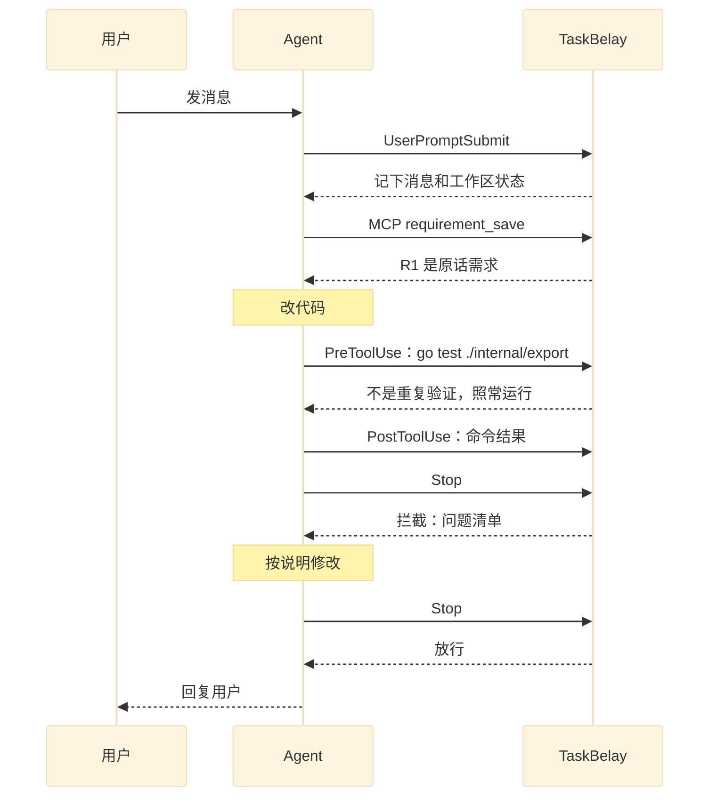
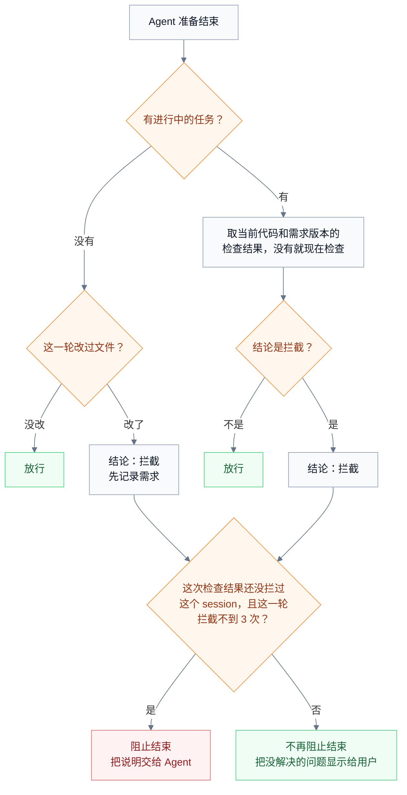

# Agent 接入

TaskBelay 在 Windows、macOS 和 Linux 上接入 Claude Code 和 Codex，靠的是三样东西：hook、MCP 和 skill。两个 Agent 的 hook 机制几乎一样：事件名称相同，输入都是一段 JSON，都能拦下工具调用、阻止 Agent 结束、往 Agent 的上下文里加内容。所以 TaskBelay 用同一套逻辑处理两边的事件，只在输入输出格式、平台和几处能力上分开处理。本文说明接了哪些 hook、每个 hook 做什么、两个 Agent 和三个平台有什么差异、怎样安装和卸载，以及 TaskBelay 自己出错时怎样处理。各平台差异可能带来的问题，记在项目根目录的 `notice.md` 里。

## 接入方式

- **hook**：接 5 个事件。每次触发时 Agent 运行 `taskbelay hook <agent> <事件>`，把事件的 JSON 从标准输入传进来，TaskBelay 处理完把决定写到标准输出。输出的 JSON 只用 ASCII 字符，中文等其他字符写成 `\u` 转义，这样不管经过哪个平台的哪种 shell，内容都不会被转码。输出里只写用到的字段，因为 Codex 遇到它不认识的字段时，会把整个输出当作出错。
- **MCP**：Agent 启动时运行 `taskbelay mcp`，得到 [任务账本](requirements-ledger.md) 里定义的 8 个工具。
- **skill**：[半自动模式](semi-auto.md) 写方案用的两个 skill，write-technical-plans 和 write-a-well-document，随 TaskBelay 一起安装到两个 Agent 的用户级 skill 目录。
- **事前提示**：要告诉 Agent 的规矩，在 session 开始时通过 hook 注入。

| 时机 | hook | TaskBelay 做什么 | 会不会阻止 |
| --- | --- | --- | --- |
| session 开始、恢复、清空、压缩之后 | SessionStart | 记录 session；注入事前提示和接续摘要 | 不会 |
| 用户发出消息 | UserPromptSubmit | 记下消息原文和此刻的工作区状态；把上一轮没解决的提示交给 Agent | 不会 |
| Agent 运行 shell 命令之前 | PreToolUse，接 shell 工具 | 识别验证命令，按验证过程的规则拦下或提示；记下验证记录 | 规则结论是拦截时拦下命令 |
| Agent 用编辑工具改文件之前 | PreToolUse，接编辑工具 | 半自动模式下，方案待确认时拦下对工作区文件的编辑 | 会 |
| 命令运行之后 | PostToolUse，Claude Code 另接 PostToolUseFailure，都只接 shell 工具 | 补上验证记录的结果 | 不会 |
| Agent 准备结束这一轮 | Stop | 检查本次任务的改动，拦截一次或放行；把没解决的问题告诉用户 | 拦截时阻止结束一次 |

hook 按工具名匹配，两个 Agent 的工具名不同：

| 工具 | Claude Code | Codex |
| --- | --- | --- |
| shell 工具 | `Bash`、`PowerShell` | `Bash`（包括 `exec_command`） |
| 编辑工具 | `Edit`、`Write`、`NotebookEdit` | `apply_patch` |

Claude Code 的 PowerShell 工具在 Windows 上默认开启；macOS 和 Linux 上要装好 PowerShell 7（`pwsh`）并设置 `CLAUDE_CODE_USE_POWERSHELL_TOOL=1` 才有。它的输入字段和 Bash 工具相同，只匹配 `Bash` 会漏掉它。

下图是一轮里各个 hook 的先后顺序，以第一次结束被拦截、改完后放行为例：



## 每个 hook 做什么

### SessionStart

TaskBelay 先记下这个 session，再用 `additionalContext` 注入两样东西：

- **事前提示**：session 新开（`startup`）、清空（`clear`）、压缩之后（`compact`）注入。恢复（`resume`）和分叉（`fork`）时，原来的上下文里还有它，不再重复。内容由两份判定文档的“事前提示”一节规定；工作模式是半自动时，再加上 [半自动模式](semi-auto.md) 的事前提示。
- **接续摘要**：什么情况下给、写什么，由 [任务接续](handoff.md) 规定。

两者加起来的长度上限由 [任务接续](handoff.md) 规定，定在两个 Agent 的注入上限以内，两边的上限见下文“Claude Code 和 Codex 的差异”。

[任务接续](handoff.md) 要求提醒“另一个 session 也在这个工作区”时，提醒写进注入内容交给 Agent，同时用 `systemMessage` 告诉用户。

### UserPromptSubmit

TaskBelay 记下消息原文、session、轮次和此刻的工作区状态，作为原话引用的来源和起点快照的候选。

如果上一轮结束时留下了没解决的提示档命中，TaskBelay 用 `additionalContext` 把它们简短地交给 Agent。用户把拦截强度设为只提示时，没解决的拦截档命中也通过这里交给 Agent。

这个 hook 只做记录和补充上下文。

### PreToolUse：shell 命令

1. 确定命令的写法，再把命令拆段、分类，分类方法见 [过度测试判定](over-testing.md) 的“哪些命令算验证命令”一节。命令里有“其他命令”时，更新这个 session 的“最后一次运行其他命令的时间”。
2. 命令里没有验证命令时，直接结束，不输出任何东西。绝大多数命令走这一步。
3. 有验证命令时，计算工作区状态，按验证过程的规则判断。命令没被拦下时记下验证记录，结果先记为未知。
4. 规则结论是拦截时，返回 `permissionDecision: "deny"` 和说明，命令不运行；结论是提示时，只返回 `additionalContext`，命令照常运行。拦截强度设为只提示时，拦截也按提示处理。

提示时只返回 `additionalContext`，是因为在 Claude Code 里，`permissionDecision: "allow"` 会让这条命令跳过用户自己设置的权限确认。

命令的写法按 Agent 实际使用的 shell 来定：

| 情况 | 按哪种写法解析 |
| --- | --- |
| Claude Code 的 Bash 工具：macOS 和 Linux 上是用户的 bash 或 zsh，Windows 上是 Git Bash | POSIX |
| Claude Code 的 PowerShell 工具 | PowerShell |
| Codex 在 macOS 和 Linux 上 | POSIX |
| Codex 在 Windows 上 | PowerShell |

命令文本整体是 `powershell -Command "…"`、`pwsh -Command "…"`、`bash -lc "…"` 这种形式时，先取出引号里的命令，再按里面的写法解析。

### PreToolUse：编辑工具

只在工作模式是半自动、最新一版方案还在等用户确认时起作用，其余时候直接结束。

1. 取出这次编辑要改的文件：Claude Code 的 `Edit`、`Write` 取 `tool_input.file_path`，`NotebookEdit` 取 `tool_input.notebook_path`；Codex 的 `apply_patch` 从 `tool_input.command` 的补丁文本里取 `*** Add File:`、`*** Update File:`、`*** Delete File:`、`*** Move to:` 后面的路径。
2. 有任何一个文件在工作区里，返回 `permissionDecision: "deny"` 和 [半自动模式](semi-auto.md) S1 的说明。拦截强度设为只提示时，只返回 `additionalContext`。

### PostToolUse 和 PostToolUseFailure

TaskBelay 用 `tool_use_id` 找到 PreToolUse 时记下的验证记录，补上结果：

- **Claude Code**：Bash 和 PowerShell 工具相同。命令成功时触发 PostToolUse，结果记为通过；退出码不为 0 时触发 PostToolUseFailure，`error` 字段第一行是 `Exit code N`，结果记为失败并记下退出码；命令被中断时记为未知。
- **Codex**：不管退出码是多少都触发 PostToolUse，而 shell 命令的 `tool_response` 只是一段文字，内容是命令的输出，不带退出码；命令失败但没有输出时，和成功且没有输出的命令完全一样（见 [openai/codex#34289](https://github.com/openai/codex/issues/34289)）。所以 Codex 里的验证记录结果一律记为未知。

### Stop

Stop 是判定规则真正起作用的地方。检查结果里包括两份判定文档的规则，半自动模式下还包括 [半自动模式](semi-auto.md) 的 S1、S2。TaskBelay 按下图决定放行还是拦截：



几点说明：

- **“这一轮改过文件”**，指当前工作区状态和这一轮用户消息到达时的状态不同。这时还没有任务，说明 Agent 动了代码却没记录需求。拦下时的说明是：用 `requirement_save` 记录需求（会自动开始任务），改完后填写实现位置。
- **同一次检查结果，对同一个 session 只拦一次。** 检查结果对应“工作区状态加需求版本”，见 [任务账本](requirements-ledger.md)。Agent 被拦下后改了代码，或者补了实现位置、原话引用，下次结束时会重新检查，还有问题就再拦。Agent 什么都没改又结束了，说明它决定保留，或者要停下来问用户，这时不再阻止，但没解决的问题会显示给用户，也会留在任务完成报告里，并不算放行。这样 Agent 不会被卡在结束这一步，没解决的问题也不会被悄悄放过。换一个 session 遇到同样的检查结果，会再拦一次，让新的 Agent 也看到这些问题。
- **每轮最多拦 3 次。** 防止 Agent 每次只改一点、反复被拦。Claude Code 自己的上限是连续 8 次，Codex 的文档没写上限，所以 TaskBelay 自己设一个更低的上限。
- **放行时有没解决的问题**，TaskBelay 用 `systemMessage` 显示给用户，最多列 5 条，后面写“还有 N 条，运行 taskbelay status 查看”。其中的提示档命中，会在下一轮的 UserPromptSubmit 时交给 Agent。
- **这一轮里任务被标为已完成时**，`systemMessage` 显示任务完成报告：每条需求对应哪些实现位置，新增的对外入口和凭原话放行的地方单独标出，并附上原话；半自动模式下再附上确认方案时用户的原话。
- **拦截强度设为只提示时**，所有命中都按“放行时有没解决的问题”处理。
- **拦截的方式**：两边都返回 `decision: "block"`，`reason` 里放说明。Claude Code 会让 Agent 带着说明继续这一轮；Codex 会把 `reason` 作为新的提示，让 Agent 继续。
- **轮次怎样识别**：Claude Code 用输入里的 `prompt_id`，Codex 用 `turn_id`。

Stop 的检查可能要编译和运行测试，所以这个 hook 的超时设为 300 秒。运行测试的部分有自己的时间预算，见 [过度测试判定](over-testing.md)。

## Claude Code 和 Codex 的差异

| 项目 | Claude Code | Codex |
| --- | --- | --- |
| hook 配置写在哪里 | 用户目录下 `.claude/settings.json` 的 `hooks` | 用户目录下 `.codex/hooks.json` |
| MCP 怎样注册 | `claude mcp add --scope user` | `codex mcp add`，写入用户目录下 `.codex/config.toml` 的 `[mcp_servers.taskbelay]` |
| skill 装在哪里 | 用户目录下 `.claude/skills/` | 用户目录下 `.agents/skills/` |
| hook 什么时候生效 | 安装后新开的 session | 用户在 Codex 里用 `/hooks` 确认信任之后；hook 配置变了要重新确认 |
| 轮次标识 | `prompt_id` | `turn_id` |
| 命令失败时 | 触发 PostToolUseFailure，`error` 第一行是 `Exit code N` | 仍触发 PostToolUse，`tool_response` 只有输出文字，不带退出码 |
| 注入内容的上限 | 每段 10,000 字符 | 默认约 2,500 token |
| Stop 连续阻止的上限 | 8 次 | 文档没写 |
| shell 命令的覆盖范围 | Bash 和 PowerShell 工具 | Bash 和 `exec_command`；后续的 `write_stdin` 不会再触发 PreToolUse |

Codex 的文档说明，tool hook 是“有用的护栏，但不是完整的强制边界”，有少数专用的工具路径不经过 hook。所以在 Codex 里，个别命令和编辑可能绕过 PreToolUse 的检查。Stop 时的检查看的是工作区里的实际改动，不受影响。

## 三个平台的差异

macOS 和 Linux 的做法相同，Windows 不同：

| 项目 | macOS、Linux | Windows |
| --- | --- | --- |
| 用户目录 | `~` | `%USERPROFILE%` |
| TaskBelay 程序 | `taskbelay` | `taskbelay.exe` |
| Agent 运行命令用的 shell | Claude Code、Codex 都是用户的 bash 或 zsh | Claude Code 是 Git Bash 或 PowerShell，Codex 是 PowerShell |
| Codex 运行 hook 命令用的 shell | bash 或 zsh，用 `-c` 运行 | PowerShell，用 `-NoProfile -Command` 运行 |
| Codex 的 hook 条目 | `command` 写成 `'/Users/dev/go/bin/taskbelay' hook codex stop` | `command` 写成 `& 'C:\Users\dev\go\bin\taskbelay.exe' hook codex stop` |

Claude Code 的 hook 条目在三个平台上写法相同，用 exec 形式：`command` 写 taskbelay 的绝对路径，`args` 写参数。Claude Code 直接启动这个程序，不经过 shell，所以路径里有空格、中文或引号都原样写，也省掉了每次启动 shell 的时间。exec 形式从 Claude Code 2.1.139 开始支持。

Codex 用自己运行命令的那个 shell 运行 hook 命令，所以 Codex 的 hook 条目按这个 shell 的写法来写。程序路径里可能有空格、中文或引号，比如用户名带空格，所以路径一律加单引号：POSIX 写法里，路径中的单引号写成 `'\''`；PowerShell 写法里，路径中的单引号写成两个单引号，PowerShell 当作单引号的几个弯引号也一样。

在 Windows 的 WSL 里运行的 Agent 是 Linux 程序，按 Linux 接入：TaskBelay 装在 WSL 里，配置和数据都在 WSL 的用户目录下。

## 安装和卸载

**安装 Claude Code 的接入：`taskbelay install claude`。**

1. 在 Claude Code 的 `settings.json` 的 `hooks` 里加入 7 个条目：SessionStart、UserPromptSubmit、Stop 各一个；PreToolUse 两个，一个匹配 `Bash|PowerShell`，一个匹配 `Edit|Write|NotebookEdit`；PostToolUse、PostToolUseFailure 各一个，匹配 `Bash|PowerShell`。每个条目用 exec 形式写 taskbelay 的绝对路径和参数，绝对路径保证 Agent 运行时找得到它。Stop 的超时设为 300 秒，其他设为 30 秒。用户原有的配置保持不动。
2. 运行 `claude mcp add --scope user taskbelay -- <taskbelay 的绝对路径> mcp`。
3. 安装两个 skill。

写入的 hook 条目是这个样子（只列出两个，路径以 macOS 为例，Windows 上是 taskbelay.exe 的路径）：

```json
{
  "hooks": {
    "PreToolUse": [
      {
        "matcher": "Bash|PowerShell",
        "hooks": [
          { "type": "command", "command": "/Users/dev/go/bin/taskbelay", "args": ["hook", "claude", "pre-tool-use"], "timeout": 30 }
        ]
      }
    ],
    "Stop": [
      {
        "hooks": [
          { "type": "command", "command": "/Users/dev/go/bin/taskbelay", "args": ["hook", "claude", "stop"], "timeout": 300 }
        ]
      }
    ]
  }
}
```

**安装 Codex 的接入：`taskbelay install codex`。**

1. 在 Codex 的 `hooks.json` 里加入 6 个条目：SessionStart、UserPromptSubmit、Stop 各一个；PreToolUse 两个，一个匹配 `Bash`，一个匹配 `apply_patch`；PostToolUse 一个，匹配 `Bash`。命令的写法见上一节“三个平台的差异”，超时和 Claude Code 相同。
2. 运行 `codex mcp add taskbelay -- <taskbelay 的绝对路径> mcp`。
3. 安装两个 skill。
4. 提示用户打开 Codex，用 `/hooks` 确认信任 TaskBelay 的 hook。不确认的话，hook 不会运行。

**两个 skill 怎样安装。** 两个 skill 的文件内置在 TaskBelay 项目的 `skills/` 目录里，编译时打包进程序。安装时，把它们复制到 Agent 的 skill 目录，每个 skill 一个子目录：`write-technical-plans/` 和 `write-a-well-document/`。目录里已经有同名的子目录时，保留用户原有的那份。TaskBelay 在自己复制过去的目录里放一个 `.taskbelay` 标记文件，卸载时只删除带这个标记的目录。

两条安装命令都可以重复运行，重复运行只更新 TaskBelay 自己的条目。安装写的是用户级配置，对这台电脑上所有的 git 工作区生效；配置文件是符号链接时，修改它指向的文件。安装前先检查版本：git 要 2.5 或更高，安装 Claude Code 的接入时 Claude Code 要 2.1.139 或更高，不满足时报错并说明要求，不写入任何配置。安装时找不到 `claude` 或 `codex` 命令，TaskBelay 会报错，并打印需要手动写入的配置。

**卸载：`taskbelay uninstall claude`、`taskbelay uninstall codex`。** 删除命令里带 taskbelay 路径和 `hook` 子命令的条目，运行 `claude mcp remove --scope user taskbelay` 或 `codex mcp remove taskbelay`，再删除带 `.taskbelay` 标记的 skill 目录。任务账本里的数据保留。

## TaskBelay 出错时

TaskBelay 自己出了问题，比如数据库打不开、git 命令失败、代码加载失败、检查超时，hook 都正常退出、不输出内容，Agent 照常工作。

错误写进日志（位置见 [系统架构](product-architecture.md)）。Stop 时检查没能完成的，用 `systemMessage` 告诉用户“TaskBelay 这次没有完成检查”和原因，`taskbelay status` 里也能看到。

当前目录不在 git 工作区里时，所有 hook 直接退出，MCP 工具返回“当前目录不在 git 工作区里”。

## 参考资料

- [Claude Code hooks 文档](https://code.claude.com/docs/en/hooks)
- [Claude Code 工具说明（含 PowerShell 工具）](https://code.claude.com/docs/en/tools-reference)
- [Codex hooks 文档](https://developers.openai.com/codex/hooks)
- [Codex MCP 文档](https://developers.openai.com/codex/mcp)
- [Codex skill 文档](https://developers.openai.com/codex/skills)
