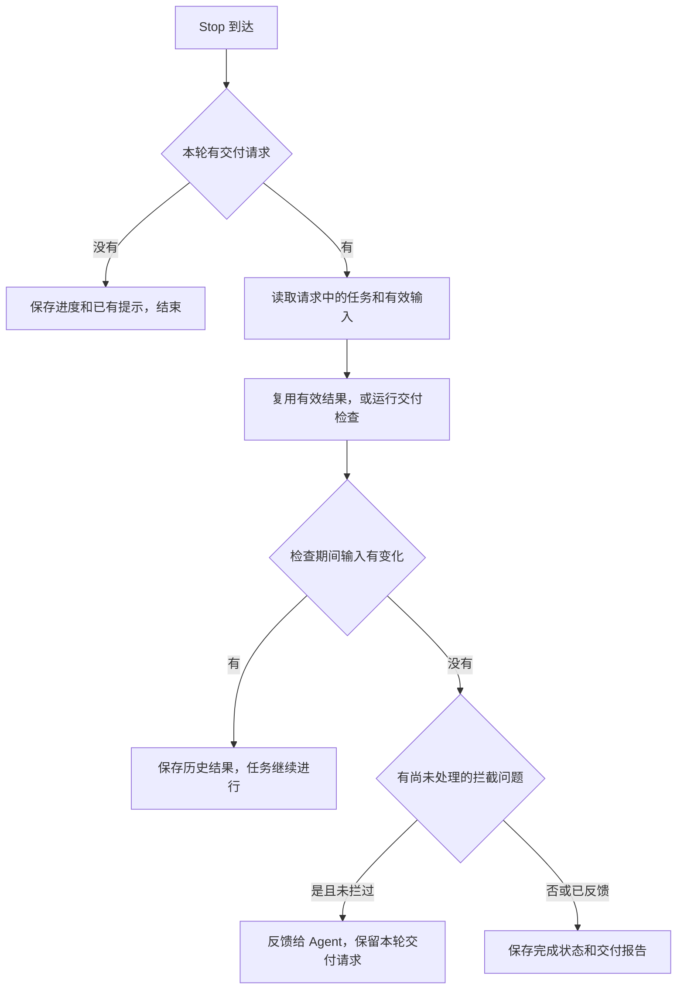

# Agent 接入

TaskBelay 通过 hook 记录开发过程，通过 MCP 让 Agent 保存需求、方案和决定，通过 skill 提供方案写作方法。平台和 Agent 的格式差异放在适配器里，任务和判定逻辑共用。

## 接入方式

每次 hook 启动 `taskbelay hook <agent> <事件>`，JSON 通过标准输入输出传递。输出仅包含该 Agent 支持的字段，中文用 ASCII 转义输出。MCP 使用 stdio，每个 session 一个 `taskbelay mcp` 进程，提供 [任务账本](requirements-ledger.md) 的八个工具。

| 时机 | hook | 处理 |
| --- | --- | --- |
| 开始、恢复、清空、压缩或分叉 session | SessionStart | 核对任务上下文和当前文件，注入提示与接续摘要 |
| 用户消息到达 | UserPromptSubmit | 保存原文和快照，更新当前决定与任务上下文 |
| shell 命令前 | PreToolUse | 分类、记录验证请求，按 V1 至 V3 处理 |
| 编辑工具前 | PreToolUse | 读取目标文件，发现工作区更新，核对过期编辑和方案范围 |
| 命令或编辑后 | PostToolUse；Claude Code 另接 PostToolUseFailure | 核对实际结果，记录编辑及工作区更新，补验证结果 |
| 本轮准备结束 | Stop | 处理待交付任务，或保存普通停顿的进度与提示 |

| 工具 | Claude Code | Codex |
| --- | --- | --- |
| shell | Bash、PowerShell | Bash，包括 exec_command |
| 编辑 | Edit、Write、NotebookEdit | apply_patch |

后置 hook 同时匹配 shell 和编辑工具。用户直接在 IDE 或终端修改，不需要触发 Agent 工具；下次观察文件时将变化记为工作区更新。

## SessionStart

记录 session 和事件，再比较当前文件、分支上下文、账本及有效设置。按 [任务接续](handoff.md) 生成摘要。恢复和分叉也核对工作区，不能只凭账本没变就沿用旧上下文。

新开、清空和压缩后注入事前提示；恢复时有模式或规则变化则更新对应部分。摘要与提示共用长度预算。另一个 session 最近有活动时，附一条共享工作区提示。

## UserPromptSubmit

保存完整消息、轮次和快照，作为任务起点及引用来源。Agent 根据消息更新需求和用户决定。工作区有更新时，补充当前内容变化；上一轮相同提示已交付且没有新事实时不重复注入。

## PreToolUse：shell

适配器给出命令、实际目录、shell 写法和工具调用编号。shell 解析器分类后，非验证命令记录必要的活动信息并快速返回。有验证时保存输入和环境标识，按 [过度测试判定](over-testing.md) 判断。

V1 满足拦截条件且本次还未提示过时返回 deny；用户重跑决定有效时允许运行并消耗一次授权。提示只返回 additionalContext，不返回强制 allow，保留 Agent 原有权限流程。

POSIX 与 PowerShell 按实际工具确定；外层为 `bash -lc`、`pwsh -Command` 等形式时解析内部命令。未识别的命令仍照常执行，记录为其他命令。

## PreToolUse：编辑

先读取目标文件，把当前内容与最近观察及请求中的前置内容核对。未变化的片段正常编辑；发现更新时，附上变化位置。请求准备覆盖已变化片段时退回这次编辑，把当前版本交给 Agent 重新读取；只提示模式仅补充当前内容和冲突位置。

尚未建立任务时也读取有效工作模式；半自动按首次方案待确认处理。再按 [半自动模式](semi-auto.md) 检查是否已授权编辑目标。首次确认前拦下工作区编辑，增补待确认时只拦新增范围。只提示模式下把方案问题交给 Agent，不拒绝调用。

保存工具请求、编辑前标识及可推导的预期改动，用于后置核对。不为每次编辑扫描整个仓库。

## PostToolUse 与失败事件

以工具调用编号找到前置记录。编辑请求与实际内容一致时保存 Agent 编辑；出现其他变化或没有足够信息时保存工作区更新。shell 的前后差异也按这条规则处理，不能把期间的用户修改归给命令。

验证结果按可取得的信息保存：Claude Code 的成功和失败事件可核对退出状态，Codex 的 shell 响应只有输出文本时记为未知。长命令只有启动结果、还在后台运行时记为正在运行，后续拿不到结束信息就保留未知，V1 不复用它。

## Stop 与交付



- `task_finish` 只提交交付请求，Stop 使用请求中的任务编号，不因待交付状态走“没有任务”的分支。
- 普通分析、问问题或等待确认时，不启动完整交付检查和动态测试。没有记录需求却已有 Agent 编辑时，给 Agent 补记提示，保留这轮观察。
- 交付先做静态检查；项目开启或本次请求了动态检查时才运行测试。完整输入版本见 [任务账本](requirements-ledger.md)。
- 同一问题按稳定编号对每个 session 最多拦一次，每轮最多三次。位置或其他文件变化不重置身份。
- 首次反馈后保留本轮交付请求；输入未变就再次 Stop 时，展示未处理问题并完成。Agent 继续修改或更新需求、授权时，请求过期，任务回到进行中，之后重新申请交付并复用有效分析。
- 检查期间用户或其他 session 修改了输入时，保存结果版本，提示 Agent 按当前内容接续，本轮不使用旧结果拦截。
- 交付完成后显示需求、位置、用户决定、工作区更新及检查完成情况。普通提示去重后最多展示五条，其余可用 `taskbelay status` 查看。

Stop 超时设为 300 秒，动态检查自己的预算是 120 秒。只提示模式下同样生成报告，不拒绝工具调用或阻止结束。

## Agent 与平台能力

适配器按已支持的输入字段读写，缺失的退出码或结果保留未知。Codex 的 write_stdin 等后续路径可能没有对应前置事件，交付检查仍以观察到的实际文件为准。

| 项目 | Claude Code | Codex |
| --- | --- | --- |
| hook 配置 | `~/.claude/settings.json` 的 hooks | `~/.codex/hooks.json` |
| MCP 注册 | `claude mcp add --scope user` | `codex mcp add` |
| skill 目录 | `~/.claude/skills/` | `~/.agents/skills/` |
| hook 生效 | 安装后新 session | 用户用 `/hooks` 确认信任后 |
| 轮次 | prompt_id | turn_id |
| 验证结果 | 按成功、失败或中断事件记录 | 没有可核对退出状态时记未知 |

## 三个平台的差异

macOS 和 Linux 的做法相同，Windows 不同：

| 项目 | macOS、Linux | Windows |
| --- | --- | --- |
| 用户目录 | `~` | `%USERPROFILE%` |
| TaskBelay 程序 | `taskbelay` | `taskbelay.exe` |
| Agent 运行命令用的 shell | Claude Code、Codex 都是用户的 bash 或 zsh | Claude Code 是 Git Bash 或 PowerShell，Codex 是 PowerShell |
| Codex 运行 hook 命令用的 shell | bash 或 zsh，用 `-c` 运行 | PowerShell，用 `-NoProfile -Command` 运行 |
| Codex 的 hook 条目 | `command` 写成 `'/Users/dev/go/bin/taskbelay' hook codex stop` | `command` 写成 `& 'C:\Users\dev\go\bin\taskbelay.exe' hook codex stop` |

Claude Code 的 hook 条目在三个平台上写法相同，用 exec 形式：`command` 写 taskbelay 的绝对路径，`args` 写参数。Claude Code 直接启动这个程序，不经过 shell，所以路径里有空格、中文或引号都原样写，也省掉了每次启动 shell 的时间。exec 形式从 Claude Code 2.1.139 开始支持。

Codex 用自己运行命令的那个 shell 运行 hook 命令，所以 Codex 的 hook 条目按这个 shell 的写法来写。程序路径里可能有空格、中文或引号，比如用户名带空格，所以路径一律加单引号：POSIX 写法里，路径中的单引号写成 `'\''`；PowerShell 写法里，路径中的单引号写成两个单引号，PowerShell 当作单引号的几个弯引号也一样。

在 Windows 的 WSL 里运行的 Agent 是 Linux 程序，按 Linux 接入：TaskBelay 装在 WSL 里，配置和数据都在 WSL 的用户目录下。

## 安装和卸载

**安装 Claude Code 的接入：`taskbelay install claude`。**

1. 在 Claude Code 的 `settings.json` 的 `hooks` 里加入 7 个条目：SessionStart、UserPromptSubmit、Stop 各一个；PreToolUse 两个，一个匹配 `Bash|PowerShell`，一个匹配 `Edit|Write|NotebookEdit`；PostToolUse、PostToolUseFailure 各一个，匹配 `Bash|PowerShell|Edit|Write|NotebookEdit`。每个条目用 exec 形式写 taskbelay 的绝对路径和参数，绝对路径保证 Agent 运行时找得到它。Stop 的超时设为 300 秒，其他设为 30 秒。用户原有的配置保持不动。
2. 运行 `claude mcp add --scope user taskbelay -- <taskbelay 的绝对路径> mcp`。
3. 安装两个 skill。

写入的 hook 条目是这个样子（只列出两个，路径以 macOS 为例，Windows 上是 taskbelay.exe 的路径）：

```json
{
  "hooks": {
    "PreToolUse": [
      {
        "matcher": "Bash|PowerShell",
        "hooks": [
          { "type": "command", "command": "/Users/dev/go/bin/taskbelay", "args": ["hook", "claude", "pre-tool-use"], "timeout": 30 }
        ]
      }
    ],
    "Stop": [
      {
        "hooks": [
          { "type": "command", "command": "/Users/dev/go/bin/taskbelay", "args": ["hook", "claude", "stop"], "timeout": 300 }
        ]
      }
    ]
  }
}
```

**安装 Codex 的接入：`taskbelay install codex`。**

1. 在 Codex 的 `hooks.json` 里加入 6 个条目：SessionStart、UserPromptSubmit、Stop 各一个；PreToolUse 两个，一个匹配 `Bash`，一个匹配 `apply_patch`；PostToolUse 一个，匹配 `Bash|apply_patch`。命令的写法见上一节“三个平台的差异”，超时和 Claude Code 相同。
2. 运行 `codex mcp add taskbelay -- <taskbelay 的绝对路径> mcp`。
3. 安装两个 skill。
4. 提示用户打开 Codex，用 `/hooks` 确认信任 TaskBelay 的 hook。不确认的话，hook 不会运行。

**两个 skill 怎样安装。** 两个 skill 的文件内置在 TaskBelay 项目的 `skills/` 目录里，编译时打包进程序。安装时，把它们复制到 Agent 的 skill 目录，每个 skill 一个子目录：`write-technical-plans/` 和 `write-a-well-document/`。目录里已经有同名的子目录时，保留用户原有的那份。TaskBelay 在自己复制过去的目录里放一个 `.taskbelay` 标记文件，卸载时只删除带这个标记的目录。

两条安装命令都可以重复运行，重复运行只更新 TaskBelay 自己的条目。安装写的是用户级配置，对这台电脑上所有的 git 工作区生效；配置文件是符号链接时，修改它指向的文件。安装前先检查版本：git 要 2.5 或更高，安装 Claude Code 的接入时 Claude Code 要 2.1.139 或更高，不满足时报错并说明要求，不写入任何配置。安装时找不到 `claude` 或 `codex` 命令，TaskBelay 会报错，并打印需要手动写入的配置。

**卸载：`taskbelay uninstall claude`、`taskbelay uninstall codex`。** 删除命令里带 taskbelay 路径和 `hook` 子命令的条目，运行 `claude mcp remove --scope user taskbelay` 或 `codex mcp remove taskbelay`，再删除带 `.taskbelay` 标记的 skill 目录。任务账本里的数据保留。

## TaskBelay 出错时

TaskBelay 自己出了问题，比如数据库打不开、git 命令失败、代码加载失败、检查超时，hook 正常退出，Agent 的原操作照常进行。

错误写进日志（位置见 [系统架构](product-architecture.md)）。Stop 时检查没能完成的，用 `systemMessage` 告诉用户“TaskBelay 这次没有完成检查”和原因，`taskbelay status` 里也能看到。

当前目录不在 git 工作区里时，所有 hook 直接退出，MCP 工具返回“当前目录不在 git 工作区里”。

## 参考资料

- [Claude Code hooks 文档](https://code.claude.com/docs/en/hooks)
- [Claude Code 工具说明（含 PowerShell 工具）](https://code.claude.com/docs/en/tools-reference)
- [Codex hooks 文档](https://developers.openai.com/codex/hooks)
- [Codex MCP 文档](https://developers.openai.com/codex/mcp)
- [Codex skill 文档](https://developers.openai.com/codex/skills)
