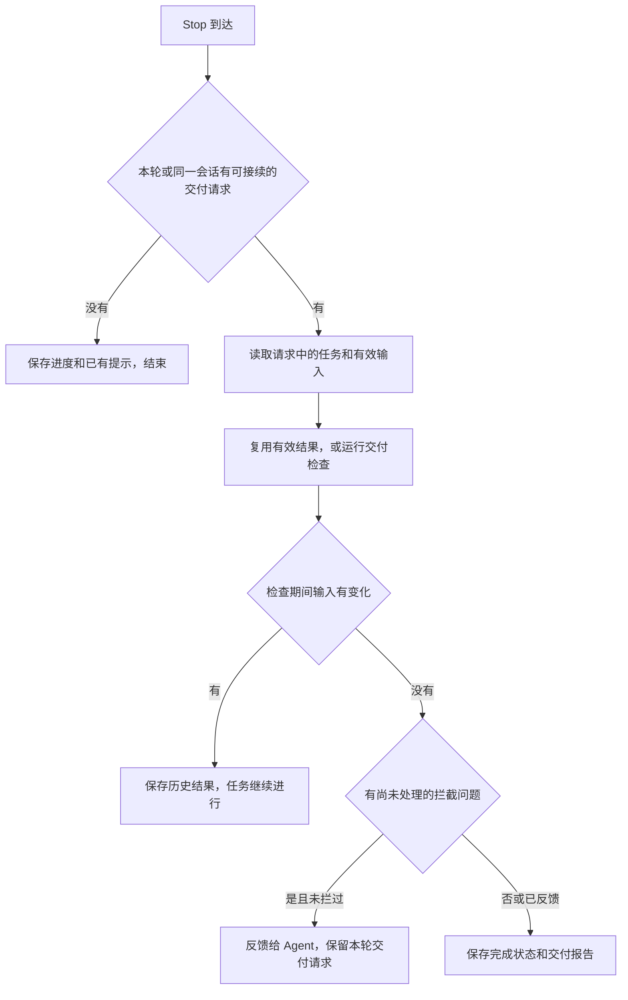

# Agent 接入

TaskBelay 通过 hook 记录开发过程，通过 MCP 让 Agent 保存需求、方案和决定。平台和 Agent 的格式差异放在适配器里，任务和判定逻辑共用。

## 接入方式

每次 hook 启动 `taskbelay hook <agent> <事件>`，JSON 通过标准输入输出传递。输出仅包含该 Agent 支持的字段，中文用 ASCII 转义输出。MCP 使用 stdio，每个 session 一个 `taskbelay mcp` 进程，提供 [任务账本](requirements-ledger.md) 的八个工具。

| 时机 | hook | 处理 |
| --- | --- | --- |
| 开始、恢复、清空、压缩或分叉 session | SessionStart | 核对任务上下文和当前文件，注入提示与接续摘要 |
| 用户消息到达 | UserPromptSubmit | 保存原文和快照，更新当前决定与任务上下文 |
| shell 命令前 | PreToolUse | 分类、记录验证请求，按 V1 至 V3 处理 |
| 编辑工具前 | PreToolUse | 读取目标文件，发现工作区更新，核对过期编辑和方案范围 |
| Claude Code 调用 TaskBelay MCP 工具前 | PreToolUse | 记录本次调用的 session、轮次和工具调用编号，供 MCP 精确关联 |
| 命令或编辑后 | PostToolUse；Claude Code 另接 PostToolUseFailure | 核对实际结果，记录编辑及工作区更新，补验证结果 |
| 本轮准备结束 | Stop | 处理待交付任务，或保存普通停顿的进度与提示 |

| 工具 | Claude Code | Codex |
| --- | --- | --- |
| shell | Bash、PowerShell | Bash，包括 exec_command |
| 编辑 | Edit、Write、NotebookEdit | apply_patch |

后置 hook 同时匹配 shell 和编辑工具。用户直接在 IDE 或终端修改，不需要触发 Agent 工具；下次观察文件时将变化记为工作区更新。

## SessionStart

记录 session 和事件，再比较当前文件、分支上下文、账本及有效设置。按 [任务接续](handoff.md) 生成摘要。恢复和分叉也核对工作区，不能只凭账本没变就沿用旧上下文。

新开、清空和压缩后注入事前提示；恢复时有模式或规则变化则更新对应部分。摘要与提示共用长度预算。另一个 session 最近有活动时，附一条共享工作区提示。

## UserPromptSubmit

保存完整消息、轮次和快照，作为任务起点及引用来源。Agent 根据消息更新需求和用户决定。工作区有更新时，补充当前内容变化；上一轮相同提示已交付且没有新事实时不重复注入。

Codex 可以在同一个 `turn_id` 中追加用户消息。消息事件用轮次和完整原文的 SHA-256 共同标识，不把轮次当作唯一消息编号；轮次本身保持不变。同轮不同原文分别保存，相同原文按重复投递处理。宿主未提供独立消息编号时，无法区分同轮同文重发与再次提交。

## PreToolUse：shell

适配器给出命令、实际目录、shell 写法和工具调用编号。shell 解析器分类后，非验证命令记录必要的活动信息并快速返回。有验证时保存输入和环境标识，按 [过度测试判定](over-testing.md) 判断。

V1 满足拦截条件且本次还未提示过时返回 deny；用户重跑决定有效时允许运行并消耗一次授权。提示只返回 additionalContext，不返回强制 allow，保留 Agent 原有权限流程。

POSIX 与 PowerShell 按实际工具确定；外层为 `bash -lc`、`pwsh -Command` 等形式时解析内部命令。未识别的命令仍照常执行，记录为其他命令。

## PreToolUse：Claude Code 的 MCP 调用身份

Claude Code 的 hook 提供 `session_id`、`prompt_id` 和 `tool_use_id`，但 MCP 请求不保证携带轮次。为使写入对应到准确的用户消息，单独注册匹配 `^mcp__taskbelay__.*$` 的 PreToolUse 条目：只保存工作区、Agent、session、轮次、工具调用编号和工具名，不检查业务内容、不改写工具参数，也不返回 allow 或 deny。该事件沿用快速事件预算。

Claude Code 启动 MCP 子进程时提供 `CLAUDE_CODE_SESSION_ID`，工具请求的 `_meta["claudecode/toolUseId"]` 提供原生调用编号。MCP 用这两项和当前工作区读取前置记录，核对工具名后取得轮次；不使用最近活动或 JSON-RPC 请求编号猜测。相同身份重发可以复用，重复编号对应了不同轮次或工具则报冲突，不覆盖原记录。

前置 hook 缺失、未加载、超时或身份字段不全时，hook 仍正常退出；MCP 写工具说明身份无法核对，不写账本。`task_get` 仍可查询已有任务。已完成调用的重试继续按原生工具调用编号返回原结果，旧轮次的新写入仍按账本规则拒绝。

Codex 从 MCP 请求的 `callId` 和 `x-codex-turn-metadata` 中读取工具调用编号、`session_id`、`turn_id`，核对同时出现的 `sessionId`；`threadId` 不代替 hook 的 session。它不增加身份记录 hook。两种方式均只适配已有传输字段，不向 MCP 工具参数增加身份字段。

## PreToolUse：编辑

先读取目标文件，把当前内容与最近观察及请求中的前置内容核对。未变化的片段正常编辑；发现更新时，附上变化位置。请求准备覆盖已变化片段时退回这次编辑，把当前版本交给 Agent 重新读取；只提示模式仅补充当前内容和冲突位置。

尚未建立任务时也读取有效工作模式；半自动按首次方案待确认处理。再按 [半自动模式](semi-auto.md) 检查是否已授权编辑目标。首次确认前拦下工作区编辑，增补待确认时只拦新增范围。只提示模式下把方案问题交给 Agent，不拒绝调用。

保存工具请求、编辑前标识及可推导的预期改动，用于后置核对。不为每次编辑扫描整个仓库。

请求按规范化后的文件身份归组，保留每个文件对应的原始操作下标。单项请求中的多个 hunk 按其定位约束核对；同一文件重复出现独立操作而无法确定最终执行含义时，该文件标为无法完整核对，其他文件继续处理。工作区外目标不使用本工作区的历史；路径身份不明或读取失败单独保存原因。工作区内能够确定的目标仍进行过期编辑和方案范围检查。需要可核对编辑记录时使用编辑工具，shell 写入按实际取得的信息记录。

## PostToolUse 与失败事件

以工具调用编号找到前置记录。编辑请求与实际内容一致时保存 Agent 编辑；出现其他变化或没有足够信息时保存工作区更新。shell 的前后差异也按这条规则处理，不能把期间的用户修改归给命令。

验证结果按可取得的信息保存。Claude Code 的成功和失败事件可核对退出状态；Codex 的结构化结果读取退出码或运行中的 session。

Codex 的部分版本只在后置 hook 中提供 stdout。输入带有 `transcript_path` 时，字符串结果按 stdout 处理，从该文件末尾最多读取 4 MiB 的完整记录，只接受已知的 `CommandExecution` 完成事件。事件的 session、turn、工具调用编号、完整输出及成功或失败状态必须一致，才采用退出码。会话格式不是稳定协议；文件不可读、记录尚未写入、超出读取范围、格式变化或内容不匹配时仍为未知，不把 stdout 当作宿主结果头部。

未提供会话路径的旧输入仍识别包含耗时、退出状态和输出分隔的完整宿主结果头部；JSON 字符串中的结构化结果须同时具有耗时和输出字段。普通命令输出里的退出码或成功字样不作为结果依据。长命令只有可核对的启动结果、还在后台运行时记为正在运行；同一工具调用后续收到结束事件时补齐结果，拿不到结束信息就保留未知，V1 不复用它。

## Stop 与交付



- `task_finish` 只提交交付请求，Stop 使用请求中的任务编号，不因待交付状态走“没有任务”的分支。
- Stop 失败后，同一 session 的当前轮次可以接续当前任务尚未完成的交付请求，并重新核对输入版本；不接管其他 session、其他任务或迟到轮次的请求。
- 普通分析、问问题或等待确认时，不启动完整交付检查和动态测试，保留这轮观察。没有记录需求却已有 Agent 编辑时，在下一次任务接续摘要提示补记，不使用 `BlockStop` 强制继续。
- 交付先做静态检查；项目开启或本次请求了动态检查时才运行测试。完整输入版本见 [任务账本](requirements-ledger.md)。
- 同一问题按稳定编号对每个 session 最多拦一次，每轮最多三次。位置或其他文件变化不重置身份。
- 首次反馈后保留本轮交付请求；输入未变就再次 Stop 时，展示未处理问题并完成。Agent 继续修改或更新需求、授权时，请求过期，任务回到进行中，之后重新申请交付并复用有效分析。
- 交付请求过期或检查期间用户、其他 session 修改了输入时，通过 `systemMessage` 当场告诉用户任务仍在进行中，需要按当前内容重新申请交付；旧结果保留为历史，本轮不使用旧结果拦截。尚未解决的接续事项从任务事实生成，随下一次摘要送给 Agent。
- 交付完成后显示需求、位置、用户决定、工作区更新及检查完成情况。普通提示去重后最多展示五条，其余可用 `taskbelay status` 查看。

Stop 超时设为 300 秒，动态检查自己的预算是 120 秒。只提示模式下同样生成报告，不拒绝工具调用或阻止结束。

## Agent 与平台能力

适配器按已支持的输入字段读写，缺失的退出码或结果保留未知。Codex 的 write_stdin 不重复触发原命令的前置事件，命令完成时可以补发原调用的后置事件；交付检查仍以观察到的实际文件为准。

| 项目 | Claude Code | Codex |
| --- | --- | --- |
| hook 配置 | `~/.claude/settings.json` 的 hooks | `~/.codex/hooks.json` |
| MCP 注册 | `claude mcp add --scope user` | `codex mcp add` |
| hook 生效 | 安装后新 session | 用户用 `/hooks` 确认信任后 |
| 轮次 | prompt_id | turn_id |
| 验证结果 | 按成功、失败或中断事件记录 | 没有可核对退出状态时记未知 |

## 三个平台的差异

macOS 和 Linux 的做法相同，Windows 不同：

| 项目 | macOS、Linux | Windows |
| --- | --- | --- |
| 用户目录 | `~` | `%USERPROFILE%` |
| TaskBelay 程序 | `taskbelay` | `taskbelay.exe` |
| Agent 运行命令用的 shell | Claude Code、Codex 都是用户的 bash 或 zsh | Claude Code 是 Git Bash 或 PowerShell，Codex 是 PowerShell |
| Codex 运行 hook 命令用的 shell | bash 或 zsh，用 `-c` 运行 | PowerShell，用 `-NoProfile -Command` 运行 |
| Codex 的 hook 条目 | `command` 写成 `'/Users/dev/go/bin/taskbelay' hook codex stop` | `command` 写成 `& 'C:\Users\dev\go\bin\taskbelay.exe' hook codex stop` |

Claude Code 的 hook 条目在三个平台上写法相同，用 exec 形式：`command` 写 taskbelay 的绝对路径，`args` 写参数。Claude Code 直接启动这个程序，不经过 shell，所以路径里有空格、中文或引号都原样写，也省掉了每次启动 shell 的时间。exec 形式从 Claude Code 2.1.139 开始支持。

Codex 用自己运行命令的那个 shell 运行 hook 命令，所以 Codex 的 hook 条目按这个 shell 的写法来写。程序路径里可能有空格、中文或引号，比如用户名带空格，所以路径一律加单引号：POSIX 写法里，路径中的单引号写成 `'\''`；PowerShell 写法里，路径中的单引号写成两个单引号，PowerShell 当作单引号的几个弯引号也一样。

在 Windows 的 WSL 里运行的 Agent 是 Linux 程序，按 Linux 接入：TaskBelay 装在 WSL 里，配置和数据都在 WSL 的用户目录下。

## 安装和卸载

### 安装程序

macOS、Linux 在项目目录执行 `bash install.sh --source`；Windows 在 PowerShell 中执行 `& .\install.ps1 -Source`。源码安装需要 Go 1.26 或更高，构建成功后才替换已安装程序。

发布版本后，可直接下载脚本安装预编译程序，无需 Go：

```sh
curl -fsSL https://github.com/Innocent-children/TaskBelay/releases/latest/download/install.sh | bash
```

```powershell
irm https://github.com/Innocent-children/TaskBelay/releases/latest/download/install.ps1 | iex
```

脚本默认选择最新发布版本；`install.sh --version vX.Y.Z` 或 `install.ps1 -Version vX.Y.Z` 可指定正式版本。`release-manifest.json` 保存 `version`、`revision` 字符串和 `assets` 文件名数组。安装器先核对元数据与目标平台资产，再从该标签的固定下载地址取得 `SHA256SUMS` 和程序，避免发布切换时混用文件。下载、校验或程序版本核对失败时保留旧版；缺少元数据的旧发布包不按新格式安装，可使用源码安装。

发布资产包括 `taskbelay-<系统>-<架构>` 六种程序、`install.sh`、`install.ps1`、`SHA256SUMS` 和 `release-manifest.json`。Windows 程序增加 `.exe` 后缀，系统为 darwin、linux、windows，架构为 amd64、arm64。校验清单包括程序和安装脚本，程序版本与元数据使用同一个标签。源码安装 `@new` 指向开发分支；`@latest` 按 Go 发布版本选择，不保证包含 `new` 的改动。

macOS、Linux 安装到 `~/.local/bin/taskbelay`，将该目录加入 bash、zsh 的用户启动文件；Windows 安装到 `%LOCALAPPDATA%\Programs\TaskBelay\taskbelay.exe`，加入用户 PATH。重新打开终端后运行 `taskbelay`；安装结束也会打印当前终端可直接运行的完整路径。脚本只安装程序，Agent 接入由用户在菜单中选择。

### 交互管理

`taskbelay` 在交互终端中打开菜单，`taskbelay menu` 显式打开。上下方向键选择，右方向键或回车进入，左方向键、Esc 或 `q` 返回，空格勾选，Ctrl+C 退出菜单。Agent 列表可多选，回车执行；未勾选时不修改接入。菜单包括：

- 安装或修复 Claude Code、Codex 接入，以及移除接入。
- 查看本机版本、程序和数据位置、Agent 命令、TaskBelay hook 和 MCP 注册。发现配置不完整时说明具体原因；本机诊断不证明 Agent 已信任或实际执行 hook。
- 在用户、项目或当前任务范围设置工作模式、拦截强度和动态检查。显示有效设置及来源；项目、任务范围沿用现有命令的工作区要求。
- 查看当前任务和最近检查，主动运行静态检查；一次动态检查需要单独确认。
- 更新程序，或移除两个 Agent 的接入后卸载程序。卸载默认取消，确认后才执行；接入移除失败时保留程序并说明未完成部分。

无交互终端时不读取按键；无参数显示帮助，显式 `menu` 返回说明。子命令始终可单独调用。`taskbelay update` 仅更新程序，完成后重新打开菜单；已运行的 Agent session 仍需重启才能加载新程序。`taskbelay uninstall --all --yes` 用于明确要求无交互卸载的脚本。

更新器使用 Go 语义版本比较正式版本与伪版本，例如 `v0.5.0 < v0.5.1-0.20261027023236-bee390c559a8 < v0.5.1`。目标更高才下载替换，相同或更低时返回无需更新。当前为 `dev`、`(devel)` 或无效版本时显示版本与构建信息，结束自动更新；用户可用安装脚本明确选择发布包或当前源码。工作区修改标记另行显示，不改变合法版本的排序。

包含 schema 11 的程序首次打开账本时原子升级全部业务表。已运行的旧 MCP 后续读写会失败，重新启动 Agent session 恢复新程序接入；hook 自身失败仍放行正常开发。升级后不能只回退二进制并假定旧程序能够读取新账本。初始化失败保留完整旧结构，下一次打开可重试，不做破坏性重建；安装和更新保留账本及 Agent 配置。

安装脚本在程序旁写入 `.taskbelay-install` 标记。自更新、自卸载核对用户安装位置和标记，不删除 Go 安装或其他包管理器管理的程序。macOS、Linux 的旧入口若是符号链接，安装脚本通过本机 Go 的构建信息确认它指向 TaskBelay 后，可用新程序替换链接本身，原 Go 程序保留；其他链接和未标记的普通文件不覆盖。Windows 运行中的旧程序通过重命名退役；若暂时无法删除，输出待清理文件路径，关闭使用旧版的 Agent 后可手动删除该文件。任务账本、日志、用户原有配置及用户 PATH 中的目录条目保留；卸载不递归删除用户目录。

### 接入和移除 Agent

**安装 Claude Code 的接入：`taskbelay install claude`。**

1. 在 Claude Code 的 `settings.json` 的 `hooks` 里加入 8 个条目：SessionStart、UserPromptSubmit、Stop 各一个；PreToolUse 三个，分别匹配 `Bash|PowerShell`、`Edit|Write|NotebookEdit`、`^mcp__taskbelay__.*$`，第三个只记录 MCP 调用身份；PostToolUse、PostToolUseFailure 各一个，匹配 `Bash|PowerShell|Edit|Write|NotebookEdit`。每个条目用 exec 形式写 taskbelay 的绝对路径和参数，绝对路径保证 Agent 运行时找得到它。Stop 的超时设为 300 秒，其他设为 30 秒。用户原有的配置保持不动。
2. 运行 `claude mcp add --scope user taskbelay -- <taskbelay 的绝对路径> mcp`。

写入的 hook 条目是这个样子（只列出两个，路径以 macOS 为例，Windows 上是 taskbelay.exe 的路径）：

```json
{
  "hooks": {
    "PreToolUse": [
      {
        "matcher": "Bash|PowerShell",
        "hooks": [
          { "type": "command", "command": "/Users/dev/go/bin/taskbelay", "args": ["hook", "claude", "pre-tool-use"], "timeout": 30 }
        ]
      }
    ],
    "Stop": [
      {
        "hooks": [
          { "type": "command", "command": "/Users/dev/go/bin/taskbelay", "args": ["hook", "claude", "stop"], "timeout": 300 }
        ]
      }
    ]
  }
}
```

**安装 Codex 的接入：`taskbelay install codex`。**

1. 在 Codex 的 `hooks.json` 里加入 6 个条目：SessionStart、UserPromptSubmit、Stop 各一个；PreToolUse 两个，一个匹配 `Bash`，一个匹配 `apply_patch`；PostToolUse 一个，匹配 `Bash|apply_patch`。命令的写法见上一节“三个平台的差异”，超时和 Claude Code 相同。
2. 运行 `codex mcp add taskbelay -- <taskbelay 的绝对路径> mcp`。
3. 提示用户打开 Codex，用 `/hooks` 确认信任 TaskBelay 的 hook。不确认的话，hook 不会运行。

两条安装命令都可以重复运行，重复运行只更新 TaskBelay 自己的条目。安装写的是用户级配置，对这台电脑上所有的 git 工作区生效；配置文件是符号链接时，修改它指向的文件。安装前先检查版本：git 要 2.5 或更高，安装 Claude Code 的接入时 Claude Code 要 2.1.139 或更高，不满足时报错并说明要求，不写入任何配置。安装时找不到 `claude` 或 `codex` 命令，TaskBelay 会报错，并打印需要手动写入的配置。

Codex 允许在 `hooks.json` 或 `config.toml` 中声明 hook。同一个配置层同时包含两种事件定义时，两边都会加载，但启动时会提示 `prefer a single representation for this layer`。TaskBelay 安装器只维护 `hooks.json`，不会自动迁移用户在 `config.toml` 中定义的 hook。遇到该提示时，先备份两个文件，将原有事件组完整合并到 `hooks.json`，再从 `config.toml` 移除对应的事件定义；保留其他配置以及 `[hooks.state]` 中由 Codex 管理的启用和信任记录。迁移不得改变命令、匹配条件或超时，也不手工补写信任记录；来源路径变化后，按 `/hooks` 提示重新核对需要信任的条目。配置来源与信任机制见 [Codex hooks 文档](https://developers.openai.com/codex/hooks)。

**卸载：`taskbelay uninstall claude`、`taskbelay uninstall codex`。** 删除命令里带 taskbelay 路径和 `hook` 子命令的条目，运行 `claude mcp remove --scope user taskbelay` 或 `codex mcp remove taskbelay`。任务账本里的数据保留。

## TaskBelay 出错时

TaskBelay 自己出了问题，比如数据库打不开、git 命令失败、代码加载失败、检查超时，hook 正常退出，Agent 的原操作照常进行。

错误写进日志（位置见 [系统架构](product-architecture.md)）。Stop 时检查没能完成的，用 `systemMessage` 告诉用户“TaskBelay 这次没有完成检查”和原因，`taskbelay status` 里也能看到。

当前目录不在 git 工作区里时，所有 hook 直接退出，MCP 工具返回“当前目录不在 git 工作区里”。

## 参考资料

- [Claude Code hooks 文档](https://code.claude.com/docs/en/hooks)
- [Claude Code 工具说明（含 PowerShell 工具）](https://code.claude.com/docs/en/tools-reference)
- [Codex hooks 文档](https://developers.openai.com/codex/hooks)
- [Codex MCP 文档](https://developers.openai.com/codex/mcp)
