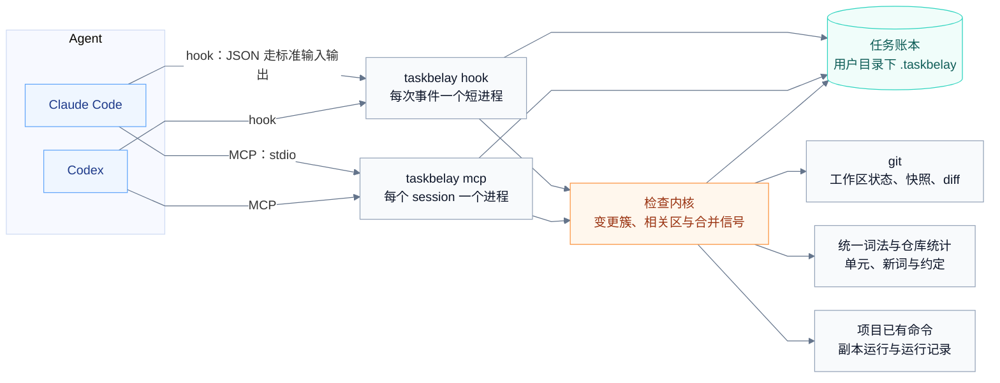
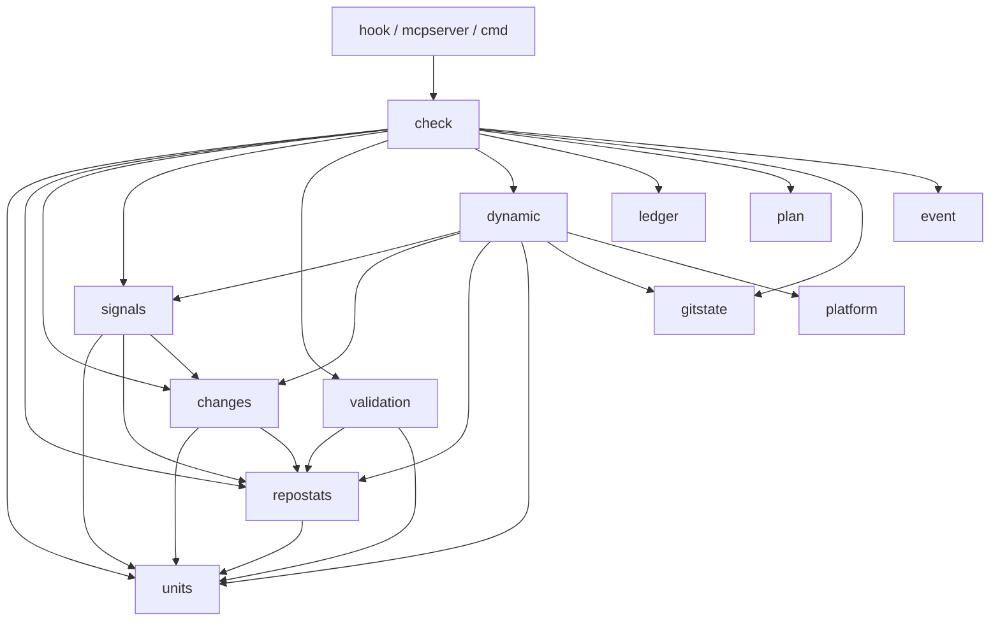
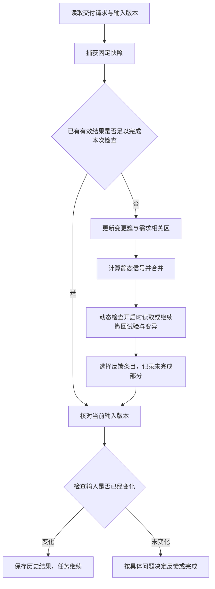

# 系统架构

TaskBelay 是一个 Go 写的命令行程序，运行在 Windows、macOS 和 Linux 上，接入 Claude Code 和 Codex。它没有常驻进程：Agent 每触发一次 hook，就启动一个短进程，处理完立刻退出；每个 Agent session 各自启动一个 MCP server 进程，session 结束时随之退出。这些进程通过同一个 SQLite 文件共享任务账本，通过 git 命令读取工作区。

开发期间的自动工作由 Agent 事件触发，每次事件启动短进程；用户也可用命令主动查看状态和运行检查。

分析内核按 [语言无关算法](algorithm.md) 组织。`check` 统一调用词法分析、仓库统计、变更簇分析、信号计算、验证结果复用和副本运行等能力，供 hook、MCP 和命令行使用。

## 组成



## 命令

| 命令 | 做什么 | 谁用 |
| --- | --- | --- |
| `taskbelay`、`taskbelay menu` | 打开终端管理菜单；无参数且没有交互终端时显示帮助 | 用户 |
| `taskbelay --version`、`taskbelay doctor` | 查看版本、本机程序路径、Agent 命令与接入状态 | 用户 |
| `taskbelay update` | 校验下载包后更新由安装脚本管理的程序 | 用户 |
| `taskbelay uninstall --all` | 移除本机两个 Agent 的接入，以及由安装脚本管理的程序，保留账本；需交互确认，脚本可显式加 `--yes` | 用户 |
| `taskbelay install claude`、`taskbelay install codex` | 接入 Agent，见 [Agent 接入](product-agent-integration.md) | 用户 |
| `taskbelay uninstall claude`、`taskbelay uninstall codex` | 移除接入 | 用户 |
| `taskbelay status` | 显示当前任务、可恢复任务、接续摘要和最近检查 | 用户 |
| `taskbelay check`、`taskbelay check --tests` | 在当前工作区检查；--tests 请求一次动态检查 | 用户 |
| `taskbelay config get <设置项>` | 显示合并后的有效设置和来源 | 用户 |
| `taskbelay config set workflow auto` 或 `semi` | 设置默认工作模式；`--project` 或 `--task` 指定作用范围 | 用户 |
| `taskbelay config set enforcement block` 或 `hint` | 设置拦截强度；支持用户、项目和当前任务范围 | 用户 |
| `taskbelay config set analysis.tests on` 或 `off` | 开启或关闭动态检查，支持 `--project`、`--task` | 用户 |
| `taskbelay config set analysis.parallel <数量>` | 声明副本命令可以独立并行，支持 `--project`、`--task` | 用户 |
| `taskbelay config set debug on` 或 `off` | 开启或关闭详细过程记录，支持 `--project`、`--task`，也可从常用设置菜单操作 | 用户 |
| `taskbelay hits --since 14d` | 导出最近触发拦截的问题和 Agent 的处理方式，见 [算法评估](product-evaluation.md) | 维护者 |
| `taskbelay hook <agent> <事件>` | 处理一次 hook 调用 | Agent |
| `taskbelay mcp` | 运行 MCP server | Agent |

## 项目结构

TaskBelay 要在三个平台上接入两个 Agent。程序在解析输入和执行命令时处理各类差异，分析内核只处理统一的词、单元、变更簇和运行记录：

- **Agent**：Claude Code 和 Codex 的 hook 输入输出格式、工具名和配置文件各不相同。
- **平台**：Windows 和另外两个平台的用户目录、程序文件名、hook 命令的写法不同；macOS 和 Linux 之间在这些方面相同。
- **命令写法**：Agent 运行的命令有 POSIX 和 PowerShell 两种写法，用哪种取决于 Agent 和平台。
- **项目内容与工具**：不同语言的文件和不同的项目命令，都按 [输入与执行协议](languages.md) 转换为词、单元、统计结果和运行记录，不按语言划分算法。

内核按职责分包，不直接处理 Agent、平台和 shell 的差异。

### 代码目录

```text
cmd/taskbelay/          CLI、菜单及进程组装
internal/
  agent/                Claude Code、Codex 及 hook JSON 适配
  platform/             目录、文件复制、进程组、优先级和平台差异
  shell/                POSIX、PowerShell 命令解析
  event/                统一事件、决定和入口预算
  hook/                 处理事件并调用 check
  mcpserver/            八个 MCP 工具及分页响应
  check/                编排、反馈选择、校准、问题及报告
  units/                词法、版面树、单元、多模式匹配和签名
  repostats/            起点约定、文件角色、测试词汇、结果解析
  changes/              diff、变更簇、相关区与最强路径
  signals/              设计候选、用例与等价类
  validation/           验证输入、重复、注释敏感性与通过规律
  dynamic/              副本、哨兵、探针、撤回、变异及确认
  ledger/               SQLite 账本、压缩正文、版本与日志
  gitstate/             Git 观察、快照、diff 和导出
  plan/                 方案、确认与半自动范围
  summary/              接续摘要和事前提示
  distribution/         发布、安装维护与更新
  terminal/             菜单按键和显示
```

导入箭头从使用方指向被使用方；外围模块只通过 `check` 调用内核。



`units`、`repostats`、`changes`、`signals` 和 `validation` 只处理调用方提供的数据。`dynamic` 导出固定快照并运行进程，平台操作由 `platform` 提供。`ledger` 和 `plan` 不导入内核；编辑前需要的文件分类由 `hook` 从 `check` 取得后传给 `plan`。

### 统一的事件和决定

`event` 定义 TaskBelay 关心的七种事件，以及处理之后给出的决定。每个事件都带 Agent、session、轮次和工作目录。

| 事件 | 来自哪个 hook | 带什么 |
| --- | --- | --- |
| session 开始 | SessionStart | 开始方式：新开、恢复、清空、压缩之后、分叉 |
| 用户消息 | UserPromptSubmit | 消息原文 |
| 命令请求 | PreToolUse，shell 工具 | 命令文本、命令写法（POSIX 或 PowerShell）、工具调用编号 |
| 编辑请求 | PreToolUse，编辑工具 | 文件列表、前置内容和拟写入内容或补丁 |
| MCP 调用身份 | PreToolUse，需要补齐 MCP 身份的 Agent | 工具调用编号、工具名；仅建立调用到 session 和轮次的对应关系 |
| 工具结束 | PostToolUse、PostToolUseFailure | 工具调用编号、实际编辑或命令结果、可取得的退出码 |
| 准备结束 | Stop | 无 |

处理结果有五种，可以组合：不作干预、给 Agent 补充上下文、拒绝这次工具调用、阻止结束，以及向用户显示提示。

### 适配器

每个 Agent 一个适配器，放在 `internal/agent/<名字>/` 下，实现同一个接口：

```go
// internal/agent
type Adapter interface {
	Name() string // "claude"、"codex"，也是 hook 命令里的 <agent>
	ParseEvent(hookEvent string, input []byte) (event.Event, error)
	RenderDecision(hookEvent string, d event.Decision) ([]byte, error)
	Install(env platform.Env, exe string) (string, error) // exe 是 taskbelay 的绝对路径，返回要告诉用户的话
	Uninstall(env platform.Env) (string, error)
}
```

适配器负责处理各 Agent 的差异：工具名对应哪种事件、命令按哪种写法解析、处理结果写成什么 JSON、配置文件在哪里，以及 hook 条目怎样写。具体规则见 [Agent 接入](product-agent-integration.md)。两个 Agent 的 hook 配置结构相同，用到的输出字段也相同，这两部分由 `hookjson` 共用；修改配置文件时保持用户原有内容和键的顺序不变。

适配层还会读取 Agent 在 MCP 请求中提供的调用身份字段，入口将这些信息写入共用账本。Claude Code 的调用身份事件只用短事务登记调用信息，不采集完整快照、不检查工具业务参数，也不返回权限决定。MCP 进程随后根据工作区、session 和 Agent 提供的工具调用编号读取所属轮次。字段或前置记录缺失、无法确定调用归属时，拒绝写入，仍允许只读查询。

### 平台

平台差异放在 `internal/platform` 里，用 Go 的构建约束区分：`platform_unix.go`（构建约束是 `unix`，macOS 和 Linux 共用）和 `platform_windows.go` 提供同一组函数，编译时只会选中其中一个。它们负责确定用户目录、TaskBelay 数据目录、程序文件名，以及 Codex 的 hook 命令和工具命令应采用的 shell 写法。macOS 和 Linux 在这些方面相同，所以共用一个文件。Claude Code 的 hook 不经过 shell，三个平台写法相同，无需按平台区分。

平台用构建约束，不用运行时的接口，因为一个程序文件只会在一个平台上运行，编译时选定就够了。

**路径比较。** 工作区采用 git 返回的规范根目录，并解析已存在路径的符号链接。路径统一使用相同的分隔符，大小写规则取自实际卷或目录属性，不按操作系统一律转成小写。新文件通过最近的已存在父目录定位；程序根据 git 目录与 worktree 信息共同识别工作区。

### 命令写法

`internal/shell` 当前把一条命令拆成几段，并给出每段的命令名和参数。`posix/` 基于 `mvdan.cc/sh` 解析 bash、zsh 和 Git Bash 的写法；`pwsh/` 是自己写的 PowerShell 解析，只做拆段、去掉引号、识别命令名和别名这几件事，保留引号内字面值并识别重定向；未识别的结构归入其他命令，交给原 shell 照常执行。用哪一个，由适配器在命令请求事件里写明。算法把解析结果记入运行记录，命令是否属于验证按行为判断，见 [输入与执行协议](languages.md)。

### 内核职责与扩展

| 包 | 输入与输出 |
| --- | --- |
| `units` | 固定内容与约定 → 词序列、版面树、单元、结构置信度 |
| `repostats` | 起点内容与运行输出 → 关键字、注释、测试、文件角色和结果标记 |
| `changes` | 累计内容差异、编辑来源和需求 → 变更簇、新词、相关区和路径 |
| `signals` | 仓库与改动 → 对外新增项、结构信号、用例与等价类 |
| `validation` | 命令和历史结果 → 输入比较、重复验证及提示 |
| `dynamic` | 固定输入与可信命令 → 探针、撤回与变异记录、确认集合 |
| `check` | 以上结果与账本 → 反馈、按事实决定的拦截、校准结果、完成状态和报告 |

每个包的参数集中在 `params.go`，变更参数时核对所指向的算法章节。接入项目内容和验证工具不新增语言规则；新 Agent 扩展 `agent`，新的 shell 写法扩展 `shell`，平台差异放在带构建约束的 `platform` 文件中。

## 关键流程

### 用户消息与任务接续

适配器把消息转成统一事件，记录原文与工作区快照。`hook` 核对上下文、当前任务，以及无法与已有编辑记录对应的文件变化，将结果写入账本，再交给 `summary` 生成必要的补充内容。任务的起点和生命周期由 [任务和需求](requirements.md) 定义。

SessionStart 也读取当前文件状态。恢复 session 时比较账本修订和实际状态，用户在 Agent 停下期间手改的内容因此进入摘要。

### 编辑前后

PreToolUse 只读取目标文件，取得当前 blob 标识，再与最近观察的内容及工具请求中的编辑前内容核对。`Edit` 的原文、`apply_patch` 的上下文和 `Write` 的整份目标内容都作为请求保存。请求按文件准备，路径规范化后指向同一文件的只准备一次，并保留对应操作的原始下标。某个文件无法核对、目标位于工作区外或路径有误时，仍继续准备其他文件。

发现当前内容已变时，TaskBelay 将变化位置告诉 Agent。编辑范围与更新范围重叠时，根据拦截强度退回过期请求或补充冲突信息，其他片段继续编辑。

编辑结束后，重新读取目标文件。预期改动与实际前后内容能对应时保存 Agent 编辑；多出的内容记为工作区更新。记录采用文件与片段的内容标识，只有移动或改名能唯一对应时才自动迁移逻辑位置。没有足够信息的 shell 写入在下一次完整观察中作为工作区更新保存。

TaskBelay 不需要追踪 Agent 的每一次读文件动作。发生冲突后，Agent 按当前内容重新组织编辑；TaskBelay 每次都核对请求中的编辑前内容，不因为“已经提醒过”就允许旧内容覆盖当前文件。如果整文件写入没有可核对的编辑前内容，而且会覆盖工作区更新，Agent 应先读取当前文件，再提交带有当前上下文的编辑请求。

编辑核对的结果分为可核对、已确认冲突和无法核对。上下文出现多个匹配位置、补丁解析失败或原文为空时，不判定内容过期，实际变化按工作区更新记录。只有补丁能匹配此前观察的内容、不能匹配当前内容，且两次内容确实不同，才认定上下文过期；仅有“文件曾被修改”的标志不足以证明冲突。整文件写入的编辑前内容不一致，或写入会覆盖已知更新时，仍按冲突处理。

### 命令前后

`shell` 解析执行目录、参数、环境前缀和命令段。检查流程计算这次命令的验证输入，查询验证输入记录、范围包含与通过规律，以及有效的重跑决定；命令是否属于验证按行为判断，不用命令名白名单，命令前不运行完整分析。重复验证的全部条件由 [过度测试判定](over-testing.md) 定义。

命令结束后的事件用于补充运行结果。无法核对退出状态时，将结果记为未知，不能根据输出为空推断成功。命令执行前取得的环境标识只保存用于比较的摘要，原始凭据不进入账本。

命令已被完整解析，而且所有命令段都只读或只调整执行上下文、不产生副作用时，命令结束后不再采集整个工作区。涉及重定向写入、后台运行、未知结构或混合写操作的命令不能省略这一步。用户的并发修改仍会在编辑前核对目标文件，以及处理消息、检查和 Stop 时采集完整工作区状态的过程中发现。完整观察的 debug 记录分别说明采集状态、保留引用和保存结果的情况。

### 交付

`task_finish` 在短事务中保存待交付请求及本轮任务编号，立即返回已有检查。Stop 根据该请求组织检查；普通停顿只保存观察和已有提示。



检查输入包含任务、内容、需求、方案、编辑、决定、分析设置、算法版本和已结束的验证记录。文件词法及词法计数按 blob 复用，起点约定按 tree 合并；内容或判定依据变化时，重新计算变更簇、相关区和信号。动态结果按固定输入复用，超时、取消或执行错误保留各自状态。主动刷新重新计算，仍受动态检查开关约束。

文件分析按 blob 和起点约定缓存，起点索引按 tree 保存；检查按 [算法核心](algorithm.md#九什么时候计算) 查询索引与改动覆盖层，并按任务输入版本复用报告。动态检查的中间结果逐步写入账本。观察到的内容没有变化时，以及仅记录 hook 活动时，不增加内容修订号。

交付反馈最多六千字符，优先说明为什么拦截、检查了哪些内容、哪些内容未能检查，以及未完成的检查可能带来的影响，不再展开全部需求、改动及验证明细。完整报告继续保存在账本，可通过 `taskbelay status` 或 `task_get` 查询。所有有效需求已标记完成但未申请交付时，普通 Stop 提示尚未执行交付检查；同一 session、任务和需求修订只提示一次，不自动结束任务或启动动态测试。

检查完成时再次核对输入修订和当前状态，再用短事务发布结果和交付状态。期间有用户修改或其他 session 写入时，结果保留为历史，当前任务继续进行。计算和测试期间不持有数据库写锁，不锁工作区，不循环重试直到工作区停止变化。

## 工作区状态和快照

工作区状态用 git tree 表示。Git 将当前索引复制到临时目录，使用独立的 Git 元数据与属性设置读取原始字节，再生成 tree。用户实际使用的索引不变，暂存与未暂存的划分保留，各 worktree 分别处理。临时索引会清除忽略内容变化的标记，并重新核对存在的文件；缺失的稀疏检出条目仍保留其版本，普通文件是否被删除由原索引确定。完整文件清单在 Git 进程之间传递；Go 只读取相对上次完整 tree 的差异，以及此后单独核对过的路径。

快照包含 git 管理的文件和未忽略的新文件。对于子模块与嵌套仓库，只记录其所在位置和引用的版本；需要检查其中的修改时，将任务关联到各自的工作区，不把它们当作普通目录展开。

起点、恢复观察点和检查所需的内容通过 `refs/taskbelay/<归属编号>/<快照编号>` 保留。归属编号使用任务编号，尚未绑定任务时使用工作区、Agent 和 session 的组合摘要。新引用使用 `update-ref` 创建，直接指向 tree；引用已存在时不覆盖。完整快照，以及保存原始文件和预期编辑内容的 tree，分别保留。

每个引用创建前，先在账本 `cleanup_items_v12` 登记工作区、完整引用名、预期对象及三十天后的处理时间。登记失败则不创建引用。创建成功后，保存观察记录的事务会核对这项登记，保存实际对象、类型及所属工作区，并撤销对应的清理项。这些操作在同一事务中完成。

观察记录保存失败、只创建了部分引用或进程退出时，清理登记仍保留，供后续回收引用。正常删除到期观察记录时，也在事务内将其引用加入清理队列，提交后才释放 Git 引用。

维护时，先核对对象是否仍被任务或观察记录引用。仍有引用时保留对象，并结束本次队列项的处理；没有引用时，再核对工作区、命名空间、对象类型和预期对象。清理不接受符号引用，删除时使用 `update-ref --no-deref` 并核对旧对象编号。对象已经变化时，保留它并记录原因。各工作区的 Git 引用分别管理，不因共用文件表而合并。

累计 diff 通过比较起点快照与当前 tree 得到，与用户提交了多少次无关。工作区更新和 Agent 编辑分别记录，不根据 commit 作者推断修改来源。采集大文件同样计入快照时间预算，未完成的范围记入结果，不为采集文件修改用户的忽略规则。

## 分析流程

分析从固定版本读取累计改动，按 [输入与执行协议](languages.md) 生成变化文件的词序列、版面树和单元，并按 blob 缓存。`check` 从账本查询起点索引与覆盖层，将查询邻居、倒排记录和计数的函数传给内核；内核不直接读取账本或 Git。索引内容、更新和失效规则见 [算法核心](algorithm.md#九什么时候计算)。随后计算变更簇、新词、需求相关区和各项静态信号，合并信号后选择要反馈的问题。

用途核对由 `check` 从当前任务读取需求、用途笔记和已观察的快照，仅对所引路径比较内容，按需复用文件索引核对声明和调用。报告沿用已有问题记录、反馈预算及缺口分类。用途笔记、判断规则或工作区变化时，按新的检查输入重新计算。具体条件见[用途核对](algorithm.md#用途核对)。

只有开启动态检查或明确请求动态检查时，才运行撤回试验、变异和探针。这些工作在 session 的 MCP 进程中后台进行，结果逐步写入账本。Stop 使用已有结果；动态检查尚未完成时，在剩余预算内继续。计算在事务外进行，提交结果时核对版本，工作区发生变化时不会无限重试。

## 运行测试

检查过程中，TaskBelay 只为撤回试验、变异和探针执行命令。它只使用 Agent 在本任务的真实工作区中已经成功运行过的验证命令，并按 [输入与执行协议](languages.md#副本中的运行) 在写时复制的副本中运行。撤回试验用分组检验减少运行次数，变异逐个运行，结论都经过确认运行；运行次数受动态检查预算限制。方法与复杂度见 [算法核心](algorithm.md)、[过度设计判定](over-design.md) 和 [过度测试判定](over-testing.md)。

默认串行，项目设置声明命令可以独立运行时并行；以较低优先级运行，Agent 开始自己的验证时暂停。动态检查总预算见下方性能预算表，不代表必须用满预算；到期或取消时终止本次启动的进程组并清理副本，保存已完成的确认结果。

项目未开启动态检查时，Stop 只使用静态结果和已有验证记录；`check_run(depth="tests")` 可以请求一次动态检查。这些入口共用相同的副本运行与确认流程。

## 存储和修订

数据目录在 macOS、Linux 为 `~/.taskbelay`，Windows 为 `%USERPROFILE%\\.taskbelay`。

- `taskbelay.db` 使用 modernc.org/sqlite，开启 WAL。观察、编辑、需求与方案修订、问题和 hook 活动的字段见 [任务账本](requirements-ledger.md)。
- 方案为 `plans/<任务编号>/v<版本>.md`，保存完整方案及变更摘要。
- 起点快照和核对编辑所需的内容在 git 对象库，用 TaskBelay 引用保留。
- 用户默认、项目和任务设置保存在账本里，按作用范围合并。
- `logs/` 按天记录，保留七天；任务及其引用按账本保留期限一起清理。

写入使用短事务。更新需求和方案时，核对调用方读取时的版本；版本已变化则返回最新内容。数据库等待时间按当前事件的剩余预算设置，快速事件最多等待二十毫秒，消息和普通 MCP 最多二百毫秒。写入失败时不提交不完整的记录，Agent 的原工具操作照常结束。

账本使用 schema 12，业务表采用 `_v12` 名称。初始化取得写锁后再次核对版本，在同一事务中完成结构和索引更新，最后提交版本；失败整体回滚，下次打开可重试，不重建或丢弃业务记录。每次 MCP 调用开始及每个账本事务内核对进程支持的 schema，业务 SQL 使用同一连接和事务视图。不兼容时停止账本操作，hook 仍按自身故障放行。

完整且成功的观察用 tree 保存工作区的全部状态，`Files` 只编码本次核对的路径，通过外键引用不可变的 `file_sets_v12`。删除标记、原始 blob 和合法的空映射均保留；部分或不完整的观察仍将正文直接保存在记录中。路径版本同时写入 `observation_paths_v12`，读取时按工作区、路径和观察编号查找；只需要 tree 与修订号时，不加载文件正文。

编码、计算摘要和 gzip 快速压缩在写事务外完成。压缩不能节省空间时保存 JSON；内容已经存在时，只核对版本、长度和摘要等元数据。检查的输入、状态、问题、缺口和完成范围留在 `checks_v12.data`，包含全部信息的完整报告另外保存为 gzip 或 JSON 正文列。

统一读取入口在同一事务中还原完整的观察或检查记录，并核对正文长度与 SHA-256。正文缺失、损坏或引用不符时，返回包含记录编号的错误，不从当前文件表或 Git 重建历史正文。维护流程按主键逐条准备已有正文，进入写事务后，再确认记录仍存在、原文未变化且尚未整理，然后保存处理结果。提交事务预留二十毫秒；压缩超过准备预算时，保存未压缩正文并标记已处理；总预算耗尽则保留原文。

SessionStart 后的维护和状态维护各使用独立的二百毫秒总预算，用于清理超过七天的日志、到期记录、处理资源队列及整理正文，不沿用事件处理阶段的截止时间。维护先按索引查找候选，每轮最多处理八个已结束任务。每个任务在单独事务中复核状态、删除该任务独有的明细和任务记录，并登记需要清理的资源；超时则整个事务回滚。

独立记录每类最多处理 256 条。删除前，逐个核对它们是否仍被全部需求与方案修订、来源、起点与恢复点、当前文件、编辑或验证关联引用，不复制所有保留任务的正文。最后一个观察引用删除后，使用带索引的 `NOT EXISTS` 查询，在写事务中回收共享文件表中不再被引用的内容。随后释放已进入清理队列的资源，最后整理保留的正文。二百毫秒不保证能删完任意大小的任务，未完成的工作留待下次维护；不执行 `VACUUM`。

同一工具调用重复到达时复用其记录，避免重复建立任务或消耗授权。TaskBelay 自己的错误及本次未完成的检查，写入状态和日志。

保存 hook 结束记录使用独立的二百毫秒预算，不沿用已经超时或取消的处理 context。hook 处理失败时仍登记为 `failed`；最终状态也无法保存时，记录错误日志，不把 `pending` 当作成功。

并行执行的观察只增加了观察编号、没有改变文件修订和 Git 上下文时，根据原先读取的文件内容得到的结果仍可提交。如果文件内容确实变化，完整观察及编辑前后核对流程会在原事件预算内最多重新读取并核对一次。再次冲突或预算不足时，记录为未完成，不用旧快照覆盖新记录，也不放宽确认 Agent 编辑的条件。

## 调试记录

`taskbelay config set debug on` 开启用户级 debug，`--project` 或 `--task` 缩小作用范围；`taskbelay config get debug` 查看有效值和来源，设为 `off` 停止后续调用的详细记录。新任务从用户和项目设置开始，恢复已有任务时采用该任务的覆盖值。MCP 每次调用都读取有效设置，切换开关无需重启 session。

记录写入数据目录 `debug/<YYYY-MM-DD>/<任务唯一标识>.jsonl`，例如 `~/.taskbelay/debug/2026-10-26/t17.jsonl`。日期取事件发生时的本机日期，同一任务跨天时在各日期目录中使用相同文件名。多个 Agent、session 和短进程追加同一任务文件；每行是独立 JSON，带格式版本、时间及偏移、工作区和任务编号、Agent、session、轮次、工具调用编号、进程编号、调用追踪编号、调用内序号、环节和累计耗时。跨进程按时间和调用编号关联，文件行顺序不代表业务因果顺序。

记录包括：

- 调用开始时的任务状态、有效设置、程序构建信息与运行平台。
- hook 的统一事件、输入长度与摘要、解析后的命令信息、编辑请求、工具结果状态和退出码；实际返回给 Agent 的决定与协议输出。
- 到达 MCP 工具处理入口的工具名、参数、身份解析结果、业务结果和错误，包括业务处理失败的调用。
- 检查输入版本、算法版本、静态和动态结果是否复用、代码归属、逻辑记录及其依据、未完成范围、工作区复核和交付结果。
- 调用结束时的任务账本视图，包含原始需求消息、需求修订、用户决定、工作区更新、检查和验证记录。已有快照与 blob 仍按原账本方式引用。

格式版本 2 将检查正文保存到同一日期目录下的 `<任务唯一标识>.checks/<SHA-256>.json`。同一天、同一任务中，相同内容只保存一份，多个进程和 session 共用；内容变化时生成新的哈希文件。JSONL 中的检查位置保留 `check_ref`、`sha256`、`bytes`，以及检查编号、深度、输入版本、状态和结论级别。`check_ref` 相对于 JSONL 所在的日期目录；动态检查正文中的静态检查也使用这种引用。正文完整写入并关闭后才发布，随后追加引用，写入失败按诊断故障记录。

检查引用只用于 debug 序列化。账本、内部检查和动态用例选择继续使用完整数据；MCP 在响应层生成有限摘要及续读入口，预算与查询方式见 [任务账本](requirements-ledger.md#mcp-工具)。MCP 的 `mcp.handle.end` 记录处理结束环节，最终返回结果只在 `operation.end` 保存一次；`mcp.output_size` 记录业务与协议字节数及估算 token。调用结束的任务快照继续保存当时的完整账本视图，其中检查正文复用上述引用。

TaskBelay 在确定任务后开始记录。创建任务的 MCP 调用可以先在内存中记录开始情况，取得任务编号后再写入对应文件，并从账本读取任务起点消息一并保存；不为任务创建之前的 hook 补写详细记录。切换任务时记录前后任务编号；任务完成后，仍将本次结束记录写到原任务。开启 debug 之前的过程、Agent 未通过接入提供的活动及内部思考无法还原。适配器解析或账本打开之前发生的故障仍写入错误日志，不声称已有完整任务记录。

命令沿用 shell 解析器的环境值脱敏结果，不额外复制原始 shell 输入和命令输出，也不采集进程环境。消息、需求、编辑内容和 MCP 结果按实际内容记录，文件用于本机复盘。目录使用 `0700`、文件使用 `0600` 创建，在 Windows 上由平台和用户目录 ACL 决定实际访问权限。

debug 文件及检查正文不随七天错误日志或账本保留期自动删除，关闭 debug 也不删除已有文件。用户完成复盘后自行清理，转存或清理某个任务的记录时，将 JSONL 与同名 `.checks/` 目录一起处理。

分析时读取对应任务在各日期目录下的同名文件；先核对程序版本与记录起止范围，再按调用编号串联输入、环节和输出。检查按 `check_ref` 读取正文并核对长度和 SHA-256，遇到嵌套引用继续读取。引用文件缺失、校验不符、记录没有正常结束、环节失败或状态未知时保留该事实，不能推断为成功。

判断实际运行的是哪一版程序，应查看该进程 `operation.start.details.build` 中的 Go 模块版本、`vcs.revision`、`vcs.modified` 和平台，不能仅根据日志日期就认定它对应当前工作区。`check.cache` 区分复用和新执行；`missing.kind` 区分当前能力无法判断、执行出错和检查未完成。账本正文压缩不改变 debug 的 `check_ref` 格式。更换程序后，新启动的 hook 使用新程序，MCP 要重启 Agent session 才加载新程序，版本不兼容的访问错误保留在日志中。

记录写入失败只进入原有错误日志，不修改业务结果、不阻止工具或交付。debug 会增加本地序列化、读账本和文件写入开销；结束快照的账本读取使用独立的二百毫秒预算，不继承快速事件的二十毫秒上限，也不修改业务连接的预算。读取未完成时显式记录失败。关闭时不创建调试目录，也不执行额外的过程快照采集。

## 性能预算

| 路径 | 目标 |
| --- | --- |
| 非验证命令前 | 五十毫秒，只解析和记录必要活动 |
| 编辑前 | 三百毫秒，只核对目标文件和授权 |
| SessionStart、UserPromptSubmit、可能写入的命令后 | 五秒，超时仍保留失败状态，后续观察补齐 |
| 已确认只读命令后 | 一秒，只记录事件，不采集全工作区 |
| 普通 MCP、task_finish | 一秒，不在事务中运行检查和测试 |
| 静态交付检查 | 五万行项目二十秒 |
| 动态检查 | 最多一百二十秒，项目选择开启 |
| check_run | 按请求深度使用对应检查预算 |
| SessionStart 后维护 | 独立二百毫秒，覆盖日志、账本、资源释放和正文整理 |

表中为等待上限与工程目标。词法、统计、图计算、信号、反馈、副本运行和发布都受调用截止时间控制；实际耗时需要在指定仓库和环境测量，不能把预算当作实测结果。

静态分析按位置和问题汇总未完成原因，去除重复项，保存原因与数量；汇总过程中也会响应取消请求。分析为提交结果保留时间，达到预算时保存已完成的范围，不自动追加下一轮；取得新信息或主动刷新时，再安排相关工作。各环节的复杂度见 [算法核心](algorithm.md)，实际性能通过 [算法评估](product-evaluation.md) 测量。

## 依赖

| 依赖 | 用途 |
| --- | --- |
| `modernc.org/sqlite` | 任务账本 |
| `github.com/modelcontextprotocol/go-sdk` | MCP server |
| `mvdan.cc/sh/v3` | POSIX 命令解析 |
| `golang.org/x/term` | 识别交互终端、切换和恢复终端输入模式 |
| `golang.org/x/mod/semver` | 正式版本与 Go 伪版本的语义比较 |

运行时需要 git 2.5 或更高版本；动态分析重放项目已成功运行的可信命令，不要求专门的覆盖率工具。接入安装需要 claude 或 codex 命令。Claude Code 的 exec 形式安装要求 2.1.139 或更高版本。

## 平台和安装

Windows、macOS、Linux 分别发布 amd64、arm64 程序，并附安装脚本、`SHA256SUMS` 与 `release-manifest.json`。GitHub Actions 为正式 `vX.Y.Z` 标签构建六种产物，程序版本、元数据版本与标签一致。安装器和更新器先核对版本、提交及目标平台的发布文件，再从该标签下载；文件校验和程序版本核对都通过后，才替换已安装程序。源码安装仍支持当前检出的代码或 `go install github.com/Innocent-children/taskbelay/cmd/taskbelay@new`，需要 Go 1.26；`@latest` 按 Go 发布版本解析，不表示 `new` 分支。安装位置、版本比较、账本升级及卸载行为见 [Agent 接入](product-agent-integration.md)。

## TaskBelay 自己的验证

长期只保留打包、安装及必要安装维护的基础测试。模块修改需要验证时，按本次确认的需求和当前实现编写临时测试，通过后删除测试代码及专用辅助资料，记录验证范围、环境、命令和结论。能通过阅读差异与引用确认的改动不为走流程新增测试。

维护范围和专项评估方法见 [算法评估](product-evaluation.md)。平台和 Agent 的实际运行结论只对应已经验证的环境；旧结果不能证明新算法有效。

## 会话动作记录

`internal/summary/session_record.go` 将本次处理过程中已经确认的动作和结果整理为中文 Markdown；`internal/ledger/session_records.go` 只确定文件位置并追加内容，不提供读取或汇总。hook 成功输出提示后，将本次提示的内容追加到会话记录；业务数据保存成功后，也可直接追加相应记录。检查与验证只记录当时已知的结果。写入失败时使用已有错误日志报告，不改变业务结果，不再为记录动作本身生成记录，也不启动额外检查、工作区扫描或网络请求。

路径为 `<用户数据目录>/session-records/<workspace-key>/<agent>-<session-key>.md`。用户数据目录沿用 `Store.DataDir()`：macOS、Linux 为 `~/.taskbelay`，Windows 为 `%USERPROFILE%\.taskbelay`。两个 key 分别取完整工作区标识及 session 标识的 SHA-256 前 32 个十六进制字符，Agent 使用既有固定标识。文件名不带日期或任务编号；同一会话即使跨天、发生提交或切换任务，仍向同一文件追加。不同工作区或会话分别保存，没有任务时显示未关联。

每条记录只保留简述，并独立包含带时区的时间、工作区、Agent、session、适用任务、操作对象、实际动作和能够取得的来源编号。命令简述从已有解析结果中只保留验证工具名，不复制参数和同一 shell 中的其他命令，避免将 Display 未脱敏的凭据参数写入记录；也不复制完整对话、工具输出或调试快照。

文件操作通过 `os.OpenRoot` 限定在数据根目录内，新建目录权限为 `0700`，文件权限为 `0600`。每条记录先在内存中完整生成，再一次性追加写入并核对长度。多进程不回读、重排或覆盖正文，写入次序可能与动作发生的顺序不同。用户对正文的修改继续保留；用户删除文件后，只在发生新动作时重新创建，不恢复历史内容。

用户直接查看文件夹，自行保留或删除。更新、卸载和账本清理不删除会话文件；不增加自动轮转、查询命令、MCP 工具、报告汇总、历史兼容或回填逻辑。
