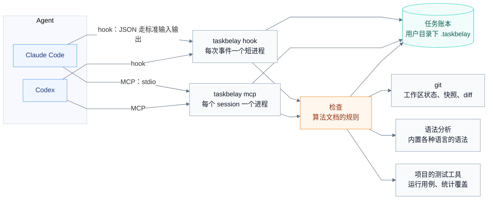
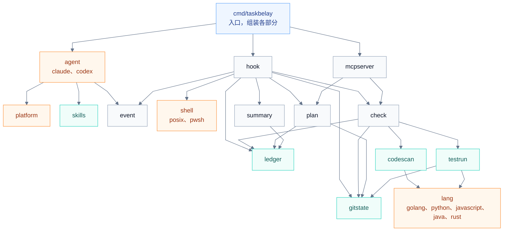
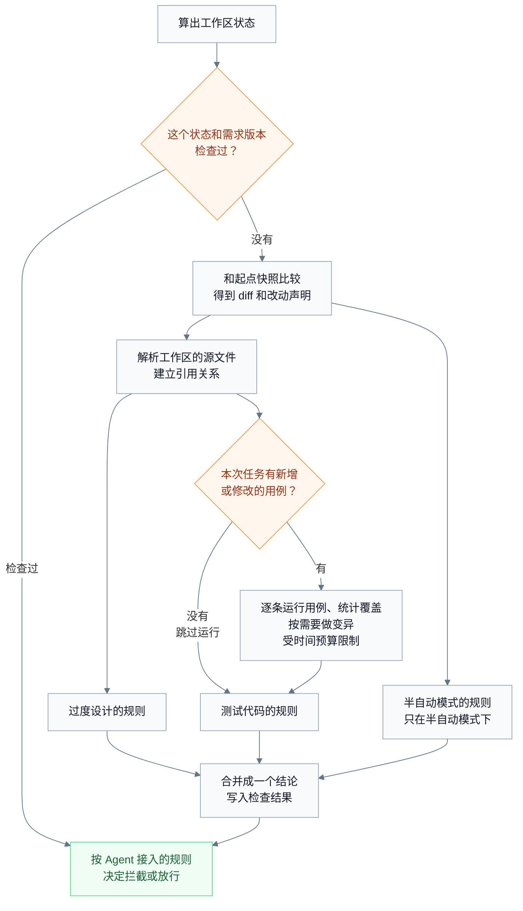

# 系统架构

TaskBelay 是一个 Go 写的命令行程序，运行在 Windows、macOS 和 Linux 上，接入 Claude Code 和 Codex。它没有常驻进程：Agent 每触发一次 hook，就启动一个短进程，处理完立刻退出；每个 Agent session 各自启动一个 MCP server 进程，session 结束时随之退出。这些进程通过同一个 SQLite 文件共享任务账本，通过 git 命令读取工作区，用内置的语法分析读代码，通过项目自己的测试工具运行测试。

所有工作都由 Agent 的事件触发，每次事件起一个短进程就够了，也省去了常驻进程的启动、保活、升级和多版本共存这些问题。

## 组成



## 命令

| 命令 | 做什么 | 谁用 |
| --- | --- | --- |
| `taskbelay install claude`、`taskbelay install codex` | 接入 Agent，见 [Agent 接入](product-agent-integration.md) | 用户 |
| `taskbelay uninstall claude`、`taskbelay uninstall codex` | 移除接入 | 用户 |
| `taskbelay status` | 显示当前工作区的接续摘要和最近一次检查结果 | 用户 |
| `taskbelay check` | 在当前工作区立即检查并打印结果 | 用户 |
| `taskbelay config get <设置项>` | 显示一项设置当前的值，设置项是 `workflow` 或 `enforcement` | 用户 |
| `taskbelay config set workflow auto` 或 `semi` | 设置工作模式：全自动或半自动 | 用户 |
| `taskbelay config set enforcement block` 或 `hint` | 设置拦截强度：拦截一次或只提示 | 用户 |
| `taskbelay hits --since 14d` | 导出最近的拦截命中和 Agent 的处理方式，见 [算法评估](product-evaluation.md) | 维护者 |
| `taskbelay hook <agent> <事件>` | 处理一次 hook 调用 | Agent |
| `taskbelay mcp` | 运行 MCP server | Agent |

## 项目结构

TaskBelay 要在三个平台上接入两个 Agent，检查各种语言的代码。项目结构围绕四处差异来组织：

- **Agent**：Claude Code 和 Codex 的 hook 输入输出格式、工具名、配置文件和 skill 目录各不相同。
- **平台**：Windows 和另外两个平台的用户目录、程序文件名、hook 命令的写法不同；macOS 和 Linux 之间在这些方面相同。
- **命令写法**：Agent 运行的命令有 POSIX 和 PowerShell 两种写法，用哪种取决于 Agent 和平台。
- **编程语言**：各种语言的接口、错误类型、对外入口、测试框架写法不同，运行一条用例的方式也不同。

这四处差异各自只出现在一个目录里。其余代码只和统一的事件、决定、声明和用例打交道，不知道自己面对的是哪个 Agent、哪个平台、哪种语言。

### 代码目录

```text
cmd/taskbelay/          命令行入口：解析子命令，把下面各部分组装起来
internal/
  event/                统一的事件和决定
  agent/                Agent 适配器的接口和已注册的适配器列表
    claude/             Claude Code 适配器
    codex/              Codex 适配器
    hookjson/           两个适配器共用的 JSON 读写：修改 hook 配置文件，写出 hook 的输出
  platform/             平台差异，分 platform_unix.go（macOS、Linux）和 platform_windows.go
  shell/                把命令拆段、分类
    posix/              bash、zsh、Git Bash 的写法
    pwsh/               PowerShell 的写法
  hook/                 每个事件该做什么，和具体 Agent 无关
  check/                算法文档里的规则、结论和参数表
  plan/                 半自动模式：方案的保存、确认，待确认期间的编辑拦截
  summary/              接续摘要和事前提示的文字
  mcpserver/            MCP 工具
  ledger/               任务账本的读写
  gitstate/             工作区状态、快照、diff
  lang/                 各种语言的规则表，和 languages.md 的“各语言的规则”一一对应
    golang/
    python/
    javascript/         JavaScript 和 TypeScript
    java/
    rust/
  codescan/             代码分析：用 tree-sitter 解析源文件，得到声明、引用、改动声明和各种用法
  testrun/              运行用例：单独运行一条用例、读出执行过的行，在临时副本里做变异
skills/                 内置的两个 skill。这个目录本身是一个 Go 包，用 go:embed 把两个 skill 打包进程序，适配器安装时复制给 Agent
  write-technical-plans/
  write-a-well-document/
eval/                   判定例子集和端到端对比脚本
```

各目录之间的依赖只朝下：



橙色是放平台、Agent、命令写法和语言差异的地方。`hook` 只认识 `event` 里的统一事件，不导入任何 Agent 的适配器；一次 hook 调用由 `cmd/taskbelay` 串起来：找到对应的适配器，把输入转成统一事件，交给 `hook` 处理，再把得到的决定交回适配器，转成这个 Agent 要的输出。

### 统一的事件和决定

`event` 定义 TaskBelay 关心的六种事件，以及处理之后给出的决定。每个事件都带 Agent、session、轮次和工作目录。

| 事件 | 来自哪个 hook | 带什么 |
| --- | --- | --- |
| session 开始 | SessionStart | 开始方式：新开、恢复、清空、压缩之后、分叉 |
| 用户消息 | UserPromptSubmit | 消息原文 |
| 命令请求 | PreToolUse，shell 工具 | 命令文本、命令写法（POSIX 或 PowerShell）、工具调用编号 |
| 编辑请求 | PreToolUse，编辑工具 | 要改的文件列表 |
| 命令结束 | PostToolUse、PostToolUseFailure | 工具调用编号、结果（通过、失败、未知）、退出码 |
| 准备结束 | Stop | 无 |

决定有五种，可以组合：不做什么；给 Agent 补充上下文；拒绝这次工具调用；阻止结束；给用户看的提示。

### 适配器

每个 Agent 一个适配器，放在 `internal/agent/<名字>/` 下，实现同一个接口：

```go
// internal/agent
type Adapter interface {
	Name() string // "claude"、"codex"，也是 hook 命令里的 <agent>
	ParseEvent(hookEvent string, input []byte) (event.Event, error)
	RenderDecision(hookEvent string, d event.Decision) ([]byte, error)
	Install(env platform.Env, exe string) (string, error) // exe 是 taskbelay 的绝对路径，返回要告诉用户的话
	Uninstall(env platform.Env) (string, error)
}
```

适配器负责这个 Agent 的全部特殊之处：工具名对应哪种事件，命令按哪种写法解析，决定写成什么 JSON，配置文件和 skill 目录在哪里，hook 条目怎样写。这些具体是什么，见 [Agent 接入](product-agent-integration.md)。两个 Agent 的 hook 配置结构相同，用到的输出字段也相同，这两部分放在 `hookjson` 里共用；修改配置文件时保持用户原有内容和键的顺序不变。

### 平台

平台差异放在 `internal/platform` 里，用 Go 的构建约束区分：`platform_unix.go`（构建约束是 `unix`，macOS 和 Linux 共用）和 `platform_windows.go` 提供同一组函数，编译时只会选中其中一个。macOS 和 Linux 在下面这些问题上的答案相同，所以共用一个文件。它们回答这几个问题：用户目录在哪里；TaskBelay 的数据目录在哪里；程序文件叫什么；Codex 的 hook 命令在这个平台上怎样写；Codex 在这个平台上用哪种命令写法。Claude Code 的 hook 不经过 shell，三个平台写法相同，不需要平台来回答。

平台用构建约束，不用运行时的接口，因为一个程序文件只会在一个平台上运行，编译时选定就够了。

**路径比较。** 同一个目录在不同地方可能有不同的写法：Windows 和 macOS 默认不区分大小写，Linux 区分；macOS 上 `/tmp` 是 `/private/tmp` 的符号链接；Windows 上分隔符可能是 `\` 也可能是 `/`。hook 输入里的 `cwd`、编辑工具给出的文件路径、git 给出的根目录，写法不一定一致。所以工作区一律取 `git rev-parse --show-toplevel` 的结果，并解析符号链接；比较两个路径之前先统一成正斜杠，在 Windows 和 macOS 上不区分大小写，在 Linux 上区分。这条规则也由 `internal/platform` 提供，macOS 和 Linux 只在区不区分大小写这一点上不同。

### 命令写法

`internal/shell` 把一条命令拆成几段，并给出每段的命令名，供 [过度测试判定](over-testing.md) 分类。`posix/` 基于 `mvdan.cc/sh` 解析 bash、zsh 和 Git Bash 的写法；`pwsh/` 是自己写的 PowerShell 解析，只做拆段、去掉引号、识别命令名和别名这几件事，规则少，不值得引入依赖。用哪一个，由适配器在命令请求事件里写明。

### 语言

`internal/lang` 下每种语言一个子目录，各提供一张规则表：一个结构体，字段和 [语言支持](languages.md) 规则表里的各项一一对应，比如扩展名、测试代码在哪里、接口的实现怎样认、对外入口有哪些写法。没有规定的字段留空，`codescan` 就按通用做法处理，通用做法也没有的，对应的检查不做。测试级的语言另外实现一个 `Runner`：从语法树里列出用例和用例名，单独运行一条用例并返回执行过的行，算出一条测试命令跑的范围和受影响的范围。

没有子目录的语言，只要内置语法里有它和它的 tags 查询，`codescan` 就按通用做法分析，它就是代码级的语言。

### 怎样扩展

| 要做的事 | 改哪里 |
| --- | --- |
| 接入一个新的 Agent | 在 `internal/agent/` 下加一个子目录，实现 `Adapter`，加进适配器列表。这个 Agent 用了新的命令写法时，在 `internal/shell/` 下加一个子目录 |
| 支持一个新的平台 | 在 `internal/platform/` 下加一个对应后缀的文件，提供同一组函数；必要时在各适配器里补上这个平台的 hook 写法 |
| 加一种语言的规则 | 在 `internal/lang/` 下加一个子目录，填好规则表，同时在 [语言支持](languages.md) 里加一张表；要支持到测试级，再实现 `Runner`。内置语法里没有这门语言时，先在 gotreesitter 里加上它的语法和 tags 查询 |
| 修改算法 | `internal/check` 和 `internal/plan`；参数集中在 `internal/check/params.go`，和算法文档的参数表一一对应 |

接口和构建约束只用在现在就有两种以上实现的地方：两个 Agent，两类平台（macOS 和 Linux 一类，Windows 一类），两种命令写法，五张语言规则表（JavaScript 和 TypeScript 共用一张）。这和 [过度设计判定](over-design.md) 对抽象的要求一致。

## 关键流程

### 用户发消息

UserPromptSubmit 触发一个短进程：适配器把输入转成用户消息事件；`hook` 算出当前工作区状态，把消息原文、session、轮次和工作区状态写进账本，再查上一轮有没有没解决的提示，有就作为补充上下文交回去。

### Agent 运行命令前

PreToolUse 触发一个短进程：适配器给出命令文本和写法，`shell` 把命令拆段、分类。绝大多数命令里没有验证命令，到这里就结束。有验证命令时，再算工作区状态，查这个 session 的验证记录，按验证过程的规则判断；对写了受影响范围的测试命令，还要由这门语言的 `Runner` 算出它会跑哪些测试，比如对 `go test` 用 `go list` 展开包参数。

### Agent 用编辑工具改文件前

PreToolUse 触发一个短进程：只有当前任务是半自动模式、方案在等确认时，`plan` 才检查要改的文件是否在工作区里，在就拒绝这次编辑。其余情况立刻结束。

### Agent 准备结束

Stop 触发一个短进程，是最重的一步：



检查结果按工作区状态和需求版本保存，两者都没变就不再检查。Agent 先调用了 `check_run`、之后什么都没改就结束时，Stop 直接用已有的结果，不用再等一遍。

## 工作区状态和快照

**工作区状态**是工作区全部文件内容的一个 git tree 哈希，算法是：把工作区的 git 索引复制一份到临时文件，用 `GIT_INDEX_FILE` 指向这份副本，运行 `git add -A`，再运行 `git write-tree`。复制的索引里有每个文件上次的大小和修改时间，没变的文件不用重新读取，所以大仓库里也很快。改的始终是副本，用户真正的索引保持原样，`git status` 看到的东西不受影响。路径一律通过 git 命令得到（比如 `git rev-parse --git-path index`），这样 worktree 也能正常处理。Windows 上同样用这几条 git 命令，换行符按仓库的 `core.autocrlf` 设置处理，和用户自己 `git add` 时一致。

**起点快照**是起点消息到达时的工作区状态（定义见 [任务和需求](requirements.md)）。TaskBelay 用 `git commit-tree` 给这个 tree 包一个 commit，再用 `refs/taskbelay/<任务编号>` 这个引用指向它，任务结束时删除这个引用。这样做是为了防止快照被 `git gc` 清掉，同时又不会出现在分支列表里。其他工作区状态只写进 git 对象库，不加引用，由 git 按自己的规则清理。

**diff** 用 `git diff <起点快照> <当前状态>` 得到。

这套做法的一个副作用是：没被 `.gitignore` 忽略的大文件，比如误放在工作区里的构建产物，也会被写进 git 对象库。

## 代码分析

- **解析**：用 gotreesitter 解析工作区状态里 TaskBelay 能解析语法的源文件，生成的代码和依赖目录下的文件除外。gotreesitter 是 tree-sitter 的纯 Go 实现，各种语言的语法和 tags 查询都打包在程序里，不需要 cgo，也不需要机器上装各语言的工具链。
- **声明和改动声明**：按 [语言支持](languages.md) 的做法从语法树里取出声明。从 git 里读出改动文件在起点快照中的版本，同样解析，按“文件、所属类型、名字”对上同一个声明，再比较两边的叶子节点序列，分辨出“只改了格式”“只改了字面量和注释”“只改了名字”这几种情况。
- **引用关系**：每个声明里出现的标识符，按名字连到同名的声明。所有声明的名字先建一张索引，查一个名字只要一次查表。
- **用法统计**：[过度设计判定](over-design.md) 里要数的各种用法，按 [语言支持](languages.md) 里各语言的写法，从语法树里数出来。

## 运行用例

- **选择运行方式**：每条用例按它所在测试文件的语言，交给这门语言的 `Runner`。具体命令见 [语言支持](languages.md)。
- **逐条运行**：每条新增和修改的用例单独运行一次，覆盖结果写到临时目录，读出它执行过的行。能先编译、再逐条运行的语言先编译一次，比如 Go 为每个测试包编译一个测试程序，Windows 上编译出的程序以 `.exe` 结尾。
- **变异**：在临时副本里做。用 `git archive` 把当前工作区状态的文件导出到临时目录，再把规则表列出的依赖目录链接过去；每做一个变异，把改过的源文件写进副本，运行组里的用例，再把文件改回来。用户工作区里的文件始终保持原样。
- **时间预算**：整个测试部分受 [过度测试判定](over-testing.md) 参数表里的时间预算限制，按 CPU 核数并行运行，到时间就停下。

用例在用户的工作区里运行，和 Agent 自己运行测试时一样，会有同样的副作用，比如写临时文件、连本地数据库。

## 存储

TaskBelay 的数据都放在用户目录下的 `.taskbelay` 目录里，macOS 和 Linux 上是 `~/.taskbelay`，Windows 上是 `%USERPROFILE%\.taskbelay`。

- **账本**：`taskbelay.db`，一个 SQLite 文件，所有工作区共用。用 `modernc.org/sqlite`，纯 Go 实现，不需要 cgo，三个平台都能直接编译。打开 WAL 模式，等锁超时设为 5 秒。两个 Agent 的多个 hook 进程和 MCP server 同时读写时，由 SQLite 保证写入一个接一个进行。记什么、保留多久见 [任务账本](requirements-ledger.md)。
- **方案**：`plans/<任务编号>/v<版本>.md`。`plan_save` 收到方案正文和三项清单后，由 TaskBelay 写成文件，“涉及的改动”一节附在末尾。方案放在工作区之外，不会出现在任务的 diff 里。
- **快照**：存在工作区自己的 git 对象库里，做法见上面的“工作区状态和快照”一节。
- **设置**：工作模式和拦截强度两项设置存在账本里。
- **日志**：`logs/`，按天一个文件，保留 7 天。

## 性能预算

用户能感受到的速度要求，写在 [产品需求](product.md) 的成功标准里；运行测试的时间预算，写在 [过度测试判定](over-testing.md) 的参数表里。为了达到这些要求，下面几个环节另有自己的预算：

| 环节 | 预算 |
| --- | --- |
| PreToolUse，命令里没有验证命令 | 50 毫秒内。Agent 运行的绝大多数命令走这条路，它决定了 TaskBelay 会不会拖慢 Agent |
| PreToolUse，编辑工具 | 50 毫秒内，理由同上 |
| SessionStart | 1 秒内 |
| `check_run` 以外的 MCP 工具 | 1 秒内 |

## 依赖

| 依赖 | 用途 |
| --- | --- |
| `github.com/odvcencio/gotreesitter` | 解析各种语言的源代码，自带语法和 tags 查询 |
| `modernc.org/sqlite` | 账本存储 |
| `github.com/modelcontextprotocol/go-sdk` | MCP server，官方的 Go SDK |
| `mvdan.cc/sh/v3` | 解析 POSIX 写法的命令 |

运行时还需要：`git` 2.5 或更高版本（`git rev-parse --git-path` 从 2.5 开始有），Windows 上是 Git for Windows；检查测试代码时，需要项目自己的测试工具和 [语言支持](languages.md) 列出的覆盖率工具；安装接入时需要 `claude` 或 `codex` 命令，Claude Code 要 2.1.139 或更高版本（hook 的 exec 形式从这个版本开始有）。

## 平台和安装

支持 Windows、macOS 和 Linux。用 `go install github.com/Innocent-children/taskbelay/cmd/taskbelay@latest` 安装，需要 Go 1.26；Windows 上装好的程序是 `taskbelay.exe`。

## TaskBelay 自己的测试

TaskBelay 自己的测试按 [过度测试判定](over-testing.md) 的规则来写。判定规则的行为由 `eval/cases` 里的例子集验证，`internal/check` 不再为同样的行为另写一套用例。例子集在三个平台上怎样运行，见 [算法评估](product-evaluation.md)。
