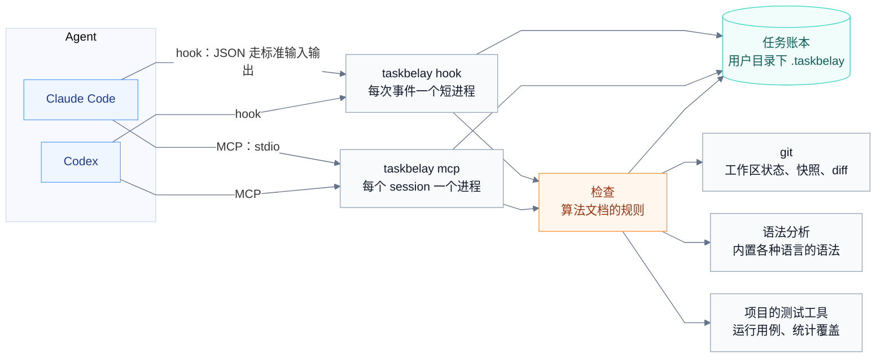
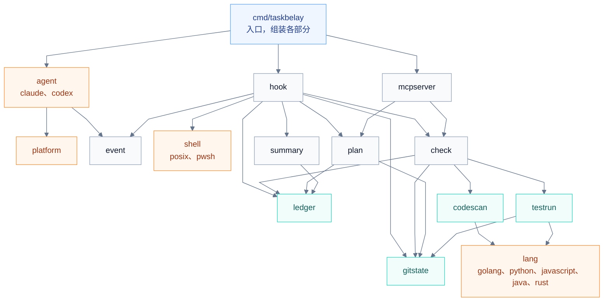
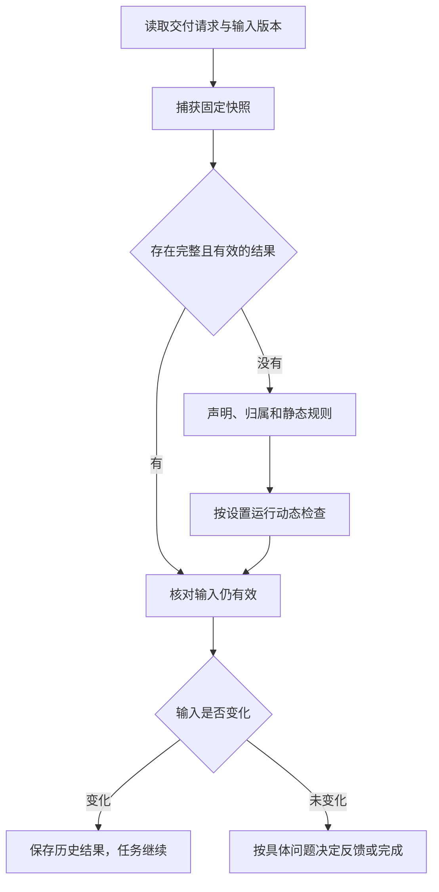

# 系统架构

TaskBelay 是一个 Go 写的命令行程序，运行在 Windows、macOS 和 Linux 上，接入 Claude Code 和 Codex。它没有常驻进程：Agent 每触发一次 hook，就启动一个短进程，处理完立刻退出；每个 Agent session 各自启动一个 MCP server 进程，session 结束时随之退出。这些进程通过同一个 SQLite 文件共享任务账本，通过 git 命令读取工作区，用内置的语法分析读代码，通过项目自己的测试工具运行测试。

开发期间的自动工作由 Agent 事件触发，每次事件启动短进程；用户也可用命令主动查看状态和运行检查。

## 组成



## 命令

| 命令 | 做什么 | 谁用 |
| --- | --- | --- |
| `taskbelay`、`taskbelay menu` | 打开终端管理菜单；无参数且没有交互终端时显示帮助 | 用户 |
| `taskbelay --version`、`taskbelay doctor` | 查看版本、本机程序路径、Agent 命令与接入状态 | 用户 |
| `taskbelay update` | 校验下载包后更新由安装脚本管理的程序 | 用户 |
| `taskbelay uninstall --all` | 移除本机两个 Agent 的接入和受管理程序，保留账本；需交互确认，脚本可显式加 `--yes` | 用户 |
| `taskbelay install claude`、`taskbelay install codex` | 接入 Agent，见 [Agent 接入](product-agent-integration.md) | 用户 |
| `taskbelay uninstall claude`、`taskbelay uninstall codex` | 移除接入 | 用户 |
| `taskbelay status` | 显示当前任务、可恢复任务、接续摘要和最近检查 | 用户 |
| `taskbelay check`、`taskbelay check --tests` | 在当前工作区检查；--tests 请求一次动态检查 | 用户 |
| `taskbelay config get <设置项>` | 显示合并后的有效设置和来源 | 用户 |
| `taskbelay config set workflow auto` 或 `semi` | 设置默认工作模式；`--project` 或 `--task` 指定作用范围 | 用户 |
| `taskbelay config set enforcement block` 或 `hint` | 设置拦截强度；支持用户、项目和当前任务范围 | 用户 |
| `taskbelay config set analysis.tests on` 或 `off` | 开启或关闭动态检查，支持 `--project`、`--task` | 用户 |
| `taskbelay config set debug on` 或 `off` | 开启或关闭详细过程记录，支持 `--project`、`--task`，也可从常用设置菜单操作 | 用户 |
| `taskbelay hits --since 14d` | 导出最近的拦截命中和 Agent 的处理方式，见 [算法评估](product-evaluation.md) | 维护者 |
| `taskbelay hook <agent> <事件>` | 处理一次 hook 调用 | Agent |
| `taskbelay mcp` | 运行 MCP server | Agent |

## 项目结构

TaskBelay 要在三个平台上接入两个 Agent，检查各种语言的代码。项目结构围绕四处差异来组织：

- **Agent**：Claude Code 和 Codex 的 hook 输入输出格式、工具名和配置文件各不相同。
- **平台**：Windows 和另外两个平台的用户目录、程序文件名、hook 命令的写法不同；macOS 和 Linux 之间在这些方面相同。
- **命令写法**：Agent 运行的命令有 POSIX 和 PowerShell 两种写法，用哪种取决于 Agent 和平台。
- **编程语言**：各种语言的接口、错误类型、对外入口、测试框架写法不同，运行一条用例的方式也不同。

这四处差异各自只出现在一个目录里。其余代码只和统一的事件、决定、声明和用例打交道，不知道自己面对的是哪个 Agent、哪个平台、哪种语言。

### 代码目录

```text
cmd/taskbelay/          命令行入口：解析子命令，把下面各部分组装起来
internal/
  distribution/         发布包下载、校验和受管理程序的更新、卸载
  terminal/             终端菜单、按键选择；具体操作由命令行入口调用已有服务
  event/                统一的事件和决定
  agent/                Agent 适配器的接口和已注册的适配器列表
    claude/             Claude Code 适配器
    codex/              Codex 适配器
    hookjson/           两个适配器共用的 JSON 读写：修改 hook 配置文件，写出 hook 的输出
  platform/             平台差异，分 platform_unix.go（macOS、Linux）和 platform_windows.go
  shell/                把命令拆段、分类
    posix/              bash、zsh、Git Bash 的写法
    pwsh/               PowerShell 的写法
  hook/                 每个事件该做什么，和具体 Agent 无关
  check/                算法文档里的规则、结论和参数表
  plan/                 半自动模式：方案的保存、确认，待确认期间的编辑拦截
  summary/              接续摘要和事前提示的文字
  mcpserver/            MCP 工具
  ledger/               任务账本的读写、按任务保存 debug 过程记录
  gitstate/             工作区状态、快照、diff
  lang/                 各种语言的规则表，和 languages.md 的“各语言的规则”一一对应
    golang/
    python/
    javascript/         JavaScript 和 TypeScript
    java/
    rust/
  codescan/             代码分析：用 tree-sitter 解析源文件，得到声明、引用、改动声明和各种用法
  testrun/              运行用例：单独运行一条用例、读出执行过的行，在临时副本里做变异
```

各目录之间的依赖只朝下：



橙色是放平台、Agent、命令写法和语言差异的地方。`hook` 只认识 `event` 里的统一事件，不导入任何 Agent 的适配器；一次 hook 调用由 `cmd/taskbelay` 串起来：找到对应的适配器，把输入转成统一事件，交给 `hook` 处理，再把得到的决定交回适配器，转成这个 Agent 要的输出。

### 统一的事件和决定

`event` 定义 TaskBelay 关心的七种事件，以及处理之后给出的决定。每个事件都带 Agent、session、轮次和工作目录。

| 事件 | 来自哪个 hook | 带什么 |
| --- | --- | --- |
| session 开始 | SessionStart | 开始方式：新开、恢复、清空、压缩之后、分叉 |
| 用户消息 | UserPromptSubmit | 消息原文 |
| 命令请求 | PreToolUse，shell 工具 | 命令文本、命令写法（POSIX 或 PowerShell）、工具调用编号 |
| 编辑请求 | PreToolUse，编辑工具 | 文件列表、前置内容和拟写入内容或补丁 |
| MCP 调用身份 | PreToolUse，需要补齐 MCP 身份的 Agent | 工具调用编号、工具名；仅建立调用到 session 和轮次的对应关系 |
| 工具结束 | PostToolUse、PostToolUseFailure | 工具调用编号、实际编辑或命令结果、可取得的退出码 |
| 准备结束 | Stop | 无 |

决定有五种，可以组合：不做什么；给 Agent 补充上下文；拒绝这次工具调用；阻止结束；给用户看的提示。

### 适配器

每个 Agent 一个适配器，放在 `internal/agent/<名字>/` 下，实现同一个接口：

```go
// internal/agent
type Adapter interface {
	Name() string // "claude"、"codex"，也是 hook 命令里的 <agent>
	ParseEvent(hookEvent string, input []byte) (event.Event, error)
	RenderDecision(hookEvent string, d event.Decision) ([]byte, error)
	Install(env platform.Env, exe string) (string, error) // exe 是 taskbelay 的绝对路径，返回要告诉用户的话
	Uninstall(env platform.Env) (string, error)
}
```

适配器负责这个 Agent 的全部特殊之处：工具名对应哪种事件，命令按哪种写法解析，决定写成什么 JSON，配置文件在哪里，hook 条目怎样写。这些具体是什么，见 [Agent 接入](product-agent-integration.md)。两个 Agent 的 hook 配置结构相同，用到的输出字段也相同，这两部分放在 `hookjson` 里共用；修改配置文件时保持用户原有内容和键的顺序不变。

MCP 的原生身份字段也由适配层读取，入口负责把身份交给共用账本。Claude Code 的调用身份事件只做短事务登记，不采集完整快照、不检查工具业务参数，也不返回权限决定。MCP 进程随后按同一工作区、session 和原生工具调用编号回读轮次；字段或前置记录缺失时拒绝身份不明的写入，仍允许只读查询。

### 平台

平台差异放在 `internal/platform` 里，用 Go 的构建约束区分：`platform_unix.go`（构建约束是 `unix`，macOS 和 Linux 共用）和 `platform_windows.go` 提供同一组函数，编译时只会选中其中一个。macOS 和 Linux 在下面这些问题上的答案相同，所以共用一个文件。它们回答这几个问题：用户目录在哪里；TaskBelay 的数据目录在哪里；程序文件叫什么；Codex 的 hook 命令在这个平台上怎样写；Codex 在这个平台上用哪种命令写法。Claude Code 的 hook 不经过 shell，三个平台写法相同，不需要平台来回答。

平台用构建约束，不用运行时的接口，因为一个程序文件只会在一个平台上运行，编译时选定就够了。

**路径比较。** 工作区采用 git 返回的规范根目录，并解析已存在路径的符号链接。路径统一分隔符，大小写规则读取实际卷或目录属性，不按操作系统一律转成小写。新文件通过最近的已存在父目录定位；工作区身份同时使用 git 目录与 worktree 信息。

### 命令写法

`internal/shell` 把一条命令拆成几段，并给出每段的命令名，供 [过度测试判定](over-testing.md) 分类。`posix/` 基于 `mvdan.cc/sh` 解析 bash、zsh 和 Git Bash 的写法；`pwsh/` 是自己写的 PowerShell 解析，只做拆段、去掉引号、识别命令名和别名这几件事，保留引号内字面值并识别重定向；未识别的结构归入其他命令，交给原 shell 照常执行。用哪一个，由适配器在命令请求事件里写明。

### 语言

`internal/lang` 下每种语言一个子目录，各提供一张规则表：一个结构体，字段和 [语言支持](languages.md) 规则表里的各项一一对应，比如扩展名、测试代码在哪里、接口的实现怎样认、对外入口有哪些写法。没有规定的字段留空，`codescan` 就按通用做法处理，通用做法也没有的，对应的检查不做。测试级的语言另外实现一个 `Runner`：从语法树里列出用例和用例名，单独运行一条用例并返回执行过的行，算出一条测试命令跑的范围和受影响的范围。

没有子目录的语言，只要内置语法里有它和它的 tags 查询，`codescan` 就按通用做法分析，它就是代码级的语言。

### 怎样扩展

| 要做的事 | 改哪里 |
| --- | --- |
| 接入一个新的 Agent | 在 `internal/agent/` 下加一个子目录，实现 `Adapter`，加进适配器列表。这个 Agent 用了新的命令写法时，在 `internal/shell/` 下加一个子目录 |
| 支持一个新的平台 | 在 `internal/platform/` 下加一个对应后缀的文件，提供同一组函数；必要时在各适配器里补上这个平台的 hook 写法 |
| 加一种语言的规则 | 在 `internal/lang/` 下加一个子目录，填好规则表，同时在 [语言支持](languages.md) 里加一张表；要支持到测试级，再实现 `Runner`。内置语法里没有这门语言时，先在 gotreesitter 里加上它的语法和 tags 查询 |
| 修改算法 | `internal/check` 和 `internal/plan`；参数保留在负责算法的模块，D4/E1 在 `internal/check/abstractions.go`，测试风险建议在 `internal/check/test_risk.go`，变异数量与并行数在 `internal/testrun/analysis.go`，事件预算在 `internal/event/event.go`，交付次数在 `internal/ledger/issues.go` |

Agent 适配器、两种命令解析器和语言 Runner 各自实现统一接口；平台函数由构建约束选择。JavaScript 和 TypeScript 共用一张语言规则表。

## 关键流程

### 用户消息与任务接续

适配器把消息转成统一事件，记录原文与工作区快照。`hook` 核对上下文、当前任务及未被编辑记录解释的文件变化，写入账本，再交给 `summary` 生成必要的补充内容。任务的起点和生命周期由 [任务和需求](requirements.md) 定义。

SessionStart 也读取当前文件状态。恢复 session 时比较账本修订和实际状态，用户在 Agent 停下期间手改的内容因此进入摘要。

### 编辑前后

PreToolUse 只读取目标文件，得到当前 blob 标识，核对最近观察及工具请求的前置内容。`Edit` 的原文、`apply_patch` 的上下文和 `Write` 的整份目标内容都作为请求保存。规范化后的同一文件只准备一次，保存对应的原始操作下标；单文件无法核对、工作区外目标或路径错误不取消其他文件的准备。发现当前内容已变时，把变化位置交给 Agent；编辑与更新相交时按拦截强度退回过期请求或补充冲突信息，其他片段继续编辑。

编辑结束后，重新读取目标文件。预期改动与实际前后内容能对应时保存 Agent 编辑；多出的内容记为工作区更新。记录采用文件与片段的内容标识，只有移动或改名能唯一对应时才自动迁移逻辑位置。没有足够信息的 shell 写入在下一次完整观察中作为工作区更新保存。

Agent 的读文件动作不需要由 TaskBelay 全量追踪。发生冲突后，Agent 按当前内容重新组织编辑；TaskBelay 每次核对具体前置内容，不靠“已经提醒过”就允许过期内容覆盖。没有可核对前置内容的整文件写入，若与工作区更新重叠，Agent 先读取当前文件，再用带当前上下文的编辑表达改动。

### 命令前后

`shell` 解析执行目录、参数、环境前缀和命令段。没有验证命令时走快速路径。有验证时，再计算输入状态，读取验证记录和当前重跑决定。V1 的完整条件由 [过度测试判定](over-testing.md) 定义。

后置事件补充命令结果。无法核对退出状态的记录保持未知；不能从输出为空推断成功。命令前的环境标识只保存比较摘要，原始凭据不进入账本。

### 交付

`task_finish` 在短事务中保存待交付请求及本轮任务编号，立即返回已有检查。Stop 根据该请求组织检查；普通停顿只保存观察和已有提示。



检查输入包含任务、快照、需求、方案、编辑记录、规则、分析设置和工具能力版本。静态结果与动态结果分开复用。静态检查只复用同输入的最新 `complete` 记录；仅有 `unsupported` 能力边界的检查可以完整，但未知判断不会变成“无问题”。`error`、`incomplete` 和未分类缺口使结果不完整，不能跳过较新的异常或过期记录去复用旧结果。复用前重新采集当前 tree，并在读事务中核对当前任务、输入和最新检查身份；主动刷新重新执行。未变化的观察和 hook 活动不增加输入修订。

检查完成时再次核对输入修订和当前状态，再用短事务发布结果和交付状态。期间有用户修改或其他 session 写入时，结果保留为历史，当前任务继续进行。计算和测试期间不持有数据库写锁，不锁工作区，不循环重试直到工作区停止变化。

## 工作区状态和快照

工作区状态用 git tree 表示。复制当前索引到临时文件，以 `GIT_INDEX_FILE` 指向副本，运行 `git add -A` 和 `git write-tree`。真正的索引不变，暂存与未暂存的划分保留。索引路径由 `git rev-parse --git-path index` 获取，worktree 分别处理。

快照包含 git 管理的文件和未忽略的新文件。子模块与嵌套仓库记录边界和所引用版本；需要检查其中的修改时，按各自工作区建立任务联系，不把它们当作普通目录展开。

起点、恢复观察点和检查所需的内容通过 `refs/taskbelay/<归属编号>/<快照编号>` 保留。归属编号使用任务编号，尚未绑定任务时使用工作区、Agent 和 session 的组合摘要。新引用由只创建语义的 `update-ref` 直接指向 tree；完整快照与原始文件、预期编辑内容的证据 tree 分别保留。旧 commit 引用继续解析到 tree，保持到正常到期。

每个引用创建前先在账本 `cleanup_items_v11` 登记工作区、完整引用名、预期对象及三十天后的处理时间。登记失败不创建引用；创建后，观察发布事务核对登记并一起保存实际对象、类型、工作区归属和撤销清理项。观察发布失败、只创建部分引用或进程退出时，登记继续提供回收依据。正常到期删除观察时也在事务内入队，提交后才释放 Git 引用。

维护先核对是否仍被任务或观察引用；仍有引用时保留对象并完成本次队列项。没有引用时核对工作区、命名空间、对象类型和预期对象，拒绝符号引用，使用 `update-ref --no-deref` 和旧对象编号比较删除。对象改变时保留并记录原因。旧版未入账 commit 仅在超过三十天、作者和邮箱为 TaskBelay、主题为快照且没有父提交时发现，带实际对象编号入队；tree 只按预登记回收。共享文件表不合并各工作区的 Git 引用。

累计 diff 用起点快照与当前 tree 比较，和用户提交了多少次无关。工作区更新与 Agent 编辑分别存证，不通过 commit 作者猜测来源。大文件采集纳入快照预算，结果中记录未完成的范围，不为采集修改用户的忽略规则。

## 代码分析

- 用 gotreesitter 解析固定 tree 中支持的源文件，语法和 tags 查询内置，无需 cgo。
- 以文件、所属类型和名字定位声明，比较叶子节点序列，区分格式、字面量、注释和名字变化。
- 声明改名或移动时，先采用工具记录，再尝试唯一结构匹配。匹配不唯一时保留旧位置和待更新标记。
- 引用按名字建立候选索引，分析用到候选集合时计入预算。归属与各条规则使用 [语言支持](languages.md) 的具体方式。
- 项目惯例读取起点版本，用户之后的约定作为单独决定参与分析。

## 运行测试

所有动态分析围绕一次固定快照，在临时目录导出源文件。Runner 使用项目已有的工具链、命令前缀、准备步骤和测试选择方式，确认覆盖率对应的是副本源码，再运行基线和变异。

依赖目录按语言与项目配置复用，源码和构建产物放在临时目录，运行输出也写入临时目录。访问数据库、服务和端口的测试使用项目声明的环境及并行条件。默认串行；可独立运行的用例可按配置并行，最多四个。

每种 Runner 都执行准备、枚举、编译、单条运行、覆盖读取和终止，返回有效结果及运行错误的分类。编译失败或基础设施失败不记作变异被发现。120 秒预算覆盖整个动态阶段；到期或收到取消时终止本次启动的进程组并清理临时资源。

项目未开启动态检查时，Stop 只使用静态结果和已有验证记录；`check_run(depth="tests")` 可以请求一次动态检查。准备过程无法在预算内完成时，保存已经完成的观察。

## 存储和修订

数据目录在 macOS、Linux 为 `~/.taskbelay`，Windows 为 `%USERPROFILE%\\.taskbelay`。

- `taskbelay.db` 使用 modernc.org/sqlite，开启 WAL。观察、编辑、需求与方案修订、问题和 hook 活动的字段见 [任务账本](requirements-ledger.md)。
- 方案为 `plans/<任务编号>/v<版本>.md`，保存完整方案及变更摘要。
- 起点和必要的内容证据在 git 对象库，用 TaskBelay 引用保留。
- 用户默认、项目和任务设置保存在账本里，按作用范围合并。
- `logs/` 按天记录，保留七天；任务及其引用按账本保留期限一起清理。

写入用短事务，需求和方案采用读取版本核对；旧版本冲突返回最新内容。数据库等待时间按当前事件剩余预算设置，快速事件最多等待二十毫秒，消息和普通 MCP 最多二百毫秒。失败的写入不发布半成品记录，Agent 的原工具操作照常结束。

账本使用 schema 11。初始化取得写锁后再次核对版本，在同一事务中把全部业务表切换为 `_v11` 名称、同步外键与索引、增加正文列和 `file_sets_v11`，最后提交 `user_version=11`。不留下旧表名的视图、触发器或空表，不在初始化中压缩存量正文；超过原初始化预算则整体回滚。旧程序的新 SQL 因表名或版本不兼容而失败；迁移前的旧读快照可读完原数据，但不能升级成写事务。新程序在每次 MCP 调用开始和每个账本事务内核对 schema，业务 SQL 使用同一连接和事务视图。不兼容时停止账本操作，hook 仍按自身故障放行。

完整且成功的观察把 `Files` 按路径排序编码为 JSON，以编码版本与未压缩正文的 SHA-256 识别内容，通过外键引用不可变的 `file_sets_v11`。删除标记、原始 blob 和合法空映射均保留；部分或不完整观察继续内联保存。编码、摘要和 gzip 快速压缩在写事务外准备，压缩不省空间时存 JSON；命中已有内容只核对版本、长度和摘要等元数据，不在写锁中解压全文。检查的输入、状态、问题、缺口和完成范围留在 `checks_v11.data`，完整自包含报告独立存为 gzip 或 JSON 正文列。

统一读取入口在同一事务中恢复完整观察或检查并核对正文长度与 SHA-256。正文缺失、损坏或引用不符返回含记录编号的错误；不从当前文件表或 Git 重建历史正文。尚未整理的旧记录继续按内联字段读取。维护按主键逐条准备存量正文，在写事务中复核记录存在、原文未变且仍未整理后发布；为提交预留二十毫秒，压缩超过准备预算时保存未压缩正文并标记已处理，总预算耗尽则保留原文。

SessionStart 后和状态维护使用独立的二百毫秒总预算，覆盖七天日志、到期记录、资源队列及正文整理，不继承事件已消耗的 deadline。先按索引查候选，每轮最多八个结束任务，每个任务在单独事务中复核状态、删除独占明细和任务、登记资源清理；超时整笔回滚。独立记录每类最多 256 条，按候选核对全部需求与方案修订、来源、起点与恢复点、当前文件、编辑和验证关联，不复制全部保留任务正文。最后一个观察引用删除后，以带索引的 `NOT EXISTS` 在写事务中回收共享文件表；随后释放已入队资源，最后整理保留正文。二百毫秒不保证任意大小的任务都能删完，未完成工作留待下次维护；不执行 `VACUUM`。

同一工具调用重复到达时复用其记录，避免重复建立任务或消耗授权。TaskBelay 自己的错误及本次未完成的检查，写入状态和日志。

并行观察仅增加观察编号、未改变文件修订和 Git 上下文时，原文件基线仍可发布。基线实际变化时，完整观察及编辑前后核对在原事件预算内最多重新读取和核对一次；再次冲突或预算不足就记录未完成，不用旧快照覆盖新记录，也不放宽编辑归属条件。

## 调试记录

`taskbelay config set debug on` 开启用户级 debug，`--project` 或 `--task` 缩小作用范围；`taskbelay config get debug` 查看有效值和来源，设为 `off` 停止后续调用的详细记录。新任务从用户和项目设置开始，恢复已有任务时采用该任务的覆盖值。首次升级到支持 debug 的版本后，先重新打开 Agent session，使 MCP 使用新程序，再保存 debug 设置；旧 MCP 进程不认识这个设置项。新版本 MCP 每次调用都读取有效设置，之后切换开关无需重启 session。

记录写入数据目录 `debug/<YYYY-MM-DD>/<任务唯一标识>.jsonl`，例如 `~/.taskbelay/debug/2026-10-26/t17.jsonl`。日期取事件发生时的本机日期，同一任务跨天时在各日期目录中使用相同文件名。多个 Agent、session 和短进程追加同一任务文件；每行是独立 JSON，带格式版本、时间及偏移、工作区和任务编号、Agent、session、轮次、工具调用编号、进程编号、调用追踪编号、调用内序号、阶段和累计耗时。跨进程按时间和调用编号关联，文件行顺序不代表业务因果顺序。

记录包括：

- 调用开始时的任务状态、有效设置、程序构建信息与运行平台。
- hook 的统一事件、输入长度与摘要、解析后的命令信息、编辑请求、工具结果状态和退出码；实际返回给 Agent 的决定与协议输出。
- 到达 MCP 工具处理入口的工具名、参数、身份解析结果、业务结果和错误，包括业务处理失败的调用。
- 检查输入版本、规则与能力版本、静态和动态结果是否复用、代码归属、规则结论及证据、未完成范围、工作区复核和交付结果。
- 调用结束时的任务账本视图，包含原始需求消息、需求修订、用户决定、工作区更新、检查和验证记录。已有快照与 blob 仍按原账本方式引用。

格式版本 2 将检查正文保存到同一日期目录下的 `<任务唯一标识>.checks/<SHA-256>.json`。同一天、同一任务中，相同内容只保存一份，多个进程和 session 共用；内容变化时生成新的哈希文件。JSONL 中的检查位置保留 `check_ref`、`sha256`、`bytes`，以及检查编号、深度、输入版本、状态和结论级别。`check_ref` 相对于 JSONL 所在的日期目录；动态检查正文中的静态检查也使用这种引用。正文完整写入并关闭后才发布，随后追加引用，写入失败按诊断故障记录。

检查引用只用于 debug 序列化。账本、内部检查和动态用例选择继续使用完整数据；MCP 在响应层生成有限摘要及续读入口，预算与查询方式见 [任务账本](requirements-ledger.md#mcp-工具)。MCP 的 `mcp.handle.end` 记录处理结束阶段，最终返回结果只在 `operation.end` 保存一次；`mcp.output_size` 记录业务与协议字节数及估算 token。调用结束的任务快照继续保存当时的完整账本视图，其中检查正文复用上述引用。

TaskBelay 从已知任务开始记录。创建任务的 MCP 调用可先在内存中记录开始阶段，取得任务编号后写入对应文件，并从账本带入任务起点消息；任务创建之前的 hook 不补造为详细追踪。任务切换记录前后任务编号；任务完成后仍将本次结束记录写到原任务。开启前的过程、Agent 未通过接入提供的活动及内部思考不可还原。适配器解析或账本打开之前的故障沿用错误日志，不声称已有完整任务记录。

命令沿用 shell 解析器的环境值脱敏结果，不额外复制原始 shell 输入和命令输出，也不采集进程环境。消息、需求、编辑内容和 MCP 结果按实际内容记录，文件用于本机复盘。目录使用 `0700`、文件使用 `0600` 创建，在 Windows 上由平台和用户目录 ACL 决定实际访问权限。

debug 文件及检查正文不随七天错误日志或账本保留期自动删除，关闭 debug 也不删除已有文件。用户完成复盘后自行清理，转存或清理某个任务的记录时，将 JSONL 与同名 `.checks/` 目录一起处理。升级不改写已有日志，同一文件可以包含格式 1 和格式 2 的行。

分析时读取对应任务在各日期目录下的同名文件；先核对程序版本与记录起止范围，再按调用编号串联输入、阶段和输出。格式 1 的检查直接读取内联正文；格式 2 按 `check_ref` 读取正文并核对长度和 SHA-256，遇到嵌套引用继续读取。引用文件缺失、校验不符、记录没有正常结束、阶段失败或状态未知时保留该事实，不能推断为成功。

运行构建以该进程 `operation.start.details.build` 的 Go 模块版本、`vcs.revision`、`vcs.modified` 和平台为准，不能仅按日志日期归到当前工作区。`check.cache` 区分复用和新执行；`missing.kind` 区分能力边界、错误和未完成。账本 schema 11 的正文压缩不改变 debug 的 `check_ref` 格式。更换程序后，新启动的 hook 使用新程序，旧 MCP 要重启 Agent session 才加载新程序；旧进程在迁移后的账本访问错误保留在错误日志中。

记录写入失败只进入原有错误日志，不修改业务结果、不阻止工具或交付。debug 会增加本地序列化、读账本和文件写入开销；结束快照的账本读取使用独立的二百毫秒预算，不继承快速事件的二十毫秒上限，也不修改业务连接的预算。读取未完成时显式记录失败。关闭时不创建调试目录，也不执行额外的过程快照采集。

## 性能预算

| 路径 | 目标 |
| --- | --- |
| 非验证命令前 | 五十毫秒，只解析和记录必要活动 |
| 编辑前 | 三百毫秒，只核对目标文件和授权 |
| SessionStart、UserPromptSubmit | 一秒，超时保留已采集内容，后续观察补齐 |
| 普通 MCP、task_finish | 一秒，不在事务中运行检查和测试 |
| 静态交付检查 | 五万行项目二十秒 |
| 动态检查 | 最多一百二十秒，项目选择开启 |
| check_run | 按请求深度使用对应检查预算 |
| SessionStart 后维护 | 独立二百毫秒，覆盖日志、账本、资源释放和正文整理 |

各阶段使用共同的截止时间。静态分析汇总未完成原因时使用集合去重并响应取消，按位置和检查类型保留原因示例及数量。分析预留最后一秒发布报告，工作区复核只使用其中前半段，给未完成结果的写入留出时间。达到预算时返回完成情况，下一次主动刷新可以继续未完成部分。性能通过 [算法评估](product-evaluation.md) 的场景测量。

## 依赖

| 依赖 | 用途 |
| --- | --- |
| `github.com/odvcencio/gotreesitter` | 内置语言语法和 tags 查询 |
| `modernc.org/sqlite` | 任务账本 |
| `github.com/modelcontextprotocol/go-sdk` | MCP server |
| `mvdan.cc/sh/v3` | POSIX 命令解析 |
| `golang.org/x/term` | 识别交互终端、切换和恢复终端输入模式 |
| `golang.org/x/mod/semver` | 正式版本与 Go 伪版本的语义比较 |

运行时需要 git 2.5 或更高版本；动态分析使用项目自己的测试和覆盖率工具；接入安装需要 claude 或 codex 命令。Claude Code 的 exec 形式安装要求 2.1.139 或更高版本。

## 平台和安装

Windows、macOS、Linux 分别发布 amd64、arm64 程序，并附安装脚本、`SHA256SUMS` 与 `release-manifest.json`。GitHub Actions 为正式 `vX.Y.Z` 标签构建六种产物，程序版本、元数据版本与标签一致。安装器和更新器先核对版本、提交及目标资产，再固定到该标签下载；校验和程序版本核对通过后才替换。源码安装仍支持当前检出或 `go install github.com/Innocent-children/taskbelay/cmd/taskbelay@new`，需要 Go 1.26；`@latest` 按 Go 发布版本解析，不表示 `new` 分支。安装位置、版本比较、账本升级及卸载行为见 [Agent 接入](product-agent-integration.md)。

## TaskBelay 自己的验证

长期只保留打包、安装及必要安装维护的基础测试。模块修改需要验证时，按本次确认的需求和当前实现编写临时测试，通过后删除测试代码及专用辅助资料，记录验证范围、环境、命令和结论。能通过阅读差异与引用确认的改动不为走流程新增测试。

历史规则例子和场景测试已删除，旧结果继续保留，维护范围及历史评估说明见 [算法评估](product-evaluation.md)。平台和 Agent 的实际运行结论只对应已经验证的环境。
