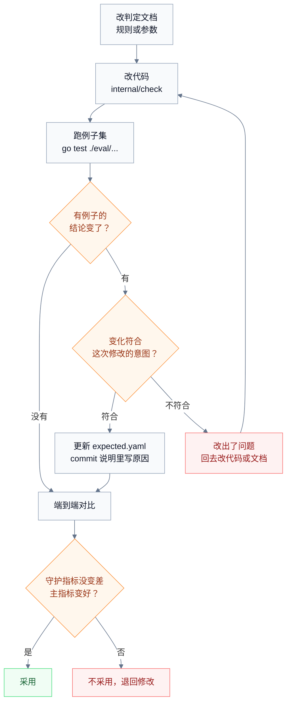

# 算法评估

[过度设计判定](over-design.md) 和 [过度测试判定](over-testing.md) 会反复修改。本文说明怎样判断一次修改是变好了还是变坏了，以及两份文档参数表里的值从哪里来。

评估用三种数据，回答三个不同的问题：

| 数据 | 回答什么 | 什么时候用 | 成本 |
| --- | --- | --- | --- |
| 判定例子集 | 规则有没有按文档写的那样判断 | 每次改规则、改参数 | 几分钟，不调用 Agent |
| 端到端对比 | 开启 TaskBelay 后，Agent 交回的改动是不是更少，而且一样正确 | 改规则或参数之后、发版之前 | 几百次 Agent 运行 |
| 日常检查记录 | 真实使用中哪些拦截是误判，有哪些漏判 | 每两周整理一次 | 人工抽查 30 条 |

前两种在开发时用，第三种来自真实使用，用来发现前两种覆盖不到的问题，并不断补充例子集。

## 判定例子集

### 一个例子包含什么

每个例子是一个目录，放在 `eval/cases/<编号>/` 下：

| 文件 | 内容 |
| --- | --- |
| `base/` | 一个小 Go 模块，是任务开始时的代码 |
| `change.patch` | Agent 的改动，基于 `base/` |
| `ledger.yaml` | 账本里和判定有关的部分：用户消息、需求、实现位置 |
| `expected.yaml` | 期望的结论，每处命中的规则编号和位置，每处放行的依据 |
| `README.md` | 一两句话说明这个例子在测什么 |

编号和算法文档里的例子一致：`OD-` 开头的是过度设计，`OT-` 开头的是过度测试，`SA-` 开头的是半自动模式。算法文档里的每个例子都在例子集里有对应的目录；例子集里还有更多例子，文档只挑有代表性的写出来。

### 例子从哪里来

- 优先用 Claude Code 和 Codex 真实产出的改动，尤其是日常使用中被误拦或漏掉的。
- 每条规则至少有一个应该命中的例子和一个不该命中的例子；每条例外至少有一个例子。
- 每处 E1 项目惯例和凭原话放行，至少有一个例子。

### 怎样运行

在仓库根目录运行 `go test ./eval/...`。它对每个例子做三件事：把 `base/` 复制到临时目录，应用 `change.patch`，按 `ledger.yaml` 构造账本；然后运行检查；最后和 `expected.yaml` 比对。结论、命中和放行全部一致，这个例子才算通过。

验证过程的规则（V1 到 V3）和半自动模式在编辑时的拦截（S1 的第 1 步）用另一种例子：`ledger.yaml` 里按顺序写一串命令或编辑，以及每一步发生时的工作区状态和方案状态，`expected.yaml` 写每一步期望的结果。命令例子同时包括 POSIX 和 PowerShell 两种写法。

例子集在 macOS、Linux 和 Windows 上都要全部通过。

### 统计

在例子集上，对每条规则统计两个数：

- **准确率**：这条规则的命中里，`expected.yaml` 也认为该命中的比例。
- **查全率**：`expected.yaml` 认为该命中的地方里，这条规则确实命中的比例。

两个数都低于 100%，说明规则和期望不一致：要么规则有问题，要么期望写错了。

### 改规则的流程

判定文档、代码和例子集的期望结果在同一个 commit 里修改，期望结果的每处变化都在 commit 说明里写明原因。

## 端到端对比

### 任务集

任务集有 30 个任务，取自 10 个开源 Go 项目里已经合并的 PR：bug 修复、小功能、小范围重构各 10 个，每个 PR 的非测试改动在 20 到 300 行之间。每个任务包括：

- **用户请求**：把 PR 描述改写成用户会说的话，只说要什么行为，不提实现方式。
- **起点**：PR 合并前的那个 commit。
- **隐藏验收测试**：PR 里的测试。Agent 工作时看不到，Agent 结束后才放进工作区运行。
- **参考改动**：PR 本身的非测试改动，用来衡量 Agent 的改动量。

另外从这 30 个任务里选 10 个，用作接续任务，见后文。

### 运行方式

每个任务在下面每种组合下各跑 3 次：

- Agent：Claude Code、Codex。
- 模式：关闭 TaskBelay、开启 TaskBelay。

一轮完整对比共 30 × 2 × 2 × 3 = 360 次运行。只验证一个小改动时，可以先用其中 10 个任务跑一轮，共 120 次，结果不好就不必再跑完整的一轮。

运行由脚本驱动，用 Agent 的无人值守模式：Claude Code 用 `claude -p`，Codex 用 `codex exec`。评估机器上事先在 Codex 里用 `/hooks` 信任一次 TaskBelay 的 hook。Agent 停下来向用户提问时，脚本在同一个 session 里回复一句固定的话：“只做我要求的部分，其余的不需要。”Claude Code 用 `claude -p --resume <session 编号>` 回复，Codex 用 `codex exec resume <session 编号>` 回复，每次运行最多回复 2 次。

开启 TaskBelay 的每次运行结束后，脚本检查账本里有没有这个 session 的 SessionStart 和 Stop 记录。缺了任何一个，说明 hook 没有运行，这次运行作废重跑，不计入结果。

同一轮对比里，Agent 的版本、模型和设置保持不变，并记录在结果里。

### 指标

| 指标 | 怎样算 | 期望 |
| --- | --- | --- |
| 改动量比 | Agent 新增的非测试代码行数 ÷ 参考改动新增的非测试代码行数 | 降低 |
| 测试量比 | Agent 新增的测试用例数 ÷ 参考改动新增的测试用例数，参考为 0 时按 1 算 | 降低 |
| 验证次数 | 一次运行里验证命令的次数 | 降低 |
| 耗时、token | Agent 一次运行的总时间和 token 用量 | 不明显增加 |
| 验收通过（守护） | 隐藏验收测试是否全部通过 | 不变差 |
| 已有测试通过（守护） | 起点已有的测试在 Agent 改完后是否仍然全部通过 | 不变差 |

测试用例按 [过度测试判定](over-testing.md) 里的方法计数，验证命令按同一份文档里的清单识别。验证次数、耗时和 token 从 Agent 无人值守模式输出的事件里统计，Claude Code 用 `--output-format stream-json`，Codex 用 `--json`。前三项指标取每组运行的中位数。

### 怎样判断开启后更好

**正确性按任务逐个比较。** 每个任务在每种模式下跑 3 次，通过 0 到 3 次。开启之后比关闭时少通过 2 次及以上，这个任务算变差；多 2 次及以上，算变好。开启后变差的任务数减去变好的任务数，不超过 2 个，正确性才算没有变差。逐个任务比较，而不是比总通过率，是因为每组只有 90 次运行，总通过率随机波动大约有 5 个百分点，比要判断的差别还大。

**三项主指标看中位数。**

- 评估 TaskBelay 本身的效果时，开启和关闭对比，标准见 [产品需求](product.md) 的成功标准。
- 评估一次规则修改时，和上一版对比：正确性没有变差，三项主指标没有一项变差超过 5%，并且至少一项变好 5% 以上，才采用这次修改。

两个 Agent 分别判断。修改只对其中一个有效、对另一个变差时不采用，先查清原因。

### 半自动模式

半自动模式另跑一组：30 个任务 × 2 个 Agent，开启 TaskBelay、工作模式设为半自动，各跑 1 次，共 60 次。脚本扮演用户：Agent 交出第一版方案后，回复“可以，按这个做”；之后 Agent 再提交新版本时，同样回复这一句。

每次运行结束后，用账本核对 [产品需求](product.md) 成功标准里“半自动”一项：方案确认之前，工作区状态始终等于待确认期间开始时的状态；任务结束时，改动过的非测试文件都在最后一版已确认方案的“涉及的文件”里。

### Windows 和 Linux 上的运行

上面的端到端对比在 macOS 上运行，用来判断算法的效果。Windows 和 Linux 上各另跑一组，确认接入在这两个平台上正常工作：从 30 个任务里取 10 个，2 个 Agent，开启 TaskBelay，各跑 1 次，每个平台 20 次。每次运行都要满足两点：账本里有这个 session 的 SessionStart 和 Stop 记录；Agent 运行过的验证命令都有验证记录。Windows 上的命令写法要覆盖 Git Bash 和 PowerShell 两种。

### 接续评估

接续评估回答的是：任务做到一半换了 Agent，新的 Agent 能不能接着做好。

1. 从 30 个任务里选 10 个。先用不中断的运行，算出 Claude Code 完成每个任务时工具调用次数的中位数。
2. 让 Claude Code 开始这个任务，工具调用次数达到中位数的一半时结束进程，不给它写总结的机会。
3. 在同一个工作区启动 Codex，只说一句“继续”。
4. 结束后运行隐藏验收测试。
5. 反过来，从 Codex 开始、换到 Claude Code，再做一遍。

每个方向、每种模式各跑 3 次，共 10 × 2 × 2 × 3 = 120 次。比较开启 TaskBelay 后接续运行的通过率和不中断时的通过率，是否达标按 [产品需求](product.md) 的成功标准判断。关闭 TaskBelay 时的接续结果作为对照，看摘要到底帮了多少。

## 日常检查记录

真实使用中的检查结果保存在账本里，保留期限见 [任务账本](requirements-ledger.md)。`taskbelay hits --since 14d` 导出最近 14 天的拦截命中，每条附上：规则编号、命中的代码片段，以及 Agent 之后怎样处理的——改掉了、凭原话放行了、没改就结束了，还是任务被中止了。处理方式由 TaskBelay 对比前后两次检查结果得出。

每两周整理一次：

1. 按规则分层抽 30 条拦截命中，人工判断该不该拦。不该拦的比例就是误判率，对应产品成功标准里的“误判”一项。
2. 误判的改动整理成例子，放进例子集，期望写成不该命中。
3. 用户发现 TaskBelay 漏掉的过度设计或过度测试，同样整理成例子，期望写成应该命中。
4. “没改就结束了”占比高的规则要重点看：可能是误判多，也可能是 Agent 没看懂反馈说明。

## 调整参数

调整两份判定文档参数表里的值时，按下面的做法：

- 一次只改一个参数，否则说不清是哪个改动起的作用。
- 先跑例子集，再跑端到端对比，判断标准和改规则相同。
- 采用之后，同时更新判定文档的参数表、代码里的参数和例子集的期望结果，commit 说明里写上这次评估的主要数字。
