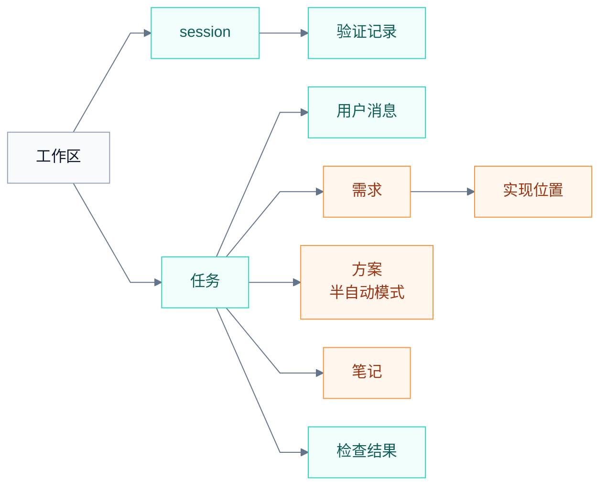

# 任务账本

任务账本是 TaskBelay 对一个任务的全部记录。[任务和需求](requirements.md)、[过度设计判定](over-design.md)、[过度测试判定](over-testing.md)、[任务接续](handoff.md) 和 [半自动模式](semi-auto.md) 要用到的数据，都由账本记下来。本文定义账本里有哪些记录、每条记录有哪些字段、谁在什么时候写、保留多久，以及 Agent 读写账本用的 MCP 工具。字段对应的概念，以上面几份文档里的定义为准。

## 谁写什么

账本里的内容分两类：一类由 TaskBelay 自动记录，Agent 改不了；另一类由 Agent 通过 MCP 工具填写。

| 内容 | 谁写 | 什么时候写 |
| --- | --- | --- |
| 用户消息 | TaskBelay | 用户每次发消息 |
| 任务 | TaskBelay | Agent 开始或结束任务时 |
| 需求和实现位置 | Agent | 开始改代码前记录需求，改完代码后列出实现位置，之后随时更新 |
| 方案 | Agent 提交，TaskBelay 记录版本和确认状态 | 半自动模式下提交方案、记下确认时 |
| 笔记 | Agent | 见 [任务接续](handoff.md) |
| 检查结果 | TaskBelay | 每次检查之后 |
| session 记录 | TaskBelay | 每次 hook 调用 |
| 验证记录 | TaskBelay | Agent 每次运行验证命令 |



图中青色的记录由 TaskBelay 自动写，橙色的由 Agent 填写。

## 记录和字段

### 工作区

| 字段 | 说明 |
| --- | --- |
| 路径 | git 工作区根目录的绝对路径 |

### 任务

| 字段 | 说明 |
| --- | --- |
| 编号 | TaskBelay 生成，形如 `t17`，在所有工作区里唯一 |
| 标题 | Agent 起的一句话标题 |
| 状态 | 进行中、已完成、已中止 |
| 工作模式 | 全自动或半自动。任务开始时按当时的设置记下，任务进行中不变 |
| 起点消息、起点快照 | 定义见 [任务和需求](requirements.md) |
| 创建时间、最后更新时间、结束时间 | 账本里属于这个任务的内容有任何变化，都会更新“最后更新时间” |
| 需求版本 | 一个计数，需求或实现位置每保存一次加一 |

### 用户消息

| 字段 | 说明 |
| --- | --- |
| 编号 | 形如 `m3` |
| 原文 | 用户发出的完整文字，包括粘贴进来的内容，以明文保存在本机 |
| 时间、Agent、session | 消息从哪个 Agent 的哪个 session 发来 |
| 到达时的工作区状态 | 用来确定起点快照 |

### 需求

| 字段 | 说明 |
| --- | --- |
| 编号 | R1、R2……在任务内递增 |
| 内容、原话引用、验收标准、状态 | 含义见 [任务和需求](requirements.md) |
| 引用来源 | 引用匹配上的那条用户消息，或者已确认方案的版本，由 TaskBelay 填写 |
| 类型 | 原话需求或推断需求，由 TaskBelay 按 [任务和需求](requirements.md) 的匹配规则判断 |
| 实现位置 | 一组位置，每个位置可以附原话引用和引用来源，写法见 [任务和需求](requirements.md) |
| 最后修改者、修改时间 | 哪个 Agent 的哪个 session 在什么时候改的 |

### 方案

半自动模式下，每提交一版方案记一条，含义见 [半自动模式](semi-auto.md)。

| 字段 | 说明 |
| --- | --- |
| 版本 | v1、v2……在任务内递增 |
| 文件路径 | TaskBelay 保存这一版方案的位置，见 [系统架构](product-architecture.md) |
| 涉及的文件、新增的对外入口、新增的依赖 | Agent 提交时单独列出的三样内容 |
| 提交时间、提交时的工作区状态 | 提交时的工作区状态是这一版待确认期间开始时的状态 |
| 提交者 | 哪个 Agent 的哪个 session 提交的 |
| 状态 | 待确认、已确认、已被新版本取代 |
| 确认引用、确认来源、确认时间 | 用户表示同意的原话、它匹配上的那条用户消息、记下确认的时间 |

### 笔记

| 字段 | 说明 |
| --- | --- |
| 种类 | 决定或下一步，含义见 [任务接续](handoff.md) |
| 内容 | Agent 写的文字 |
| 时间、Agent、session | 谁在什么时候写的 |
| 写下时的工作区状态 | 用来判断这条笔记写完之后代码有没有再变过 |

### 检查结果

检查的结论取决于两样东西：工作区里的代码，以及需求和实现位置。所以检查结果按“工作区状态加需求版本”保存。

| 字段 | 说明 |
| --- | --- |
| 工作区状态、需求版本 | 这次检查对应的代码和需求 |
| 结论 | 放行、提示、拦截 |
| 命中 | 每处命中的规则编号、位置（文件、行号、声明名）、说明、建议的改法 |
| 放行记录 | 按项目惯例或用户原话放行的地方，以及放行的依据 |
| 未完成的部分 | 超时或出错没检查完的部分，以及原因 |
| 拦截过的 session | 这次检查的结果已经阻止过哪些 session 结束 |
| 时间 | 检查完成的时间 |

### session

| 字段 | 说明 |
| --- | --- |
| Agent、session 编号 | 来自 hook 输入里的 `session_id` |
| 工作区 | session 所在的工作区 |
| 开始时间、最后活动时间 | 每次 hook 调用都会更新最后活动时间 |
| 上次给摘要的时间 | 这个 session 最后一次拿到接续摘要的时间 |
| 最后一次运行其他命令的时间 | 这个 session 最后一次运行含“其他命令”的 shell 命令的时间。命令怎样分类见 [过度测试判定](over-testing.md) |

### 验证记录

验证记录属于 session，不属于任务。每条含有验证命令、并且真正运行了的 shell 命令记一条；被拦下没有运行的命令不记。

| 字段 | 说明 |
| --- | --- |
| session、轮次 | 轮次来自 Claude Code 的 `prompt_id`、Codex 的 `turn_id` |
| 命令 | 规整后的完整命令，规整方法见 [过度测试判定](over-testing.md) |
| 是否含其他命令 | 这条命令里有没有既不是验证命令、也不是只读命令的部分 |
| 工作区状态 | 命令开始运行时的状态 |
| 开始时间 | 命令开始运行的时间 |
| 结果 | 通过、失败或未知，附退出码。拿不到结果时记为未知 |

## Agent 怎样读写账本

TaskBelay 以 MCP server 的形式向 Agent 提供 8 个工具。工具的说明文字会告诉 Agent 什么时候调用。

| 工具 | 作用 | 参数 | 返回 |
| --- | --- | --- | --- |
| `task_get` | 读取当前任务的全部内容 | 无 | 任务、需求、实现位置、笔记、最近的检查结果、改动文件列表 |
| `task_start` | 开始一个新任务 | `title` | 新任务编号；旧任务的结束状态 |
| `requirement_save` | 新增或更新一条需求 | `id`（更新时填）、`content`、`quote`、`acceptance`、`status`、`implemented_by` | 保存后的需求，包括类型；引用和位置核对不过的原因 |
| `note_add` | 写一条笔记 | `kind`（`decision` 或 `next_step`）、`text` | 笔记编号 |
| `check_run` | 立即检查当前工作区 | 无 | 检查结果 |
| `task_finish` | 把任务标为完成 | 无 | 最终检查结果，以及每条需求对应哪些实现位置的报告，带原话引用的位置连同引用一起列出 |
| `plan_save` | 半自动模式下提交一版方案 | `content`（方案正文，Markdown）、`files`、`entries`、`deps` | 版本号和方案文件的路径 |
| `plan_confirm` | 半自动模式下记下用户对最新一版方案的确认 | `quote`（用户表示同意的原话） | 确认结果；原话核对不过的原因 |

`implemented_by` 是实现位置的完整列表，每项形如 `{"at": "flag:--format", "quote": "加一个导出 CSV 的选项"}`，`quote` 可以省略。传了这个参数，就用它整体替换原来的列表；不传，原来的列表保持不变。

`requirement_save` 保存前按 [任务和需求](requirements.md) 的规则核对原话引用和实现位置：引用匹配不上时，需求照样保存，类型记为推断需求，返回结果里说明原因；位置不存在时，这个位置不保存，返回结果里说明原因。

`plan_save` 的 `files` 每项形如 `{"path": "internal/export/csv.go", "change": "新增", "note": "写出 CSV"}`，`entries` 每项形如 `{"at": "flag:--format", "note": "选择输出格式"}`，`deps` 每项形如 `{"module": "github.com/foo/bar", "reason": "……"}`，没有内容时传空列表。TaskBelay 把这三项整理成方案末尾的“涉及的改动”一节，和正文一起保存。`plan_confirm` 按 [半自动模式](semi-auto.md) 的规则核对原话：要匹配一条在最新一版方案提交之后到达的用户消息。

工作模式是全自动时，`plan_save` 和 `plan_confirm` 返回“当前任务是全自动模式”，不做记录。

## 一个账本的样子

下面是 [产品需求](product.md) 里“导出 CSV”那个任务结束时的账本，用 YAML 写出来方便阅读。

```yaml
task:
  id: t17
  title: export 命令支持 CSV
  status: 已完成
  mode: 全自动
  workspace: /Users/dev/projects/report
  start_snapshot: 4f1c2a9e   # 工作区状态的前几位
messages:
  - id: m1
    agent: claude-code
    text: 给 export 命令加一个导出 CSV 的选项
  - id: m2
    agent: claude-code
    text: 分隔符不用，逗号就行
requirements:
  - id: R1
    content: export 命令能输出 CSV
    quote: 加一个导出 CSV 的选项
    quote_source: m1
    kind: 原话需求
    acceptance: export --format csv 输出带表头的 CSV，字段用逗号分隔
    status: 已完成
    implemented_by:
      - at: flag:--format
        quote: 加一个导出 CSV 的选项
      - at: cmd/export.go:runExport
      - at: internal/export/csv.go:writeCSV
notes:
  - kind: decision
    text: CSV 用标准库 encoding/csv，不引入第三方包
last_check:
  state: 9b07d3e1
  requirements_version: 4
  conclusion: 放行
```

## 保留期限

- 已结束的任务，连同它的用户消息、需求、笔记和检查结果，保留 30 天后删除。
- 验证记录和 session 记录保留 30 天。
- 任务的起点快照保留到任务结束。

账本和快照存在哪里、怎样存，见 [系统架构](product-architecture.md)。
