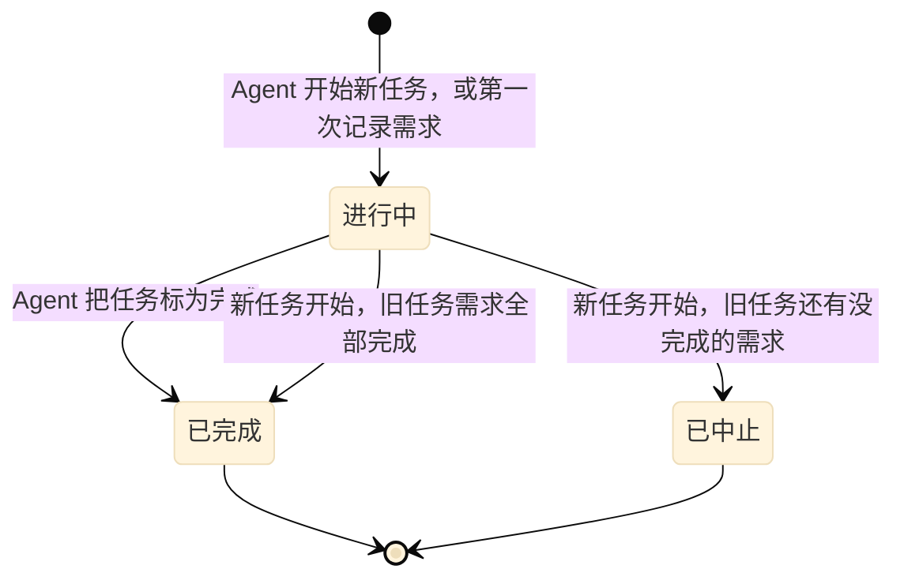
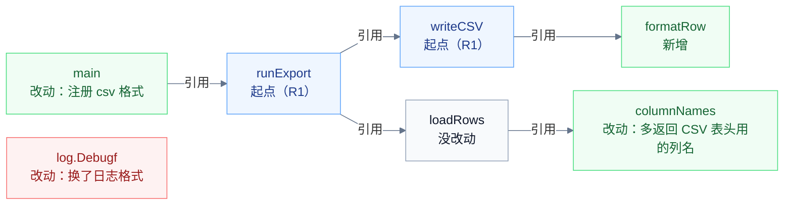

# 任务和需求

[过度设计判定](over-design.md)、[过度测试判定](over-testing.md)、[任务接续](handoff.md) 和 [半自动模式](semi-auto.md) 都建立在本文定义的几样东西上：一个任务包括哪些改动和哪些用户消息，需求怎样从用户的话里来，每条需求落在哪些地方，一处改动归属哪条需求。

## 核心想法

一处改动、一条测试有没有必要，只看一个依据：用户说过的话。

用户发给 Agent 的每条消息，TaskBelay 都原样记下，Agent 改不了。Agent 把用户的要求拆成需求时，每条需求附上一段用户原话；改完代码后，列出每条需求落在哪些地方。TaskBelay 从这些地方出发，沿着代码之间的引用关系，找出每处改动归属哪条需求。没有归属的改动，或者只归属到 Agent 自己推断出来的需求的改动，就没有依据。

这样 Agent 没法凭空编出用户的要求：一条需求要么能在用户消息里找到原话，要么只是 Agent 的推断，而推断不能作为任何改动的理由。

[半自动模式](semi-auto.md) 下，用户确认过的方案也算用户认可的文字，和用户消息一样可以引用。

## 任务

任务是用户在一个工作区里要 Agent 完成的一件事，可以跨多个 session 和 Agent。工作区是一个 git 工作区的根目录，同一个仓库的不同 worktree 是不同的工作区。一个工作区同时最多有一个进行中的任务。

**任务怎样开始。** Agent 明确开始一个新任务时，新任务开始；工作区里没有进行中的任务时，Agent 第一次记录需求也会自动开始一个。工作区里已有进行中的任务时开始新任务，旧任务先结束：需求全部完成的记为已完成，否则记为已中止。

**任务怎样结束。** Agent 把任务标为完成，任务记为已完成；或者像上面说的，被新任务替换。

**起点消息和起点快照。** 起点消息是同一个 session 里、这个工作区上一个任务结束之后到达的第一条用户消息；如果上一个任务正是因为这次开始新任务而结束的，起点消息就是这个 session 里最后一条用户消息。起点快照是起点消息到达时的工作区状态，而不是 Agent 开始任务那一刻的状态。

这样定有两个原因。Agent 常常先动手改几行代码，才想起来记录需求；用户也可能分几条消息才把要求说完。从起点消息算起，这些改动都算进本次任务，前面几条消息也都能引用。反过来，起点消息之前工作区里已有的未提交改动不属于本次任务，不会被当成 Agent 的改动来检查。

**diff。** 本次任务的 diff 是当前工作区和起点快照之间的差别，包括已提交和未提交的改动、没被 `.gitignore` 忽略的新文件。任务进行期间提交了 commit，不影响 diff 的范围。

**本任务的用户消息。** 起点消息，以及之后到达这个工作区、在任务结束之前的所有消息，都属于这个任务，不管来自哪个 Agent。所以用户在 Claude Code 里说的话，Codex 接手后同样可以引用。用户在旧任务进行中提出一件新事时，这条消息到达时旧任务还没结束，它又是新任务的起点消息，所以同时属于两个任务。

**改动声明。** diff 里新增或修改的声明。声明是代码里有名字、可以被别处引用的定义，比如函数、方法、类、接口、类型、顶层的常量和变量；各种语言里哪些写法算声明、怎样比较两个版本，见 [语言支持](languages.md)。只改了空白和格式的声明不算改动声明。TaskBelay 解析不了语法的文件，比如文档、配置，以及没有内置语法的语言的源文件，按整个文件看待，叫作**其他文件**。

## 需求

需求是用户要的一项结果。通常是一项用户能看到的行为，例如“export 命令能输出 CSV”；改名、补测试、指定范围的重构这类任务，需求就是用户点名要的那项改动，例如“FetchRows 改名为 LoadRows”“给 formatDate 补测试”。“新建一个 csv 包”这类为了完成需求而采取的实现步骤，不是需求。

每条需求有一句话的内容、一段原话引用、一两句话的验收标准，以及状态（未开始、进行中、已完成）。需求在任务内编号为 R1、R2……

**原话引用怎样匹配。** 去掉首尾空白，再把连续的空白合成一个空格之后，引用必须是某一段可引用文字里连续的一段，并且不短于参数表里的最短长度。规整之后的每个字符都算一个，包括汉字、字母、数字、标点和空格。可引用的文字有两种：本任务的用户消息；半自动模式下，本任务已确认方案的全文，包括“涉及的改动”一节。

**原话需求和推断需求。** 引用匹配上的是原话需求；没填引用或者匹配不上的是推断需求。推断需求可以记下，它会出现在接续摘要里，下一个 Agent 也能看到；但它不能作为任何改动和测试的依据，只归属到推断需求的改动和测试，判定时都按没有依据处理。用户后来的消息里提到这件事，Agent 把那段话填成引用，它就变成原话需求。

## 实现位置

实现位置回答“这条需求落在哪些地方”，由 Agent 在改完代码后为每条需求列出。大多是本次改动过的位置，也可以是用户点名、本次没改的声明，比如用户要求补测试的函数。每一项是一个位置，可以附一段原话引用。

| 种类 | 写法 | 例子 |
| --- | --- | --- |
| 代码声明 | 文件路径、冒号、名字；方法写成“类型.方法” | `internal/export/csv.go:writeCSV`、`app/store.py:Store.save` |
| 其他文件 | 文件路径。TaskBelay 能解析语法的源文件只按声明列出，不按文件列出 | `docs/usage.md` |
| 测试用例 | `test:` 加测试文件路径、冒号和用例名；用例名的写法见 [语言支持](languages.md) | `test:internal/export/range_test.go:TestParseRange/5-5`、`test:tests/test_range.py:test_parse[5-5]` |
| 命令行参数 | `flag:` 加参数名 | `flag:--format` |
| 子命令 | `cmd:` 加子命令名 | `cmd:export` |
| 环境变量 | `env:` 加变量名 | `env:EXPORT_DIR` |
| HTTP 路由 | `route:` 加方法和路径 | `route:GET /export` |
| 配置字段 | `config:` 加字段在配置文件里的名字 | `config:export.format` |
| 依赖 | `dep:` 加依赖的名字，写法见 [语言支持](languages.md) 的“依赖清单” | `dep:github.com/gocarina/gocsv`、`dep:lodash` |

文件路径都相对于工作区根目录，在 Windows 上也用 `/` 分隔。每个位置都要真实存在：代码声明和测试用例在当前代码里能找到，文件存在或者在本次 diff 里被删除，对外入口和依赖在本次 diff 里出现。

## 归属

归属回答“这处改动为哪条需求服务”。

**引用。** 一个声明的代码里用到另一个声明的名字，比如调用它、读写它、把它当作类型，就说前者引用后者。引用只按名字对应，不看作用域和类型：代码里出现 `Export`，就连到所有叫 `Export` 的声明，包括各个类型的同名方法，所以通过接口调用方法时，所有实现都连得上。各种语言里怎样从代码中找出名字，见 [语言支持](languages.md)。这里宁可多连，因为漏连会把有归属的改动判成没有归属。

**怎样确定归属。**

1. 每条需求的实现位置里列出的代码声明，是这条需求的起点。
2. 一个改动声明，满足下面任何一条，就归属这条需求：它本身是起点；从起点沿引用关系能走到它，说明它是起点用到的代码；从它沿引用关系能走到起点，说明它是调用起点的代码，比如把新命令注册进 `main` 的那几行。路上经过没改动的声明也算。
3. 改动过的其他文件，直接列在哪条需求的实现位置里，就归属哪条需求。
4. 一处改动可以归属几条需求。只归属到推断需求的改动，按没有依据处理。

下图是一个例子。R1 的实现位置列了 `runExport` 和 `writeCSV`。

- `main` 能走到起点 `runExport`，归属 R1。
- `formatRow` 能从起点 `writeCSV` 走到，归属 R1。
- `columnNames` 能从起点 `runExport` 经过没改动的 `loadRows` 走到，归属 R1。
- `log.Debugf` 和两个起点之间没有任何一个方向能走通，没有归属。

归属从 Agent 列出的起点往外推，而不是要求 Agent 逐个声明去标需求。这样 Agent 只需要列出几个关键位置，辅助函数和接线代码能自动归进来。

**需求代码。** 一条原话需求的需求代码，是归属它的改动声明，加上它的实现位置里列出的代码声明，后者包括本次没改动的声明。

## 凭用户原话放行

实现位置上附的原话引用，表示“用户明确要了这一处”，匹配规则和需求的原话引用相同。一处改动或一条测试被判为多余时，凭这样的原话可以放行；具体哪些规则可以这样放行，见两份判定文档。这是保留一处被判为多余的东西的唯一办法：Agent 要么改掉，要么向用户说明为什么需要并询问，用户同意之后，Agent 把用户的那句话填成这一处实现位置的引用。

放行的范围就是实现位置的范围。参数和字段没法单独列出：列出一个函数，它的参数一起放行；列出一个类型，它的字段一起放行；列出一个测试函数，它下面的子测试和参数组一起放行。

任务完成时，每个带引用的位置会连同引用一起列给用户看。

## 参数

| 参数 | 值 |
| --- | --- |
| 原话引用的最短长度 | 4 个字符 |

## 会在哪里判错

- **归属要靠 Agent 列的实现位置。** Agent 把一处无关改动挂在某条需求的起点下，只要引用关系连得上，就算有归属。改了起点会用到的共用代码，比如顺手重写了一个公共的日期格式化函数，也算有归属。
- **归属按整个声明判断。** 一个大函数（比如 `main`）里既有为需求接线的改动，也有无关的改动，整个函数都算有归属，里面的无关改动看不出来。
- **凭原话放行时，TaskBelay 只核对原话确实存在，判断不了这句话是不是真的在要这一处。** 任务完成时，每处凭原话放行的地方都会连同原话列给用户，引用得牵强，用户能直接看出来。
- **引用只按名字对应。** 同名的声明会连在一起：两个模块里各有一个 `load`，改了其中一个，也会被当成另一个的调用方，归进同一条需求，这时会漏判。通过反射、按字符串名字调用的代码看不到引用。跨语言的调用也看不到，比如前端按 URL 调用后端的接口，这时 Agent 要把两边的起点都列进实现位置。
- **其他文件只按整个文件归属。** 一个其他文件里既有需求要的修改、也有无关的修改，只要它列在实现位置里，整个文件都算有归属。
- **起点消息之后、任务开始之前用户自己改了文件，** 这些改动也算进本次任务。
