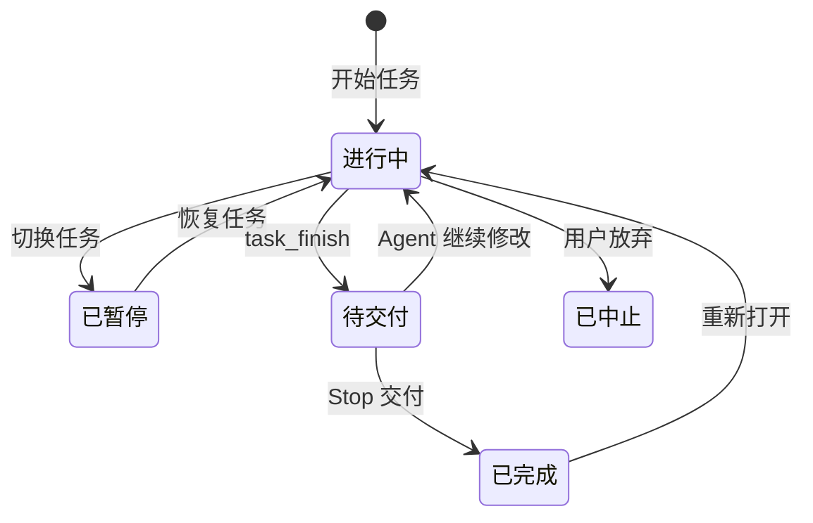

# 任务和需求

TaskBelay 围绕用户要完成的事情组织记录。用户原话说明目标，需求说明结果，实现位置把需求落到代码和文件。工作区记录保存实际发生的变化，供检查和接续使用。

## 任务

一个任务可以跨多次提交、多个 session 和两个 Agent。每个工作区有一个当前任务，可以另有暂停的任务。同一仓库的不同 worktree 分别管理。

### 开始、暂停和恢复

Agent 用 `task_start` 开始任务，或者第一次保存需求时自动开始。已有任务时，另一项任务默认从提出新请求的消息起算；没有当前任务时，默认采用本 session 自上一任务结束后收到的第一条消息及其快照。Agent 可用 `start_message_id` 选定更准确的请求起点。请求分几条消息说完时，起点保留在第一条。开始任务前的未提交内容保留在起点里。

开始另一项任务时，当前任务暂停，需求、快照和笔记保留。Agent 可按任务编号恢复；用户说“继续刚才的 CSV 导出”时，由 Agent 找到对应任务恢复。恢复以当前代码为准，期间另一任务和用户带来的变化记为工作区更新，不归给恢复后的 Agent。

状态有进行中、待交付、已暂停、已完成、已中止。`task_finish` 先把任务记为待交付；Stop 处理交付检查后记为已完成。用户明确放弃才记为已中止。完成后继续调整同一件事，可以重新打开原任务。

### 累计改动和开发操作

任务的 diff 是当前工作区与起点快照的差别，包括已提交、暂存和未暂存内容，以及未被忽略的新文件。commit、amend 和多次手动提交都不移动任务起点。已提交内容回到起点状态后，净 diff 中消失，发生过的变化仍保留在记录里。

工作区上下文包括仓库、worktree、分支和 HEAD。分支或 HEAD 变化时，TaskBelay 核对当前文件与上次观察的差别：普通提交且文件内容不变时继续原任务；切到另一分支时优先恢复该分支的任务；pull、rebase、stash 带来的文件变化按工作区更新处理。找不到对应任务时保存当前进度，展示候选任务，由 Agent 结合用户当前请求选择。

任务恢复时保存一个新的观察点，用来区分恢复前已有内容和之后的 Agent 编辑。累计 diff 仍从原起点计算，暂停期间的工作不会被重新归给 Agent。工作区目录被移动后，按 git 目录与 worktree 身份找回记录，再更新路径。

## 用户自己修改代码

用户可能随时修改 Agent 写出的代码，改完也不发消息。TaskBelay 在消息到达、session 接续、编辑前后和检查时观察文件，把两次观察之间的变化与已记录的 Agent 编辑对照。

- 能核对编辑前内容、工具要写入的内容和编辑后内容的部分，记为 Agent 编辑。
- 其余变化记为工作区更新。记录前后内容、位置和观察时间，供 Agent 接续，不猜测是谁改的。
- 一个声明或测试用例同时包含工作区更新和 Agent 编辑时，保留两部分的记录。涉及整个声明的精简建议作为提示，不建议整段删除。

用户修改过 Agent 的函数后，这个函数仍可以属于原需求。原来的检查结论失效，Agent 先读当前内容，再判断还需要做什么。工作区更新本身不需要新增需求、补用户原话或修改方案。

编辑工具准备覆盖刚变化的片段时，TaskBelay 把当前版本交给 Agent，退回这次过期编辑，让它重新读取后再改；只提示模式则交回当前内容和冲突位置，由 Agent 重新组织编辑。不相交的编辑照常进行。TaskBelay 不锁住工作区，也不把旧代码恢复回来。编辑前核对的实现见 [系统架构](product-architecture.md)。

累计 diff 回答“任务做到了什么”，编辑记录回答“哪些部分可以归责于 Agent”。拦截只针对能核对的 Agent 行为；工作区更新进入报告和接续。

## 用户消息与需求

TaskBelay 自动记录消息原文、来源、时间和到达时的工作区状态。任务中两个 Agent 收到的消息共用；暂停后恢复、重新打开任务时，原来的消息也保留。项目里既有的用户约定可以由 Agent 引用并注明来源，按同样的记录规则保存。

需求是用户要的一项结果，例如“export 命令能输出 CSV”“把 FetchRows 改名为 LoadRows”“给 formatDate 补测试”。实现步骤写进方案或笔记，不另立为用户需求。

每条需求在任务内编号 R1、R2……，包括内容、原话引用、验收标准和状态。状态有未开始、进行中、已完成、已撤销。追加结果时增加需求；修改结果时更新原需求；用户取消时标记已撤销。每次变化保留旧版本。原先的授权被后续要求收回后，后续检查采用新的要求。

### 原话与实现判断

引用须能在记录的来源里找到。比较时规整首尾及连续空白，保留原文供报告展示，不限制最短字数。“可以”“保留”“继续”可以引用，引用同时带消息编号和对应的需求、方案或问题。

有可核对引用的叫原话需求，Agent 推测出来的叫推断需求。推断需求可供讨论；落实新的用户可见行为前，Agent 先核对本次请求。

完成一条需求所必需的接线、错误处理和合理的内部拆分，属于实现判断，沿需求关系记录，不要求用户逐个点名。字符串匹配负责核对出处，引用所表达的意思由 Agent 根据完整消息说明；单独摘一句话不改变同一消息里的否定、限制或撤销。

## 实现位置

Agent 为需求填写关键位置，辅助声明沿引用关系归入。位置可以附来源和一句用途说明。

| 种类 | 写法 | 例子 |
| --- | --- | --- |
| 代码声明 | 文件路径、冒号、名字；方法带类型名 | `internal/export/csv.go:writeCSV` |
| 其他文件 | 相对工作区的文件路径 | `docs/usage.md` |
| 测试用例 | `test:` 加文件路径、冒号和用例名 | `test:internal/export/range_test.go:TestParseRange/5-5` |
| 命令行参数 | `flag:` 加参数名 | `flag:--format` |
| 子命令 | `cmd:` 加子命令名 | `cmd:export` |
| 环境变量 | `env:` 加名字 | `env:EXPORT_DIR` |
| HTTP 路由 | `route:` 加方法和路径 | `route:GET /export` |
| 配置字段 | `config:` 加字段名 | `config:export.format` |
| 依赖 | `dep:` 加模块名 | `dep:lodash` |

文件路径统一用 `/`。位置可以指当前存在的声明，也可以指起点或编辑记录中的已删除声明；记录里注明新增、修改、删除、移动或改名。改名、移动优先通过编辑记录和唯一的结构对应更新，无法唯一对应时保留旧位置并标记待更新，由 Agent 补充，不删除需求。

对外入口可以引用用户请求或已确认方案，并说明它如何实现需求。例如 CSV 请求可以对应实现所需的 `--format`，无需用户先说出参数拼写。额外的产品行为则另行确认。

## 归属

引用是一个声明的语法树中使用另一个声明的名字。通用分析按名字建立候选关系，各语言的规则见 [语言支持](languages.md)。

一处改动满足下面任一条件，就与需求关联：它是实现位置；它能沿引用到达实现位置；实现位置能沿引用到达它。中间可以经过未改动声明。文件级位置直接关联整个文件；一处改动可以关联多条需求。

名字相同或跨文件的候选关系用于帮助 Agent 找到位置。缺少关系时提示补充说明，不直接把这处改动认作无关。跨语言调用、配置驱动和删去旧行为，可以通过实现位置的用途说明建立联系。

一条需求的需求代码，是关联到它的改动声明，加上实现位置里列出的声明。删除需求采用编辑前版本及其仍存在的调用方作为检查线索。测试覆盖的使用规则见 [过度测试判定](over-testing.md)。

## 用户决定怎样生效

用户可以保留某处实现、调整范围、要求重跑或暂停检查。Agent 把完整来源与适用对象记入账本，立即用于当前任务；同一决定不反复询问。

实现位置上的引用只解释这个位置，保留一个参数不会顺带豁免整个函数的全部问题。问题记录可以精确到声明、参数、字段、入口或测试用例。用户明确认可更大范围时，按他说的范围记录。

工作区更新保留的是代码现状，用户决定记录的是明确要求，两者分别保存。Agent 接续时同时读取当前内容和仍然有效的决定。

## 交付

`task_finish` 保存交付请求和本轮任务编号。Stop 对这个任务检查，不因它进入待交付就当作没有任务。需要处理的问题交回 Agent，本轮交付请求继续保留。Agent 没有修改输入就再次结束时，复用该请求，把未处理问题列入报告后完成；有新编辑、需求或授权变化时，请求过期，任务回到进行中，Agent 完成修改后重新申请交付。

报告列出每条有效需求的实现位置、累计改动、用户决定、工作区更新、检查结果和未运行的检查。任务完成不会要求提交代码；用户可以之后继续手动提交。
