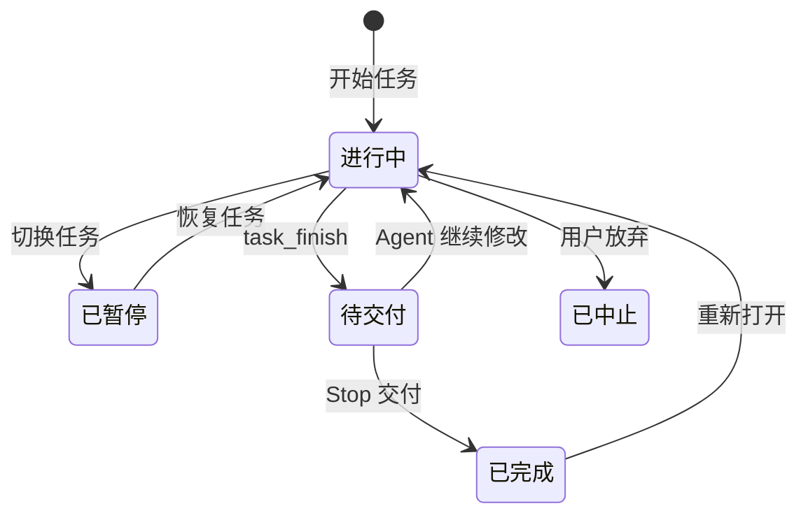

# 任务和需求

TaskBelay 围绕用户要完成的事情组织记录。用户原话说明目标，需求说明要交付的结果，实现位置说明哪些代码或文件用于实现这条需求。工作区记录保存实际发生的变化，供检查和接续使用。

## 任务

一个任务可以跨多次提交、多个 session 和两个 Agent。每个工作区有一个当前任务，可以另有暂停的任务。同一仓库的不同 worktree 分别管理。

### 开始、暂停和恢复

Agent 用 `task_start` 开始任务，或者在第一次保存需求时自动开始任务。已有任务时，新任务默认从提出新请求的那条消息起算；没有当前任务时，默认以本 session 自上一任务结束后收到的第一条消息及其快照为起点。Agent 可用 `start_message_id` 选定更准确的请求起点。请求分几条消息说完时，仍以第一条为起点。开始任务前尚未提交的内容包含在起点快照中。

开始另一项任务时，当前任务暂停，需求、快照和笔记保留。Agent 可按任务编号恢复；用户说“继续刚才的 CSV 导出”时，由 Agent 找到对应任务恢复。恢复时以当前代码为准；暂停期间其他任务和用户带来的变化记为工作区更新，不算作恢复任务后 Agent 的编辑。

状态有进行中、待交付、已暂停、已完成、已中止。`task_finish` 先把任务记为待交付；Stop 处理交付检查后记为已完成。用户明确放弃才记为已中止。完成后继续调整同一件事，可以重新打开原任务。

### 累计改动和开发操作

任务的 diff 是当前工作区与起点快照的差别，包括已提交、暂存和未暂存内容，以及未被忽略的新文件。commit、amend 和多次手动提交都不改变任务起点。已提交的内容恢复为起点状态后，对应改动不再出现在净 diff 中，但发生过的变化仍保留在记录里。

工作区上下文包括仓库、worktree、分支和 HEAD。分支或 HEAD 变化时，TaskBelay 核对当前文件与上次观察的差别：普通提交且文件内容不变时继续原任务；切到另一分支时优先恢复该分支的任务；pull、rebase、stash 带来的文件变化按工作区更新处理。找不到对应任务时保存当前进度，展示候选任务，由 Agent 结合用户当前请求选择。

任务恢复时保存一个新的观察点，用来区分恢复前已有的内容和之后的 Agent 编辑。累计 diff 仍从原起点计算，不会把暂停期间的工作重新算作恢复后的 Agent 编辑。工作区目录移动后，根据 git 目录与 worktree 标识找回记录，再更新路径。

## 用户自己修改代码

用户可能随时修改 Agent 写出的代码，改完也不发消息。TaskBelay 在消息到达、session 接续、编辑前后和检查时观察文件，把两次观察之间的变化与已记录的 Agent 编辑对照。

- 能核对编辑前内容、工具要写入的内容和编辑后内容的部分，记为 Agent 编辑。
- 其余变化记为工作区更新。记录前后内容、位置和观察时间，供 Agent 接续，不猜测是谁改的。
- 一个变更簇或单元同时包含工作区更新和 Agent 编辑时，保留两部分的记录。这样的变更簇不作为撤回候选，精简建议不得要求整段删除。

用户修改过 Agent 编写的函数后，这个函数仍可以对应原需求。原来的检查结论失效，Agent 应先读当前内容，再判断还需要做什么。工作区更新本身不要求新增需求、补充用户原话或修改方案。

编辑工具准备覆盖刚变化的片段时，TaskBelay 把当前版本交给 Agent，退回这次基于旧内容的编辑，让 Agent 重新读取后再改；只提示模式下，则返回当前内容和冲突位置，由 Agent 重新组织编辑。不涉及这些变化片段的编辑照常进行。TaskBelay 不锁住工作区，也不把旧代码恢复回来。编辑前核对的实现见 [系统架构](product-architecture.md)。

累计 diff 说明任务产生了哪些改动，编辑记录说明哪些改动能确认由 Agent 完成。拦截只针对能核对的 Agent 行为；工作区更新写入报告，并在接续时告知 Agent。

## 用户消息与需求

TaskBelay 自动记录消息原文、来源、时间和到达时的工作区状态。同一任务中，两个 Agent 收到的消息共同保存和使用；暂停后恢复或重新打开任务时，原来的消息也保留。Agent 可以引用项目中已有的用户约定并注明来源，按同样的规则保存。

需求是用户要的一项结果，例如“export 命令能输出 CSV”“把 FetchRows 改名为 LoadRows”“给 formatDate 补测试”。实现步骤写进方案或笔记，不另立为用户需求。

每条需求在任务内编号 R1、R2……，包括内容、原话引用、验收标准和状态。状态有未开始、进行中、已完成、已撤销。用户要求额外交付一项结果时，增加需求；调整原有结果时，更新原需求；取消时，标记为已撤销。每次变化都保留旧版本。用户之后收回原先的授权时，后续检查按新的要求进行。

验收标准写明用哪条用例或哪条命令确认结果。在实现前写下的验收标准，是算法判断改动是否需要、用例是否有用的 [验收依据](algorithm.md)；实现之后才补写的，只作补充依据。

### 原话与实现判断

引用内容必须能在记录的来源中找到。比较时，统一处理首尾及连续空白，原文仍保留供报告展示，不限制最短字数。“可以”“保留”“继续”也可以引用，但须同时记录消息编号和对应的需求、方案或问题。

有可核对引用的叫原话需求，Agent 推测出来的叫推断需求。推断需求可供讨论；落实新的用户可见行为前，Agent 先核对本次请求。

为完成需求而把新实现接入现有流程、处理错误或合理拆分内部代码，都属于实现判断，应记在相应需求下，不要求用户逐项提出。字符串匹配只负责核对出处，引用所表达的意思由 Agent 根据完整消息说明；即使只引用其中一句，也必须遵守同一消息中的否定、限制或撤销要求。

## 实现位置

Agent 为需求填写关键实现位置，每个位置可以附上来源和一句用途说明。以下是 `implemented_by` 接受的定位方式；名称和文件位置仅用于定位，不能据此认定需求已经满足。算法将实现位置作为需求相关区的种子之一，其权重低于原话和需求内容。对外入口、依赖和文件的位置也用于建立需求对应关系：登记过的对外新增项归为“Agent 说明”，见 [过度设计判定](over-design.md#需求对应关系)。

| 种类 | 写法 | 例子 |
| --- | --- | --- |
| 代码声明 | 文件路径、冒号、名字；方法带类型名 | `internal/export/csv.go:writeCSV` |
| 其他文件 | 相对工作区的文件路径 | `docs/usage.md` |
| 测试用例 | `test:` 加文件路径、冒号和用例名 | `test:internal/export/range_test.go:TestParseRange/5-5` |
| 命令行参数 | `flag:` 加参数名 | `flag:--format` |
| 子命令 | `cmd:` 加子命令名 | `cmd:export` |
| 环境变量 | `env:` 加名字 | `env:EXPORT_DIR` |
| HTTP 路由 | `route:` 加方法和路径 | `route:GET /export` |
| 配置字段 | `config:` 加字段名 | `config:export.format` |
| 依赖 | `dep:` 加模块名 | `dep:lodash` |

文件路径统一用 `/`。位置可以指当前存在的声明，也可以指起点或编辑记录中已经删除的声明；记录里注明新增、修改、删除、移动或改名。发生改名或移动时，优先根据编辑记录和唯一对应的结构更新位置；无法唯一对应时，保留旧位置并标记为待更新，由 Agent 补充，不删除需求。

登记对外入口时，可以引用用户请求或已确认方案，并说明该入口如何实现需求。例如，导出 CSV 的请求可以对应实现所需的 `--format` 参数，无需用户先说出参数拼写。额外的产品行为则另行确认。

## 归属

算法用 [需求相关区](algorithm.md) 记录改动与需求的关系：以用户原话、已确认方案、需求内容、验收标准和实现位置中的词为种子，在单元与标识符组成的图上做局部推送和扫描切割，得到每条需求的相关区。落在相关区内的变更簇与该需求关联，一个变更簇可以关联多条需求。边权按词的稀有程度计算，常见词几乎不传递关联；“调用了需求代码”或“被需求代码调用”本身不构成归属。

种子来源决定可信程度：原话和已确认方案最强，Agent 写的需求内容次之，实现位置最弱。将新实现接入现有流程所需的代码、错误处理和内部拆分，通过新词与需求代码紧密相连，因此会落在相关区内，不要求用户逐项提出。

没有任何种子时，相关区为未知，相关判断只作提示，不直接认定改动无关。删除旧行为时，使用编辑前的内容计算相关区；跨语言调用、配置驱动的关系也按词和单元计算，见 [输入与执行协议](languages.md)。

内容、需求、方案或实现位置变化时，受影响的相关区按新输入重新计算。

## 用户决定怎样生效

用户可以要求保留某处实现、调整范围、重跑或暂停检查。Agent 将决定的完整来源与适用对象记入账本，立即应用于当前任务，不再反复询问同一决定。

实现位置上的引用只说明该位置与需求的关系。用户要求保留一个参数，不代表整个函数的其他问题也无需检查。问题记录可以精确到声明、参数、字段、入口或测试用例。用户明确认可更大范围时，按他说的范围记录。

工作区更新保留的是代码现状，用户决定记录的是明确要求，两者分别保存。Agent 接续时同时读取当前内容和仍然有效的决定。

## 交付

`task_finish` 保存交付请求和本轮任务编号。Stop 检查该请求对应的任务，不会因为任务进入待交付状态就认为当前没有任务。发现需要处理的问题时，将问题交回 Agent，并继续保留本轮交付请求。Agent 未修改输入就再次结束时，复用该请求，把未处理问题列入报告后完成任务；出现新编辑、需求变化或授权变化时，请求过期，任务回到进行中，Agent 完成修改后重新申请交付。

Stop 失败后，请求继续保留。同一 session 后续轮次没有新的交付请求时，可以接续当前任务的有效请求；接续前重新核对输入，不接管其他 session 或已切换任务的交付。

完整报告列出每条有效需求的实现位置、累计改动、用户决定、工作区更新、检查结果和未运行的检查；hook 只发送限制长度的摘要，并提供查询完整记录的入口。所有有效需求均已完成，但没有有效交付请求时，普通 Stop 提示尚未执行交付检查。对于同一 session、任务与需求修订，只提示一次，不把停顿当作交付。完成任务不要求提交代码，用户可以之后继续手动提交。
