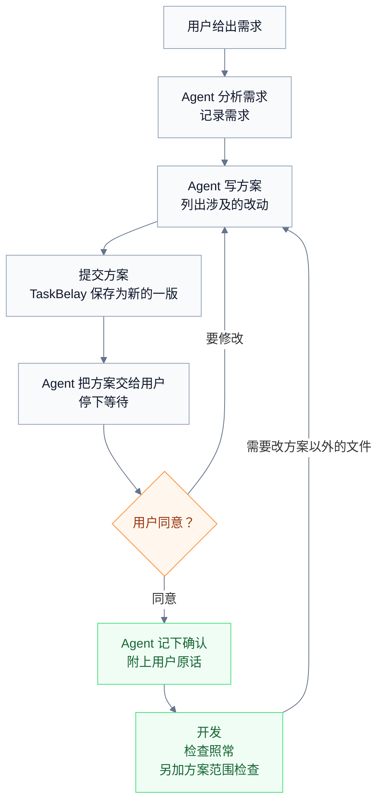

# 半自动模式

TaskBelay 有两种工作模式。全自动模式下，用户给出需求后就不用再管，Agent 直接开发，TaskBelay 在过程中检查。半自动模式下，Agent 先分析需求、写出方案、列出要改的文件，用户确认方案之后才开始开发。

本文定义半自动模式怎样运作：方案怎样写、写什么，怎样提交和确认，确认之前怎样保持工作区不变，确认之后方案起什么作用。两种模式下，[任务和需求](requirements.md)、[过度设计判定](over-design.md)、[过度测试判定](over-testing.md) 和 [任务接续](handoff.md) 的规则都照常适用。

## 流程



从任务开始，到最新一版方案被确认之前，这段时间叫**待确认期间**。待确认期间，工作区里的文件保持原样；Agent 只做分析和写方案。

## 写方案

方案用两个 skill 来写。这两个 skill 内置在 TaskBelay 里，由 TaskBelay 提供给 Claude Code 和 Codex：

- **write-technical-plans**：写方案正文，回答为什么要做、做成什么样算成功、核心做法是什么、具体怎么做。
- **write-a-well-document**：写完后自查，标准是一个不了解这次对话的人读完能完全看懂；讨论过程不写进方案。

提交方案时，除了正文，Agent 还要单独列出三样东西。TaskBelay 把它们整理成方案末尾的“涉及的改动”一节，用户确认时一眼就能看到这次会动哪些地方：

| 内容 | 写法 |
| --- | --- |
| 涉及的文件 | 每个要新增、修改、删除的文件，各附一句话说明改什么。测试文件和生成的代码不用列，测试由 [过度测试判定](over-testing.md) 管 |
| 新增的对外入口 | 每个新增的命令行参数、子命令、环境变量、HTTP 路由、配置字段，各附一句话说明用途。种类和 [过度设计判定](over-design.md) 识别的对外入口相同 |
| 新增的依赖 | 每个新增的第三方模块，附上引入的理由 |

某一项没有内容时写“无”。文件路径的写法和实现位置相同，见 [任务和需求](requirements.md)。

每提交一次，就是方案的一个新版本，编号 v1、v2……TaskBelay 保存每一版方案，并给出它的文件路径，Agent 把路径告诉用户。

## 确认方案

Agent 提交方案后，把方案的要点和文件路径告诉用户，然后停下来等用户回复。

- **用户同意**：Agent 记下确认，并附上用户表示同意的原话。TaskBelay 核对两点：这段原话按 [任务和需求](requirements.md) 的匹配规则能匹配上一条用户消息；这条消息是在最新一版方案提交之后到达的。两点都满足，这一版方案就成为**已确认方案**，待确认期间结束。
- **用户要求修改**：Agent 改完方案，提交新的一版，重新等待确认。
- **用户觉得不需要详细方案**：比如回复“很简单，直接做吧”。这句话同样可以作为对最新一版方案的确认。

用户的原话是确认的唯一依据，所以 Agent 没法自己宣布方案已经确认。

## 确认之后

开发照全自动模式进行，两份判定和接续的规则照常适用，另外多了两点：

- **已确认方案算作用户认可的文字。** 原话引用可以引自已确认方案的正文和“涉及的改动”一节（见 [任务和需求](requirements.md)）。比如方案的“新增的对外入口”里写了 `--format`，用户确认了方案，Agent 就可以引用这一行，作为 `flag:--format` 的原话依据。
- **改动不能超出方案。** 见下面的 S2。

开发中发现要改方案以外的文件、要加方案以外的依赖时，Agent 先改方案、提交新的一版，重新进入待确认期间，等用户确认后再动手。

## 规则

两条规则只在半自动模式下检查，格式和两份判定文档相同：判断什么，怎么判断，有例外时写例外，为什么这样定。

### S1 待确认期间改了文件（拦截）

**判断什么**：待确认期间，工作区里的文件有没有被改动。

**怎么判断**：

1. 待确认期间，Agent 用编辑工具改工作区里的文件时，直接拦下这次编辑。
2. Agent 准备结束时，把当前工作区状态和待确认期间开始时的状态比较。第一版方案之前，开始时的状态就是任务的起点快照；之后每次提交新版本，开始时的状态是那次提交时的工作区状态。两者不同，就命中，说明里列出改动的文件。

**为什么这样定**：半自动模式的意义，在于用户看过方案、同意之后才有代码改动。编辑工具在改动发生前就能拦住；通过 shell 命令改的文件拦不住，就在结束时查出来，让 Agent 撤回或者等确认后再做。

### S2 方案以外的改动（拦截）

**判断什么**：开发中的改动有没有超出已确认方案。

**怎么判断**：下面两种情况都命中：

- 改动过的文件不在已确认方案的“涉及的文件”里。测试代码、测试数据、生成的代码和依赖清单的锁文件除外，它们怎样认出来见 [语言支持](languages.md)。
- 依赖清单里新增的直接依赖，不在已确认方案的“新增的依赖”里。依赖清单见 [语言支持](languages.md) 的“依赖清单”。

**为什么这样定**：用户确认的是这份方案，方案以外的改动用户没有看过。新增的对外入口由 [过度设计判定](over-design.md) 的 D3 检查：方案里列过的入口能引到原话，没列过的引不到，自然会命中，不用在这里再查一遍。

## 结论和参数

S1、S2 的命中和两份判定文档的命中合并成一个结论，取所有命中里最高的档位。

| 参数 | 值 |
| --- | --- |
| S1 的档位 | 拦截 |
| S2 的档位 | 拦截 |

## 事前提示

半自动模式下，session 开始时 TaskBelay 把下面这几条交给 Agent：

- 先分析需求、写方案。用户确认方案之前，不改工作区里的任何文件。
- 用 write-technical-plans 写方案，用 write-a-well-document 自查。
- 提交方案时，列出涉及的文件、新增的对外入口和新增的依赖。
- 把方案的要点和文件路径告诉用户，然后停下来等用户回复。
- 用户同意后，附上用户的原话记下确认，再开始开发。
- 开发中要改方案以外的文件或依赖，先改方案、提交新的一版，等用户确认。

## 给 Agent 的反馈

S1 在编辑时拦下的说明：

```text
TaskBelay 拦下了这次编辑：internal/export/csv.go
半自动模式下，方案 v1 还在等用户确认，确认之前不改工作区里的文件。
先把方案交给用户，用户同意后再开始改。
```

S2 写在结束时的检查说明里，格式和其他规则相同：

```text
[S2 拦截] internal/log/log.go
  这个文件不在已确认方案 v2 的“涉及的文件”里。
  建议：撤回这处改动；如果确实需要，先修改方案、提交新的一版，等用户确认。
```

## 会在哪里判错

- **通过 shell 命令改的文件，编辑时拦不住**，要到 Agent 准备结束时才查出来。
- **确认用的原话可能并不是同意。** 比如用户回复“先这样吧，我再想想”，Agent 引用“先这样吧”作为确认，TaskBelay 只核对这句话确实存在、并且在方案之后。任务完成时，确认用的原话会列给用户看。
- **方案的范围按文件计算。** 在清单里的文件里做了方案以外的事，S2 看不出来，交给过度设计的规则判断。

## 例子

### SA-01 确认前用编辑工具改文件

- **过程**：用户在半自动模式下说“给 export 命令加一个导出 CSV 的选项”。Claude Code 读完代码，还没提交方案，就用 Edit 工具修改 `internal/export/csv.go`。
- **结论**：这次编辑被 S1 拦下。Claude Code 提交方案 v1，把要点告诉用户后停下。

### SA-02 用户要求修改方案

- **过程**：方案 v1 里有 `--delimiter` 参数。用户回复“分隔符不用，逗号就行”。Claude Code 去掉这个参数，提交 v2。用户回复“可以，按这个做”。
- **结论**：Claude Code 记下确认，引用“可以，按这个做”。这条消息在 v2 提交之后到达，v2 成为已确认方案。“分隔符不用，逗号就行”这一条是在 v2 之前到达的，不能用来确认 v2。

### SA-03 改了方案以外的文件

- **过程**：已确认方案 v2 的“涉及的文件”是 `cmd/export.go` 和 `internal/export/csv.go`。开发中 Claude Code 顺手改了 `internal/log/log.go`。
- **结论**：拦截。S2 命中 `internal/log/log.go`。
