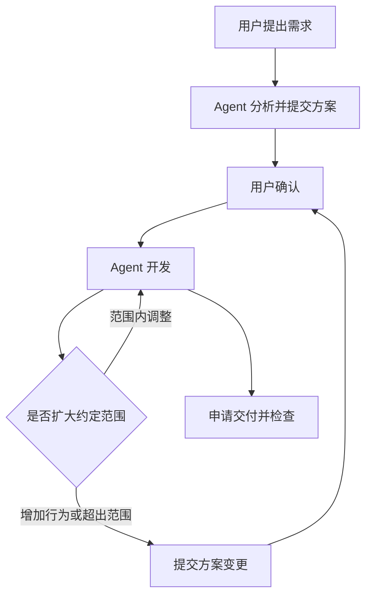

# 半自动模式

半自动模式让用户先看做法，再由 Agent 开发。方案约定要交付的行为、改动范围、新增的对外入口和依赖。用户仍可随时自己修改代码。

## 流程



方案确认前，Agent 可以分析、记录需求和提交方案，但首次确认前不能编辑工作区。方案存放在 TaskBelay 的数据目录。用户在这期间修改文件时，TaskBelay 将变化告知 Agent，由 Agent 据此调整方案。

## 方案写什么

方案正文说明为什么做、成功标准、核心做法和具体步骤。

提交方案时附上三项清单，TaskBelay 将其整理为方案末尾的“涉及的改动”：

| 内容 | 写法 |
| --- | --- |
| 涉及范围 | 列出文件或模块目录，分别写明改动目的。列文件时仅限该文件；以 `/` 结尾的目录包括其子目录 |
| 新增的对外入口 | 参数、子命令、环境变量、路由和配置字段，写明用途 |
| 新增的依赖 | 模块名和引入理由 |

已经确定的文件可以全部列出；开发中还需拆分的部分，可以按模块目录约定范围。测试、测试数据、生成文件和锁文件随对应实现一并管理，不要求逐一列出。

每次提交生成 v1、v2……。新版本包含完整的有效方案，并附相对上一版的变更摘要。每版方案都保留此前已确认且仍然有效的范围，不会因为本版只讨论新增文件，就丢掉之前的授权。

## 确认与调整

Agent 提交后，将要点、变更摘要和文件路径告诉用户，等待回复。`plan_confirm` 记录方案版本、用户消息编号和确认原话，并核对用户消息是否在该版本提交之后到达。“可以”“就这样”也可以用于确认；同一句话中附带的修改要求，一起记入方案或需求。

用户在同一条消息中说“方案按 A 做，直接改”，Agent 可先提交与 A 一致的方案，再引用这条明确授权确认方案；记录里注明这是随请求给出的授权。用户只是在讨论、否定或要求继续分析时，方案仍保持待确认。

确认后，内部函数拆分、命名和范围内的文件调整由 Agent 自行处理。需要增加用户可见行为、修改范围外的产品代码或引入新依赖时，应提交方案变更。已确认范围内的工作仍可继续，只有新增部分需要等待确认。用户说“实现细节你定”时，将这项授权记入当前方案，不再逐文件询问。

用户说“直接做吧”并希望转为全自动时，当前任务立即切换，已确认方案和需求继续作为依据。全自动转为半自动时，以切换时的工作区状态记录后续方案，之前的工作保留。

## S1 确认前的 Agent 编辑（拦截）

PreToolUse 检查编辑目标是否属于已确认且仍有效的范围。首次方案未确认时，拦下 Agent 对工作区的编辑；提交增补方案后，只拦下对新增待确认范围的编辑，已确认范围内照常工作。用户指定分析期间可写入的草稿等文件时，按这项明确授权处理。

Stop 根据 Agent 编辑记录，复核方案待确认期间发生的写入。能确认由 Agent 写入，且当时没有获得授权的部分，按 S1 处理。工作区更新交给 Agent 阅读，不按 S1 处理。提交新版方案不会清除之前的编辑记录；后来获得授权的内容，应记录实际授权时间，不能改写成事前已获授权。

## S2 超出有效方案的 Agent 改动（拦截）

交付时检查能核对为 Agent 所做的改动：产品代码所在文件必须在当前有效方案允许的范围内；新增的直接依赖必须列入当前有效方案的依赖清单。内部文件在已授权模块中移动或拆分时，仍按原有目的记录。

测试及其数据、生成代码、锁文件随对应的已授权实现一并管理，不单独触发 S2；不能借这些文件增加未授权的行为、依赖或验证目标。文件角色按 [输入与执行协议](languages.md) 的方法，从仓库统计结果中识别，不由文件后缀决定。测试是否多余，由 [过度测试判定](over-testing.md) 检查；对外入口按 [过度设计判定](over-design.md) 中的对外新增项和需求对应关系核对，已确认方案中的入口和依赖属于“原话对应”。

对于用户手动改动的文件，以及混合了工作区更新且无法拆分的部分，只展示实际变化及其与方案的关系，由 Agent 基于当前内容继续工作。

## 反馈

```text
[S2 拦截] internal/log/log.go
  这次 Agent 编辑新增了日志输出格式调整，超出了已确认的 export 模块范围。
  先保留工作区当前内容，检查这项调整是否仍有必要。
  确实需要时补充方案；撤销时只撤销本次 Agent 的那部分编辑。
```

拦截强度和同一问题的处理次数遵循 [产品需求](product.md)。用户的代码修改不需要补方案，方案反映的是 Agent 接下来要做的工作。

算法将已确认方案的涉及范围和对外入口作为需求相关区的种子，将方案成功标准中写明的用例或命令作为实现前登记的验收依据；待确认部分不用于生成种子，也不作为验收依据。精简建议本身不增加授权。范围内的内部调整仍由 Agent 自行处理，不为每条建议增加审批。编辑来源无法核对时，只给出提示，不据此按 S1 或 S2 拦截。

## 例子

| 编号 | 场景 | 结果 |
| --- | --- | --- |
| SA-01 | 首次确认前 Agent 用编辑工具写入产品代码文件 | 拦截编辑，提示先提交并确认方案 |
| SA-02 | 用户在等待方案时自己改了 CSV 函数，没有发消息 | 记录工作区更新，Agent 读取后更新方案，用户照常修改 |
| SA-03 | 用户确认 `internal/export/`，Agent 在其中拆出辅助文件 | 范围内调整，记录位置后继续 |
| SA-04 | Agent 要加方案以外的日志功能 | 提交增补方案，等待这部分确认 |
| SA-05 | v2 等待确认时继续 v1 已确认的 CSV 实现 | 继续已授权工作 |
| SA-06 | 用户回复“可以”或随请求明确说“按这个做，直接改” | 记录对应消息和授权，开始开发 |
