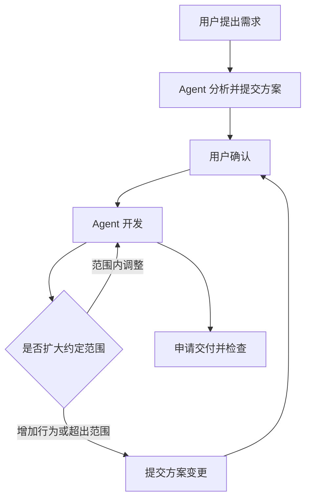

# 半自动模式

半自动模式让用户先看做法，再由 Agent 开发。方案约定要交付的行为、改动范围、新增的对外入口和依赖。用户仍可随时自己修改代码。

## 流程



Agent 在方案确认前做分析、记录需求和提交方案。首次确认前不编辑工作区；方案存放在 TaskBelay 的数据目录。用户在这期间修改文件，TaskBelay 把更新交给 Agent，Agent 据此调整方案。

## 方案写什么

方案正文说明为什么做、成功标准、核心做法和具体步骤。TaskBelay 提供 taskbelay-write-technical-plans 和 taskbelay-write-a-well-document 两个 skill，分别用于写作和自查。

提交时附三项清单，TaskBelay 整理成末尾的“涉及的改动”：

| 内容 | 写法 |
| --- | --- |
| 涉及范围 | 文件或模块目录，各写一句改动目的。文件表示精确范围；以 `/` 结尾的目录包括其子目录 |
| 新增的对外入口 | 参数、子命令、环境变量、路由和配置字段，写明用途 |
| 新增的依赖 | 模块名和引入理由 |

已知文件可以列全；需要在开发中拆分的部分按模块目录约定。测试、测试数据、生成文件和锁文件随对应实现管理，不要求逐一列文件。

每次提交生成 v1、v2……。新版本包括完整有效方案，并附相对上一版的变更摘要。涉及范围明确是累积的授权范围，不会因新版本只讨论新增文件而丢掉已经确认的部分。

## 确认与调整

Agent 提交后，把要点、变更摘要和文件路径告诉用户，等待回复。`plan_confirm` 记录方案版本、用户消息编号和确认原话，核对消息在该版本提交之后到达。“可以”“就这样”可以确认；一句话里附带的修改要求一起记入方案或需求。

用户在同一条消息中说“方案按 A 做，直接改”，Agent 可先提交与 A 一致的方案，再用这条明确授权确认；记录里注明这是随请求给出的授权。用户只是在讨论、否定或要求继续分析时，Agent 保持待确认。

确认后，内部函数拆分、命名和范围内的文件调整由 Agent 自行处理。新增用户可见行为、范围外的生产代码或新依赖，需要提交变更。已确认范围内的工作仍可继续；等待确认的只是新增部分。用户说“实现细节你定”时，把这项授权记入当前方案，不再逐文件询问。

用户说“直接做吧”并希望转为全自动时，当前任务立即切换，已确认方案和需求继续作为依据。全自动转为半自动时，以切换时的工作区状态记录后续方案，之前的工作保留。

## S1 确认前的 Agent 编辑（拦截）

PreToolUse 检查编辑目标是否属于已确认的有效范围。首次方案未确认时，拦下 Agent 对工作区的编辑；提交增补方案后，拦下新增待确认范围的编辑，已确认范围照常工作。用户指定分析期间可写的草稿等文件时，按明确授权处理。

Stop 根据 Agent 编辑记录复核待确认期间的写入。能核对为 Agent 写入、且当时没有授权的部分命中 S1。工作区更新交给 Agent 阅读，不计为 S1。提交新版本方案不会清除之前的编辑记录；后来获得授权的内容记录授权时间，不把它改写成事前已获授权。

## S2 超出有效方案的 Agent 改动（拦截）

交付时检查可核对的 Agent 改动：生产文件须在有效范围内，新增的直接依赖须在有效依赖清单中。内部文件在已授权模块中移动或拆分，按原有目的记录。

测试及其数据、生成代码、锁文件不单独触发 S2；测试质量由 [过度测试判定](over-testing.md) 检查。对外入口按 [过度设计判定](over-design.md) 的 D3 检查。

用户手动改动的文件、混合了工作区更新且无法拆分的部分，展示实际变化和与方案的关系，由 Agent 在当前内容上接续。

## 反馈

```text
[S2 拦截] internal/log/log.go
  这次 Agent 编辑新增了日志输出格式调整，超出了已确认的 export 模块范围。
  先保留工作区当前内容，检查这项调整是否仍有必要。
  确实需要时补充方案；撤销时只撤销本次 Agent 的那部分编辑。
```

拦截强度和同一问题的处理次数遵循 [产品需求](product.md)。用户的代码修改不需要补方案，方案反映的是 Agent 接下来要做的工作。

## 例子

| 编号 | 场景 | 结果 |
| --- | --- | --- |
| SA-01 | 首次确认前 Agent 用编辑工具写生产文件 | 拦截编辑，提示先提交并确认方案 |
| SA-02 | 用户在等待方案时自己改了 CSV 函数，没有发消息 | 记录工作区更新，Agent 读取后更新方案，用户照常修改 |
| SA-03 | 用户确认 `internal/export/`，Agent 在其中拆出辅助文件 | 范围内调整，记录位置后继续 |
| SA-04 | Agent 要加方案以外的日志功能 | 提交增补方案，等待这部分确认 |
| SA-05 | v2 等待确认时继续 v1 已确认的 CSV 实现 | 继续已授权工作 |
| SA-06 | 用户回复“可以”或随请求明确说“按这个做，直接改” | 记录对应消息和授权，开始开发 |
