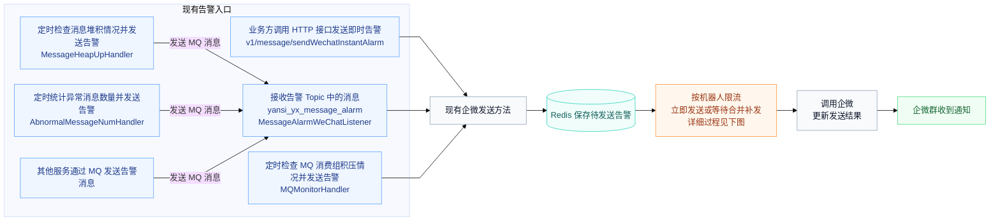
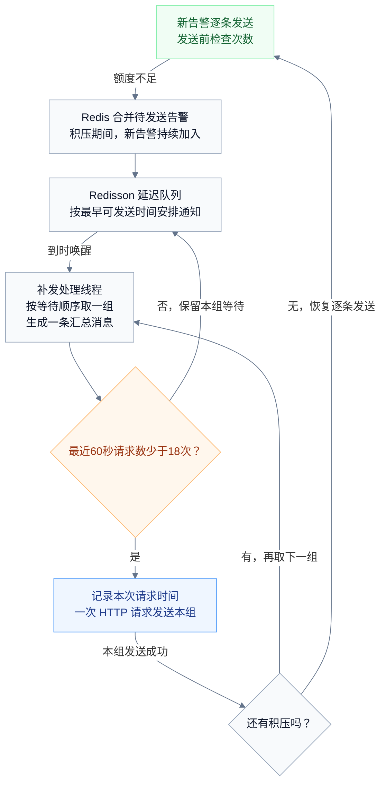

# 企微告警限流改造方案

## 背景

在企微告警多的时候（如压测期间），多个入口同时向同一个企微机器人发送大量告警，超过企微规定的每分钟 20 条限制，导致部分通知被拒绝。

## 目标

- **不超频**：任意连续 60 秒内，向同一个机器人发出的请求不超过 18 次，比企微上限少 2 次作为余量。
- **不丢告警**：超出额度的告警先暂存，稍后补发，不丢弃。
- **少发消息**：同一类告警合并成一条汇总消息发送，用更少的请求送达更多告警，也减少群里的刷屏。
- **平时无感知**：告警量正常时，发送方式和现在完全一样，即时、逐条送达。

## 思路

本次采用[精确滑动窗口算法（Sliding Window Log）](https://redis.io/tutorials/howtos/ratelimiting/)，用 Redis 记录每个机器人的请求时间，将任意连续 60 秒内的 HTTP 请求数控制在 18 次，为企微的上限留出余量。告警先保存到 Redis，没有积压且次数充足时逐条发送；需要等待时按模板合并，由延迟队列在最早可发送时间唤醒后台消费者，逐组补发。积压全部发完后，新告警恢复逐条处理。

## 流程解析

现有所有企微告警都会汇集到一个出口，所以，只改动这个出口即可。

具体细节：

1. **额度充足时，逐条发送。** 没有积压时，新告警按原有方式逐条发送。每次调用企微前，消息服务通过 Lua 脚本检查 Redis 中该机器人最近 60 秒的请求次数；少于 18 次，就记录本次请求时间并发送。

2. **合并待发送告警。** 次数用完后，后续告警保存在 Redis 中。同一机器人内，相同模板 ID 的告警合并成一组；模板 ID 为 0 时，按正文开头的固定字数合并。每组按最早一条告警的到达时间排队；一组被取出后，再来的同模板告警另起一组。

3. **安排唤醒时间。** 额度不足时，消息服务立即计算最早可发送时间：当前 18 次请求中最早一次的发送时间加 60 秒。延迟队列由 Redisson 实现，消息服务通过该队列安排延迟通知。到达预定时间后，由消息服务的补发处理线程处理该机器人的积压告警。

4. **发送当前分组。** 同一机器人的分组按等待顺序依次发送。补发处理线程将当前组的数量、时间范围和告警原文组成一条汇总消息，按企微要求控制长度。发送前检查最近 60 秒的请求次数：少于 18 次，就记录本次请求时间并通过一次 HTTP 请求发送；达到 18 次，则保留本组，按最早可发送时间重新安排唤醒。

5. **发送成功后，判断是否继续补发。** 当前组发送完成后，再检查剩余积压。有积压就取下一组；积压清空就结束补发，后续新告警恢复逐条发送。
