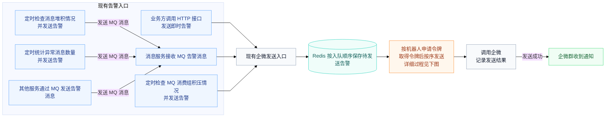
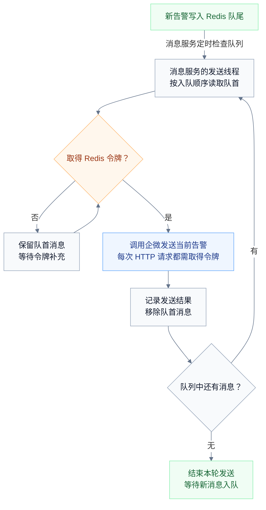

# 企微告警限流改造方案（简化版）

## 背景

在企微告警多的时候（如压测期间），多个入口同时向同一个机器人发送大量告警，超过企微规定的每分钟 20 条限制，导致部分通知被拒绝。

## 目标

- **不超频**：同一个机器人每分钟最多发送 18 次 HTTP 请求，为企微上限留出余量。
- **超额排队**：额度不足时，告警保留在 Redis 中等待。
- **按序发送**：按 Redis 实际入队顺序逐条发送，先来的先处理，后来的排在队尾。
- **有额度就发送**：消息服务读取队首消息，取得令牌后立即发送。

## 思路

本次采用 **Redis FIFO 队列 + [Redis 令牌桶](https://redis.io/tutorials/howtos/ratelimiting/#4-token-bucket)**。每个机器人分别维护一条队列和一个令牌桶，所有消息先入队，再由消息服务按顺序发送。令牌桶容量为 1，每 3335 毫秒补充一个令牌（约每分钟 18 个）；每次企微请求消耗一个令牌。没有令牌时，队首消息继续等待，后面的消息保持原有顺序。

## 流程解析

消息服务内的企微告警都会汇集到一个发送入口，本次在这个入口增加 Redis 排队和令牌桶限流。

具体细节：

1. **告警先进入 Redis 队列。** 消息到达统一发送入口后，消息服务将告警正文和提醒信息保存到对应机器人的队尾。同一个机器人共用一条队列，新消息按实际入队顺序排列，顺序发送。

2. **按顺序读取队首消息。** 消息服务定时检查各机器人的队列，有待发送消息时，安排发送线程读取队首。同一个机器人在所有服务实例中保持串行发送，当前消息处理结束前，后面的消息继续排队。

3. **申请令牌，没有额度就等待。** 每次调用企微前，发送线程通过 Lua 脚本计算并扣减 Redis 中的令牌。桶容量为 1，初始有一个令牌，按每 3335 毫秒一个令牌的速度补充，最多保留一个。没有令牌时，脚本返回还需等待的时间；发送线程等待后重新申请，队首消息保持不动。

4. **拿到令牌后发送当前消息。** 发送线程取得令牌后立即调用企微。每次 HTTP 请求消耗一个令牌。

5. **记录结果，再处理下一条。** 当前消息处理结束后，消息服务记录发送结果并将其从队列中移除。有积压就继续读取下一条，队列清空就结束本轮发送。后续新消息仍先进入队列，按同样的流程处理。
