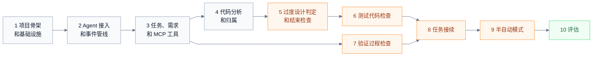

# TaskBelay 开发任务

本文按 [docs/](docs/README.md) 里的文档，把 TaskBelay 的开发工作拆成一个个小任务，分成 10 组。每组做完，都能按组末的验收标准检查一遍，确认这一阶段的成果可用。每个任务都写明依据，即它要实现的是哪份文档的哪一节；文档改了，对应的任务跟着改。

## 怎样使用

- 组内的任务按编号顺序做，组和组按下图的先后做。第 7 组只依赖第 3 组，可以和第 4 到第 6 组同时进行。
- 凡是涉及 Agent 的验收，都在 macOS、Linux 和 Windows 上，对 Claude Code 和 Codex 各做一遍，共六种组合。
- 各平台差异可能带来的问题记在 [notice.md](notice.md) 里，做到相关的组时，按那里写的办法验证。
- TaskBelay 自己的测试按 [over-testing.md](docs/over-testing.md) 的规则写。判定规则的行为由例子集验证，例子集在三个平台上都要通过。

## 第 1 组：项目骨架和基础设施

这组做完，TaskBelay 能在三个平台上编译运行，能读写设置，能算出工作区状态、建立和删除快照。

| 编号 | 任务 | 依据 |
| --- | --- | --- |
| 1.1 | 按项目结构建立本组用到的包：`cmd/taskbelay`、`internal/platform`、`internal/ledger`、`internal/gitstate`，其余目录由用到它们的组建立；建立 `cmd/taskbelay` 入口和子命令分发，本组接上 `config` 子命令 | [product-architecture.md](docs/product-architecture.md)「项目结构」「命令」 |
| 1.2 | `internal/platform`：用户目录下的数据目录。平台不同的部分（程序文件名、hook 命令的写法、Codex 的命令写法）由第 2 组在 `platform_unix.go`（macOS、Linux）和 `platform_windows.go` 里加上 | [product-architecture.md](docs/product-architecture.md)「平台」「存储」 |
| 1.3 | 日志：写到数据目录下的 `logs/`，按天一个文件，保留 7 天 | [product-architecture.md](docs/product-architecture.md)「存储」 |
| 1.4 | `internal/ledger`：打开 SQLite（WAL 模式，等锁 5 秒），建好账本的全部记录 | [requirements-ledger.md](docs/requirements-ledger.md)「记录和字段」；[product-architecture.md](docs/product-architecture.md)「存储」 |
| 1.5 | 设置的读写：工作模式（默认全自动）、拦截强度（默认拦截一次）；`taskbelay config get`、`taskbelay config set` | [product.md](docs/product.md)「默认行为」；[product-architecture.md](docs/product-architecture.md)「命令」 |
| 1.6 | `internal/gitstate`：找到工作区根目录；按“复制索引、`git add -A`、`git write-tree`”算出工作区状态 | [product-architecture.md](docs/product-architecture.md)「工作区状态和快照」 |
| 1.7 | `internal/gitstate`：给快照包一个 commit，建立和删除 `refs/taskbelay/<任务编号>`；算出两个状态之间的 diff，精确到行 | [product-architecture.md](docs/product-architecture.md)「工作区状态和快照」 |

**验收**

- 三个平台上都能用 `go install` 装好程序，Windows 上的程序是 `taskbelay.exe`。
- 不做任何设置时，读到的工作模式是全自动、拦截强度是拦截一次；设置之后重新读取，值一致。
- 在一个 git 仓库里：文件不变时，两次算出的工作区状态相同；改一个文件、加一个没被忽略的新文件，状态都会变；改被 `.gitignore` 忽略的文件，状态不变；算状态前后 `git status` 的输出一致。
- 建立快照引用后，`git branch` 里看不到它；运行 `git gc` 之后快照还在；删除引用后快照不再被保留。

## 第 2 组：Agent 接入和事件管线

这组做完，两个 Agent 的每次 hook 调用都能走通 TaskBelay，用户消息和 session 会被记下来。

| 编号 | 任务 | 依据 |
| --- | --- | --- |
| 2.1 | `internal/event`：六种事件和五种决定 | [product-architecture.md](docs/product-architecture.md)「统一的事件和决定」 |
| 2.2 | `internal/agent`：`Adapter` 接口和适配器列表 | [product-architecture.md](docs/product-architecture.md)「适配器」 |
| 2.3 | Claude Code 适配器：把 SessionStart、UserPromptSubmit、PreToolUse（Bash、PowerShell、Edit、Write、NotebookEdit）、PostToolUse、PostToolUseFailure、Stop 的输入转成统一事件，按工具和平台定出命令写法；把决定转成 Claude Code 要的 JSON | [product-agent-integration.md](docs/product-agent-integration.md)「每个 hook 做什么」「Claude Code 和 Codex 的差异」 |
| 2.4 | Codex 适配器：同上，工具是 Bash 和 apply_patch，轮次取 `turn_id` | 同上 |
| 2.5 | `taskbelay hook <agent> <事件>`：适配器、`internal/hook`、适配器三步串起来；不在 git 工作区里直接退出；出错时正常退出、不输出内容，错误写进日志 | [product-agent-integration.md](docs/product-agent-integration.md)「TaskBelay 出错时」；[product-architecture.md](docs/product-architecture.md)「关键流程」 |
| 2.6 | `internal/hook`：每次调用更新 session 记录和最后活动时间；UserPromptSubmit 时记下用户消息原文、轮次和到达时的工作区状态 | [requirements-ledger.md](docs/requirements-ledger.md)「session」「用户消息」 |
| 2.7 | `taskbelay install claude`、`uninstall claude`：写入和删除 hook 条目，用 exec 形式写程序的绝对路径和参数，三个平台相同；安装前检查 git 和 Claude Code 的版本；保留用户原有配置，可以重复运行 | [product-agent-integration.md](docs/product-agent-integration.md)「安装和卸载」「三个平台的差异」 |
| 2.8 | `taskbelay install codex`、`uninstall codex`：写入和删除 `hooks.json` 条目，命令在 macOS 和 Linux 上按 POSIX 写法、在 Windows 上按 PowerShell 写法；安装后提示用户用 `/hooks` 确认信任 | 同上 |
| 2.9 | `taskbelay status`：显示当前工作区记到的 session 和最近的用户消息，第 8 组扩展成完整内容 | [product-architecture.md](docs/product-architecture.md)「命令」 |

**验收**

- 安装后新开 session，发一条消息，`taskbelay status` 能显示这个 session 和这条消息的原文。Codex 先用 `/hooks` 确认信任。
- 安装命令运行两次，配置里 TaskBelay 的条目不重复；用户原有的 hook 条目保持原样；卸载后只剩用户原有的条目。
- 在不是 git 工作区的目录里用 Agent，TaskBelay 不输出任何内容。
- 把账本文件设成只读，人为制造错误，Agent 照常工作，日志里有这条错误。

## 第 3 组：任务、需求和 MCP 工具

这组做完，Agent 能通过 MCP 开始和结束任务、记录需求和实现位置、写笔记，两个 Agent 看到的是同一个任务。

| 编号 | 任务 | 依据 |
| --- | --- | --- |
| 3.1 | `taskbelay mcp`：用官方 Go SDK 启动 stdio 的 MCP server | [product-architecture.md](docs/product-architecture.md)「依赖」 |
| 3.2 | 任务的开始和结束：`task_start`、`task_finish`，第一次记录需求时自动开始任务；开始新任务时，旧任务按需求是否全部完成记为已完成或已中止 | [requirements.md](docs/requirements.md)「任务」 |
| 3.3 | 起点消息和起点快照：按规则选出起点消息，用它到达时的工作区状态建立快照引用；任务结束时删除引用 | [requirements.md](docs/requirements.md)「任务」 |
| 3.4 | 原话引用的匹配：规整空白、最短 4 个字符、在本任务的用户消息里查找；判断原话需求和推断需求 | [requirements.md](docs/requirements.md)「需求」 |
| 3.5 | 实现位置：解析 9 种写法，路径统一用 `/`；核对位置存在，Go 声明用 `go/parser` 在文件里查找 | [requirements.md](docs/requirements.md)「实现位置」 |
| 3.6 | `requirement_save`：新增和更新需求，`implemented_by` 整体替换，需求版本加一，返回核对结果 | [requirements-ledger.md](docs/requirements-ledger.md)「Agent 怎样读写账本」 |
| 3.7 | `note_add`、`task_get` | 同上 |
| 3.8 | 保留期限：清理结束超过 30 天的任务，以及超过 30 天的验证记录和 session 记录 | [requirements-ledger.md](docs/requirements-ledger.md)「保留期限」 |
| 3.9 | 安装和卸载补上 MCP：`claude mcp add`、`codex mcp add` 和对应的移除 | [product-agent-integration.md](docs/product-agent-integration.md)「安装和卸载」 |

**验收**

- Agent 开始任务，记一条带原话引用的需求和一条不带引用的需求，`task_get` 显示前一条是原话需求、后一条是推断需求；引用少于 4 个字符时被判为推断需求，返回结果里写明原因。
- Agent 先改了文件、后记录需求时，任务的 diff 里包含这些先改的文件。
- 实现位置写一个不存在的声明，会被拒绝并写明原因；写对的保存成功，需求版本加一。
- 在 Claude Code 里开始任务，再到 Codex 里调用 `task_get`，看到的是同一个任务；用户在 Claude Code 里说的话，Codex 里可以引用。
- `task_finish` 之后任务记为已完成，`refs/taskbelay/<任务编号>` 被删除。

## 第 4 组：代码分析和归属

这组做完，TaskBelay 能找出本次任务的改动声明，并算出每处改动归属哪条需求。

| 编号 | 任务 | 依据 |
| --- | --- | --- |
| 4.1 | `internal/goscan`：用 `go/packages` 加载改动所在的模块，取得语法树和类型信息；多模块的仓库逐个加载 | [product-architecture.md](docs/product-architecture.md)「Go 代码分析」 |
| 4.2 | 改动声明：读出起点快照里的版本和当前版本，按“包、接收者类型、名字”对上声明，比较语法树；分出只改格式、只改字面量和注释、只改名字三种情况 | [requirements.md](docs/requirements.md)「任务」；[product-architecture.md](docs/product-architecture.md)「Go 代码分析」 |
| 4.3 | 引用关系：每个声明引用了哪些声明；通过接口调用的方法，连到已加载代码里所有满足这个接口的类型的同名方法 | [requirements.md](docs/requirements.md)「归属」 |
| 4.4 | 归属和需求代码：从起点双向沿引用关系推，非 Go 文件按直接列出判断，标出只归属推断需求的改动 | [requirements.md](docs/requirements.md)「归属」 |

**验收**

- 用 [requirements.md](docs/requirements.md)「归属」一节的例子写成测试：`main`、`formatRow`、`columnNames` 归属 R1，`log.Debugf` 没有归属。
- 只用 gofmt 重排过的声明不算改动声明；只改了字符串的声明标为“只改字面量和注释”；只改了名字的声明标为“只改名字”。
- 三个平台上结果相同。

## 第 5 组：过度设计判定和结束检查

这组做完，Agent 准备结束时会按过度设计的规则检查，有问题就拦截一次；任务完成时用户能看到报告。

| 编号 | 任务 | 依据 |
| --- | --- | --- |
| 5.1 | 例子集框架：读取 `eval/cases/<编号>/` 下的 `base/`、`change.patch`、`ledger.yaml`、`expected.yaml`，用 `go test ./eval/...` 运行检查并比对 | [product-evaluation.md](docs/product-evaluation.md)「判定例子集」 |
| 5.2 | D1 没人用的代码 | [over-design.md](docs/over-design.md)「D1」 |
| 5.3 | D2 和需求无关的改动 | [over-design.md](docs/over-design.md)「D2」 |
| 5.4 | D3 没有原话依据的对外入口，以及对外入口的识别方式 | [over-design.md](docs/over-design.md)「D3」「结论和参数」 |
| 5.5 | D4 只有一种用法的抽象：接口、类型参数、函数类型的参数和字段、错误类型四种数法；E1 项目惯例 | [over-design.md](docs/over-design.md)「D4」「E1」 |
| 5.6 | D5 用不上的参数和字段 | [over-design.md](docs/over-design.md)「D5」 |
| 5.7 | D6 只转发的函数、D7 保留旧写法、D8 新增依赖 | [over-design.md](docs/over-design.md)「D6」「D7」「D8」 |
| 5.8 | 凭原话放行；合并结论；`internal/check/params.go` 参数表；给 Agent 的说明格式 | [over-design.md](docs/over-design.md)「凭用户原话放行」「结论和参数」「给 Agent 的反馈」；[requirements.md](docs/requirements.md)「凭用户原话放行」 |
| 5.9 | 检查结果按“工作区状态加需求版本”保存和复用；MCP 工具 `check_run`；命令 `taskbelay check` | [requirements-ledger.md](docs/requirements-ledger.md)「检查结果」；[product-architecture.md](docs/product-architecture.md)「Agent 准备结束」 |
| 5.10 | Stop：没有任务却改了文件时拦截；同一次检查结果对同一个 session 只拦一次；每轮最多拦 3 次；用 `systemMessage` 显示没解决的问题；拦截强度为只提示时不阻止 | [product-agent-integration.md](docs/product-agent-integration.md)「Stop」 |
| 5.11 | 任务完成报告：`task_finish` 返回，Stop 时显示给用户；对外入口和凭原话放行的地方附上原话 | [product-agent-integration.md](docs/product-agent-integration.md)「Stop」；[requirements-ledger.md](docs/requirements-ledger.md)「Agent 怎样读写账本」 |
| 5.12 | 把 OD-01 到 OD-11 写进例子集 | [over-design.md](docs/over-design.md)「例子」 |

**验收**

- OD-01 到 OD-11 在三个平台上全部通过。
- 复现 [product.md](docs/product.md)「一个完整的例子」里和过度设计有关的部分：Agent 加了 `Exporter` 接口和 `--delimiter` 参数，结束时被拦一次，说明里有 D4 和 D3；Agent 不改就再次结束，不再阻止，用户看到没解决的问题；Agent 改掉之后检查通过，任务完成报告列出 `--format` 和它的原话。
- 拦截强度设为只提示时，同样的改动不阻止 Agent 结束。
- 在 5 万行以内的 Go 项目上，过度设计部分的检查在 20 秒内完成。

## 第 6 组：测试代码检查

这组做完，Agent 准备结束时，新增和修改的测试用例也会被检查，和过度设计的结论合在一起。

| 编号 | 任务 | 依据 |
| --- | --- | --- |
| 6.1 | 测试用例识别：测试函数、`t.Run` 子测试、表格行和子测试名的对应；分出新增用例和修改用例 | [over-testing.md](docs/over-testing.md)「检查用到的输入」 |
| 6.2 | 编译测试程序（`go test -c -cover -coverpkg`），逐条运行用例，按覆盖得到每条用例的路径 | [product-architecture.md](docs/product-architecture.md)「运行用例」 |
| 6.3 | 用例定额：判断轻微改动，识别风险加项，上限 8 条 | [over-testing.md](docs/over-testing.md)「用例定额」 |
| 6.4 | T1 没测到需求代码、T4 只测了简单代码、T5 只检查了 mock、T6 测试不够 | [over-testing.md](docs/over-testing.md)「测试代码的规则」 |
| 6.5 | T2 走同一条路径的用例：按路径分组，用 `-overlay` 做变异，按发现的变异挑选用例 | [over-testing.md](docs/over-testing.md)「T2」；[product-architecture.md](docs/product-architecture.md)「运行用例」 |
| 6.6 | T3 超出定额；`test:` 位置凭原话放行；和过度设计的结论合并 | [over-testing.md](docs/over-testing.md)「T3」「凭用户原话放行」「结论和参数」 |
| 6.7 | 时间预算：按 CPU 核数并行，超时停下，没检查的用例标为“未检查” | [over-testing.md](docs/over-testing.md)「结论和参数」 |
| 6.8 | 把 OT-01 到 OT-08 写进例子集 | [over-testing.md](docs/over-testing.md)「例子」 |

**验收**

- OT-01 到 OT-08 在三个平台上全部通过。
- 复现 [product.md](docs/product.md)「一个完整的例子」里测试的部分：测同一段代码的 3 条重复用例被退回，留下的用例检查通过。
- 检查前后，用户工作区里的文件内容不变。
- 把时间预算调小到不够用，结果里标出“未检查”的用例，不因此拦截。

## 第 7 组：验证过程检查

这组做完，Agent 运行测试、构建这类命令之前，重复的运行会被拦下，范围过大和次数过多会被提示。

| 编号 | 任务 | 依据 |
| --- | --- | --- |
| 7.1 | `internal/shell/posix`：基于 `mvdan.cc/sh` 拆段，处理变量赋值和 `env` 前缀，取出 `bash -lc "…"` 里的命令 | [over-testing.md](docs/over-testing.md)「哪些命令算验证命令」；[product-architecture.md](docs/product-architecture.md)「命令写法」；[product-agent-integration.md](docs/product-agent-integration.md)「PreToolUse：shell 命令」 |
| 7.2 | `internal/shell/pwsh`：拆段、去掉引号、识别命令名和别名，取出 `powershell -Command "…"`、`pwsh -Command "…"` 里的命令 | 同上 |
| 7.3 | 命令分类和规整：验证命令、只读命令、其他命令，判断“含其他命令”；去掉开头切换到工作区根目录的那一段 | [over-testing.md](docs/over-testing.md)「哪些命令算验证命令」 |
| 7.4 | PreToolUse（shell）：更新最后一次运行其他命令的时间；记验证记录；拦截时返回 `deny`，提示时只返回 `additionalContext` | [product-agent-integration.md](docs/product-agent-integration.md)「PreToolUse：shell 命令」 |
| 7.5 | PostToolUse 和 PostToolUseFailure：补上验证记录的结果，Codex 记为未知 | [product-agent-integration.md](docs/product-agent-integration.md)「PostToolUse 和 PostToolUseFailure」 |
| 7.6 | V1 代码没变又跑一遍；V2 跑的范围超出改动影响（用 `go list` 展开包参数，算出受影响的包）；V3 一轮里验证太多次 | [over-testing.md](docs/over-testing.md)「V1」「V2」「V3」 |
| 7.7 | 把 OT-09、OT-10 和命令序列的例子写进例子集，命令包括 POSIX 和 PowerShell 两种写法 | [product-evaluation.md](docs/product-evaluation.md)「怎样运行」 |

**验收**

- 本组的例子在三个平台上全部通过。
- 测试失败后不改代码、原样再跑一遍，被拦下；Claude Code 的说明里有上次的结果和退出码，Codex 的说明里只有上次运行的时间。
- 两次运行之间执行过 `docker start` 这类其他命令时，不拦。
- Windows 上 Codex 和 Claude Code 的 PowerShell 工具运行的验证命令同样被识别和记录。
- 不含验证命令的 shell 命令，PreToolUse 在 50 毫秒内返回。

## 第 8 组：任务接续

这组做完，换 Agent、开新 session、压缩上下文之后，Agent 都能拿到当前任务的摘要接着做。

| 编号 | 任务 | 依据 |
| --- | --- | --- |
| 8.1 | `internal/summary`：生成接续摘要，按顺序排列，超过长度上限时从后往前删 | [handoff.md](docs/handoff.md)「摘要里有什么」「参数」 |
| 8.2 | 事前提示：两份判定文档“事前提示”一节的文字 | [over-design.md](docs/over-design.md)「事前提示」；[over-testing.md](docs/over-testing.md)「事前提示」 |
| 8.3 | SessionStart：新开、清空、压缩之后注入事前提示和摘要；恢复和分叉时，账本被别的 session 改过才注入摘要 | [product-agent-integration.md](docs/product-agent-integration.md)「SessionStart」；[handoff.md](docs/handoff.md)「什么时候给摘要」 |
| 8.4 | UserPromptSubmit：把上一轮没解决的提示交给 Agent | [product-agent-integration.md](docs/product-agent-integration.md)「UserPromptSubmit」 |
| 8.5 | 两个 session 在 10 分钟内都在同一个工作区活动时，提醒 Agent 和用户 | [handoff.md](docs/handoff.md)「两个 session 同时在一个工作区里」 |
| 8.6 | `taskbelay status`：显示接续摘要和最近一次检查结果 | [product-architecture.md](docs/product-architecture.md)「命令」 |

**验收**

- 复现 [handoff.md](docs/handoff.md) 的例子：Claude Code 做到一半时结束它的进程，在同一个目录打开 Codex，Codex 收到的摘要里有需求、改动的文件和最近一次失败的 `go test`。反过来从 Codex 换到 Claude Code，结果相同。
- 压缩上下文后，Agent 重新收到摘要；恢复一个 session、期间账本没被别人改过时，不重复注入。
- 两个 session 同时在一个工作区活动时，Agent 和用户都收到提醒。
- 摘要和事前提示加起来不超过 2,000 token。

## 第 9 组：半自动模式

这组做完，工作模式设为半自动时，Agent 先交方案，用户确认后才开发，开发中不会超出方案。

| 编号 | 任务 | 依据 |
| --- | --- | --- |
| 9.1 | `skills` 包：用 `go:embed` 打包两个 skill；安装时复制到两个 Agent 的 skill 目录，已有同名目录时保留用户的版本，复制过去的目录放 `.taskbelay` 标记，卸载时只删带标记的 | [product-agent-integration.md](docs/product-agent-integration.md)「安装和卸载」；[product-architecture.md](docs/product-architecture.md)「代码目录」 |
| 9.2 | 任务开始时按当时的设置记下工作模式 | [requirements-ledger.md](docs/requirements-ledger.md)「任务」 |
| 9.3 | `plan_save`：版本递增，收下三项清单，把正文和“涉及的改动”一节写成方案文件 | [semi-auto.md](docs/semi-auto.md)「写方案」；[requirements-ledger.md](docs/requirements-ledger.md)「方案」；[product-architecture.md](docs/product-architecture.md)「存储」 |
| 9.4 | `plan_confirm`：核对原话，要匹配最新一版提交之后到达的用户消息 | [semi-auto.md](docs/semi-auto.md)「确认方案」 |
| 9.5 | 待确认期间拦下编辑：Claude Code 取 `file_path` 和 `notebook_path`，Codex 从 `apply_patch` 的补丁文本里取路径 | [product-agent-integration.md](docs/product-agent-integration.md)「PreToolUse：编辑工具」 |
| 9.6 | S1 待确认期间改了文件、S2 方案以外的改动；和其他规则的结论合并 | [semi-auto.md](docs/semi-auto.md)「规则」「结论和参数」 |
| 9.7 | 原话引用的来源加上已确认方案的全文 | [requirements.md](docs/requirements.md)「需求」 |
| 9.8 | 半自动模式的事前提示；接续摘要里的“方案”一项；任务完成报告附上确认方案的原话 | [semi-auto.md](docs/semi-auto.md)「事前提示」；[handoff.md](docs/handoff.md)「摘要里有什么」；[product-agent-integration.md](docs/product-agent-integration.md)「Stop」 |
| 9.9 | 把 SA-01 到 SA-03 写进例子集 | [semi-auto.md](docs/semi-auto.md)「例子」 |

**验收**

- SA-01 到 SA-03 在三个平台上全部通过。
- 复现 [product.md](docs/product.md)「一个完整的例子」里的半自动部分：方案确认之前，Agent 用编辑工具改文件被拦下；Agent 交出带“涉及的改动”的方案后停下；用户回复“可以，按这个做”之后开始开发；改 `internal/log/log.go` 时被 S2 拦下。
- 用户本机已有同名 skill 时，安装后用户的版本保持原样；卸载只删除 TaskBelay 复制过去的 skill。
- 半自动模式下换 Agent，摘要里写明方案的版本、路径和确认状态。

## 第 10 组：评估

这组做完，能按 [product.md](docs/product.md) 的成功标准衡量 TaskBelay 的效果，并用日常记录发现误判。

| 编号 | 任务 | 依据 |
| --- | --- | --- |
| 10.1 | `taskbelay hits --since`：导出拦截命中，以及 Agent 之后的处理方式 | [product-evaluation.md](docs/product-evaluation.md)「日常检查记录」 |
| 10.2 | 准备任务集：从 10 个开源 Go 项目的已合并 PR 中取 30 个任务，每个任务包括用户请求、起点、隐藏验收测试和参考改动 | [product-evaluation.md](docs/product-evaluation.md)「任务集」 |
| 10.3 | 端到端脚本：用 `claude -p`、`codex exec` 驱动 Agent，回复固定的话并在同一个 session 里继续，核对 hook 是否运行过，统计各项指标 | [product-evaluation.md](docs/product-evaluation.md)「运行方式」「指标」 |
| 10.4 | 开启和关闭 TaskBelay 的对比，按任务逐个比较正确性 | [product-evaluation.md](docs/product-evaluation.md)「怎样判断开启后更好」 |
| 10.5 | 半自动模式的运行和核对 | [product-evaluation.md](docs/product-evaluation.md)「半自动模式」 |
| 10.6 | Windows 和 Linux 上的运行 | [product-evaluation.md](docs/product-evaluation.md)「Windows 和 Linux 上的运行」 |
| 10.7 | 接续评估 | [product-evaluation.md](docs/product-evaluation.md)「接续评估」 |

**验收**

- 完成一轮完整的评估，得到一份结果，逐项对照 [product.md](docs/product.md) 的成功标准。没达到的项，按 [product-evaluation.md](docs/product-evaluation.md)「改规则的流程」修改算法，再评估一轮。
- `taskbelay hits --since 14d` 能导出最近 14 天的拦截命中和处理方式。
